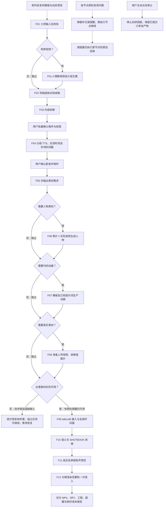

# AI 数字人口播 Agent 平台 PRD

| 项目 | 内容 |
| --- | --- |
| 产品名称 | Avatar Agent：AI 数字人口播视频制作平台 |
| 文档版本 | V1.11，2026-11-05 |
| 状态 | 产品需求基线；第 6 章功能需求已确认；用于下一轮设计、开发和验收，不代表功能已经实现 |
| 对应项目 | `D:\pro\ai_cat\avatar-agent` |
| 部署环境 | 本机 WSL2 Docker，前端、Go 后端、数据库及媒体执行环境统一运行 |
| 主要依据 | 用户已确认的第 6 章功能需求、制作流程、现有开发计划、混合型口播与 talkcraft 参考分析 |

V1.1 修订：增加“未上传视频”和“上传视频”两条入口路径；上传视频先理解、再写最终解说稿，并用带源视频时间段的内容描述支持后续画面匹配。

V1.2 修订：项目创建明确提供人物照片、视频主题、文案内容、动效风格、人物音色、原视频素材、成片画面比例七项输入；首版支持选择风格、音色和比例，并贯穿预览、生成、合成及局部重做。

V1.3 修订：数字人默认只使用一个镜头角度；仅用户在文案制作要求中明确提出多角度时，才规划和生成多机位人物素材。分段配音、多镜头剪辑或画中画不自动触发多角度生成。

V1.4 修订：文案拆解后先生成分段 TTS 并锁定实际时长，再做画面预规划。拆解阶段只处理内容结构，不提前决定镜头、景别、人物布局或动效；画面方案必须引用已确认配音及其实测时间。

V1.5 修订：将 F05 明确为“素材需求规划”，仅输出数字人镜头、代码动画和真实素材检索/准备任务及其时长、内容、风格要求。此阶段不拼接、不组合图层、不编排成片镜头时间线；当时定义素材就绪后由 F09、F10 完成组合与剪辑（后期步骤现已由 V1.8 重写）。本条取代 V1.4 中关于提前安排成片镜头、布局和切镜时间的定义。

V1.6 修订：F06 默认生成上半身数字人口播素材，新增真实面部纹理、分区反光、参考人物特征保留和视频纹理稳定要求；提示词及审片依据本地 `参考/realistic-skin-texture/SKILL.md`，不增加独立皮肤生成模型。

V1.7 修订：F07 以 mg-styles-15、lemo-opuscar、awesome-opus5-5-videos、opus-video-prompts 的案例、源码和已有提示词建设动效模板库。创建前提供动态缩略图选择风格，制作时优先复用已验证模板和提示词，按本片内容、实际配音时长及比例适配；区分可制作模板与仅供参考的案例。

V1.8 修订：完整重写 F09–F12 为 video-talkcraft 驱动的素材接入、语义拆镜/SHOTBOOK、Remotion 组合与预览、分镜渲染/审片交付，取代旧版后期流程。原 F12 的上传视频理解前移至 F01.4，仍在写最终稿之前执行；F01–F08 已确认的输入、文案、配音及素材生产要求继续有效。

V1.9 修订：第 6 章功能需求确认后，同步更新第 1–5 章流程图与概念边界、第 7–15 章页面/状态/数据/里程碑表述，并据此改写开发计划。正式制作链路以 F01→F12 为准：写稿与拆解 → 分段 TTS 锁定时长 → 素材需求规划 → 数字人/动画/真实素材生产 → talkcraft 接入、SHOTBOOK、组合预览与成片交付。

V1.10 修订：当前版本定位为固定 Workflow，不建设通用 Agent 的自主规划、工具选择或自我修复循环。重写第 8 章步骤契约与调度规则、第 9 章错误分类及用户停止规则：质检问题仅弹窗提醒、记录并继续执行，不能自动阻塞或停止；同步修正 F06/F07/F09–F12、流程图、状态和开发计划中与本次规则冲突的表述，新增 A33–A36 验收。

V1.11 修订：新增第 16 章 Agent 能力规划与接入方案，定义 avatarSpeak-Agent 的框架复用边界、对话协议、工具插件替换清单及与现有 Workflow 的协同模式；新增第 17 章前端 UI 全面重构需求，定义主页对话模式、Agent 工作台三区布局及与 NarratoAI-PC 电影模式 UI 的复用关系。

V1.12 修订：基于 NarratoAI-PC 电影模式 Agent 真实执行机制（`MovieDirectorConfirmationRequired` 门控、`directorConfirmationQuestions` 审核循环、`reviewMovieDirectorEdits` + `repairMovieDirectorEdits` 自动修复、`DIRECTOR_EDITORIAL_GUIDANCE` 质量门）重写第 16 章 Agent 执行模式，澄清"工作流 + Agent 审核门控"的混合架构，补充每个关键节点的 Agent 介入方式与用户交互协议；重写第 17 章为完整 SaaS 商业化平台 UI 规范，覆盖主功能页面、支付与订阅、用户管理、后台管理、模板管理全链路，统一深色设计系统，与已确认的 FlovaHomePage 视觉规范对齐。

## 1. 产品定位与目标

平台制作知识讲解、教程与产品讲解等数字人口播视频。用户在创建页提供人物照片、主题或文案、动效风格、人物音色、成片比例，以及可选原视频素材；平台按第 6 章确认的功能链路完成制作，输出可播放、可下载的 MP4。

本版为固定 Workflow 产品：程序按预设节点和业务条件执行，模型只处理节点内的具体内容任务。当前不提供通用 Agent 的自主规划与工具推理能力；“自动制作”指工作流推进，不表示自主改变任务目标或流程。

正式制作顺序固定为：

1. **F01–F03**：创建输入；有上传视频时先理解再写稿；完成文案生成与按剧情/知识点/章节/内容拆解，并确认脚本与段落。
2. **F04**：按确认段落做分段 TTS，试听并锁定实际时长与字词时间戳。
3. **F05**：依据锁定配音输出素材需求清单；只规定需要什么、做多久、什么风格，不拼镜头、不组图层。
4. **F06–F08**：分别生产上半身数字人、代码动画，或准备真实素材。
5. **F09–F12**：素材全部就绪后，复用 video-talkcraft 完成接入与时间基、语义拆镜/SHOTBOOK、Remotion 组合与有声预览、分镜渲染/审片交付。

未上传本地视频时跳过视频理解，直接走主题或已有稿件创作。上传本地视频时，必须先调用视频理解模型，将素材转为带时间段的片段文案，再编写最终解说稿；理解结果同时进入素材索引，供后续镜头按语义匹配源区间。

主要服务知识博主、课程作者、产品讲解和教程创作者。核心价值是把“写稿、配音、找素材、生成数字人、制作图解、分镜合成”组织成可追踪、可修改、可恢复的制作过程。

成片可以包含人物全屏讲解、人物小窗、代码解释动画、真实素材、操作录屏和截图。数字人默认单一角度、上半身上镜；多角度仅在用户文案制作要求中明确提出时启用。画面围绕当前台词表达信息，不以增加特效数量作为质量目标。

产品目标：

- 从主题或已有稿件出发，完成一条真正的混合型口播成片，而不只生成人物片段。
- 创建时即可选择动效风格、讲解音色和成片比例，并贯穿后续生成、预览与局部重做。
- 每段台词、配音、素材需求和最终镜头有明确映射，可定位问题并按依赖局部重做。
- 用户上传的视频有整体摘要与片段文案，成片引用的片段能追溯到原文件和源时间范围。
- 模型调用、等待、重试、用量和费用可追踪，不显示虚构成功或模拟进度。
- 用户通过网页完成主要操作，无须手动运行脚本或移动素材。

## 2. 本版与既有计划的关系

第 6 章 F01–F12 是已确认功能基线，前后章节及开发计划据此组织，不另设一套业务流程。执行计划见 [当前开发计划](AI数字人口播Agent平台-开发计划.md)，旧最小 MVP 计划只用于追溯历史，不再作为新增功能的执行依据。需求确认与实际实现状态分别记录；当前部署与测试事实见 [开发进度](progress.md)。

| 既有安排 | 本版定义 |
| --- | --- |
| 输入现成稿件为主 | 支持主题生成脚本，也保留直接输入稿件 |
| 上传视频仅作为后期画面 | 上传视频先理解并生成片段文案，再参与最终写稿和画面匹配；未上传时跳过该阶段 |
| 一条只围绕单个知识点 | 支持章节及多个相关知识点，仍围绕一个视频主题 |
| 整稿 TTS 后切成三段 | 按确认的配音段分别生成 TTS，统一音色与风格，再建立主音轨 |
| 拆解文案时同时预规划画面 | 拆解只确定内容与段落；分段 TTS 实测并确认后，才做素材需求规划 |
| 固定三个数字人机位 | 默认一个人物机位；仅用户在文案中明确要求多角度时启用多机位生成 |
| 数字人加少量文字卡 | 数字人、代码动画、真实素材及其组合 |
| 生成后合成 | TTS 后先明确素材生产与检索要求；素材全部就绪后，按 talkcraft 的接入、拆镜、组合和渲染流程制作成片 |
| 默认只保留人声 | 人声必选；背景音乐和音效为可选后续能力 |
| 固定风格、固定音色和竖屏画布 | 创建时选择动效风格、人物音色和成片比例；一次制作使用所选配置的版本快照 |
| 独立设计分段组合、精细剪辑及输出步骤 | 后期统一复用 video-talkcraft：素材接入 → 语义拆镜/SHOTBOOK → 组合与预览 → 分镜渲染/审片交付 |

保留的工程基础：NarratoAI 前后端基础、现有认证和任务持久化、talkcraft 合成能力、可配置的视频/TTS/文本模型适配、WSL2 Docker 部署。InfiniteTalk 保持备选，不加入默认链路。

当前状态依据已有进度文档：基础 MVP 已部署，已有部分真实模型调用和素材，完整真实人物成片仍待验收。本 PRD 的视频理解、主题写稿、分段配音、混合素材编排等不能表述为现已交付。

## 3. 用户与使用场景

| 场景 | 用户输入 | 期望结果 |
| --- | --- | --- |
| 从主题制作教程 | 主题、人物照片、风格、音色、比例；可补受众、目标时长与资料 | 写稿与内容拆解、分段配音、按实测时长准备素材，再交 talkcraft 拆镜合成 |
| 根据本地视频写解说 | 主题或创作意图、一条或多条本地视频、可选现成稿件 | 先理解视频并生成片段文案，再写与素材对应的解说稿，成片可追溯实际引用片段 |
| 使用已有文案 | 完整稿件、人物照片、可选素材 | 保留原意，拆段并自动安排适合的画面 |
| 解释抽象概念 | 主题或稿件、示意要求 | 用图解和代码动画辅助说明，人物按需出现 |
| 讲解操作或案例 | 稿件、录屏/视频/截图 | 对应台词展示实际操作和结果，支持人物小窗 |
| 修改局部内容 | 改某段文案、配音、画面或布局 | 只重做受影响步骤，复用其余成功产物 |

## 4. 产品流程与关键概念

### 4.1 用户流程




图中顺序和条件由程序固定，三类素材按 F05 需求串行执行；无需求类型跳过，清单长度只决定固定节点内的循环次数。风格库是制作前准备，浏览不调用模型。质检提醒虚线表示贯穿各节点的通知，不是等待点，也不是绕过剩余步骤直接交付的捷径。

模型/网络或本地技术错误按第 9 章提示并处理受影响依赖；质检未通过仅弹窗提醒，原工作流不改变状态，继续剩余步骤。用户不关闭弹窗、未审片或未修复质量问题也不阻止交付；只有用户主动停止才写入停止请求。缺失输出不伪造成功，质检问题不自动触发重试或返修。

未上传视频的项目不调用视频理解模型，也不因缺少其配置而阻塞。上传分支必须先有可用的理解结果，才编写最终解说稿；允许先形成主题提纲，但不能先把最终稿锁定再补做视频理解。素材理解成功后默认继续写稿，用户可查看和修正理解结果，无须逐个片段重复确认。

### 4.2 内容层级

| 对象 | 定义 | 示例 |
| --- | --- | --- |
| 项目 | 一条视频及其输入、版本、素材和执行记录 | “如何提高 AI 人物一致性” |
| 源视频片段 | 上传素材中的一个可定位内容区间，带独立 ID、源入出点和片段文案 | 原视频 A 的 12–18 秒：“手指点击生成按钮，页面出现任务列表” |
| 脚本 | 本条视频完整口播内容，有版本和确认状态 | 开场、两章讲解、总结 |
| 章节 | 一组相关知识点的组织单位 | “人物参考”“机位规划” |
| 配音段 | 可单独理解和朗读的连续文字，是 TTS 与局部重做单位 | 一项知识点或若干完整句子 |
| 素材需求 | F05 根据已锁定配音列出的素材生产/准备任务 | 12.4 秒配音所需的人物素材、约 6 秒流程动画及操作视频候选 |
| 素材产物 | F06–F08 准备的独立文件或可复用动画场景 | 某一段配音驱动的正面人物片段 |
| 镜头 | F10 基于已有素材拆出的连续视觉呈现区间 | 同段旁白中先人物主画面，再切到已完成的流程动画 |
| 图层 | 一个镜头内同时出现的视觉或声音元素 | 素材主画面、人物小窗、字幕、箭头 |
| 风格与模板 | 创建前选定的视觉规范及可制作模板集 | 白板风格及其步骤图、对比图模板；均有版本与动态样例 |
| 后期工程 | F09–F12 共同消费的 talkcraft 输入、分镜、实现及渲染记录 | SHOTBOOK、同源镜头表、Remotion 场景、分镜缓存与成片 |

一个章节可以有多个配音段，一个配音段可以有多个镜头，一个镜头可以有多个图层。不能把“一章”“一段配音”“一次模型生成”“一个最终镜头”视作同一个单位。

源视频片段独立于配音段：一段解说可引用多个素材片段，一个素材片段也可成为多个镜头的候选。源片时间、TTS 段内时间和成片全局时间分别记录，不因数值相近而自动视为同步。

### 4.3 素材需求规划与后续组合的边界

- **素材需求规划（F05）**：TTS 之后、素材生产之前，以对应文案和实际音频时长明确“需要什么素材、各做多久、内容与风格要求是什么、搜索什么”。数字人的机位与景别是待生成素材的拍摄要求，不是成片切镜方案。
- **素材接入（F09）**：素材全部就绪后，整理 talkcraft 工程输入、整条配音、全局字级时间戳及源素材映射。
- **语义拆镜（F10）**：按 talkcraft 方法选用现成素材、生成 SHOTBOOK 和同源镜头表，确定布局、台词锚点及切镜，不重新生产素材。
- **镜头组合（F11）**：复用 talkcraft 的 Remotion 场景、素材容器、字幕、运镜及转场，按分镜实现并预览。
- **成片交付（F12）**：复用分镜母版渲染、整轨混音、帧数断言与审片返修，输出 MP4 和工程记录。

文案拆解不规划素材，F05 不剪辑或合成画面。目标时长和字数估算只能用于写稿预算，素材需求必须依据实际配音；后续组合在锁定的人声时间内进行，不能静默改写台词或更换配音。

## 5. 版本范围与优先级

### 5.1 P0：下一版最小完整闭环

- 主题写稿与已有稿件输入；按剧情/知识点/章节/内容拆解，完成分段 TTS 后再做素材需求规划。
- 创建页提供七项输入；首版可选择动效风格、实际可用的中文音色，以及 9:16、16:9、1:1 成片比例。
- 有上传视频时，先做视频理解、片段文案和时间索引，再辅助最终写稿与画面语义匹配；无上传视频时直接走原流程。
- 脚本和拆解段落编辑、确认；按段 TTS、试听、重生成与整体确认，再按实测时长生成可调整的素材生产与检索清单。
- 按实际配音生成数字人；从四个动画参考仓库提取并适配模板与成功提示词，提供制作前可浏览的动态风格图库；允许上传真实视频、录屏与图片。
- 通过 talkcraft 的素材容器和镜头机制，按台词组合已就绪人物、动画与真实素材，画面形式由本片分镜决定。
- 数字人默认单一角度，只有用户文案中的明确多角度制作要求才启用多个角度，不沿用固定三机位策略。
- 数字人默认上半身构图；面部自然纹理、反光和跨帧稳定性进入素材生成要求与人工验收。
- talkcraft 素材接入、语义标注与 SHOTBOOK 拆镜、Remotion 组合及有声单镜预览、分镜母版渲染/审片/下载。
- 任务状态、失败恢复、成功产物复用、所有权校验、逐步成本与耗时记录。
- 固定工作流执行、模型/网络错误提示、质检不阻塞的弹窗提醒，以及用户主动停止后不再调度新步骤。

P0 先以用户提供的真实素材完成闭环，上传视频的内容理解与片段匹配属于 P0；自动网络检索不作为该版本前置依赖。代码动画通过允许清单内的模板产生，不要求用户编程，也不要求首版执行模型随意生成的程序。风格图库及已有提示词复用属于 P0，首版至少发布两套经过实际渲染验证的参考风格；不要求一次接入全部案例，也不把只有外链或提示词的条目计为可制作模板。

整片不设总时长上限，篇幅按用户要求和内容需要确定。配音按段落连续生成，累计实测时长用于校准时间线，不作为拒绝制作的条件；较长内容分段、分镜制作后合成，不截稿、不强制缩短或拆集。单次供应商调用及单个素材的技术限制仍由分段制作处理。2026-11-08 取消此前首版的 90 秒限制，历史因此失败的运行允许复用已有配音继续。

### 5.2 P1：素材获取与表现力扩展

- 网络素材候选检索、来源与使用信息管理、用户选用或替换。
- 扩充代码动画模板和动效风格、更多画面比例、背景音乐和适量音效。
- 扩充已配置音色之外的音色与语言、按章节续作和更长视频。
- 扩充供应商取消能力；P0 已支持用户停止后续调度，供应商端撤销仅在接口真实支持时提供。

### 5.3 后续评估

自由代码动画生成与隔离执行、多用户并发生产、完整多轨编辑器、支付积分、人物库、自动发布。InfiniteTalk 仅在主模型口播能力验证不满足时单独评估。上述项目不计入 P0 完成条件。

### 5.4 范围与实现状态的区分

本节 P0 是下一版交付范围，不是现有 MVP 功能清单。按 [当前开发计划](AI数字人口播Agent平台-开发计划.md) 分阶段实现，并以第 13 章真实验收证据确认完成。旧固定三镜、整稿 TTS 及单一竖屏仅作为已有代码的迁移起点；不能以旧基准规则阻止默认单角度、分段 TTS、风格/音色选择和三种比例的实现。历史任务保留原配置和素材，不自动改版、重交订单或重算历史费用。

## 6. 功能需求

### F01 项目创建与输入

#### F01.1 七项主要输入

| 输入项 | 交互方式 | 必填条件与默认值 | 后续用途 |
| --- | --- | --- | --- |
| 1. 数字人的照片 | 上传人物照片，显示缩略图，允许替换 | 使用数字人时必填；优先面部清楚、可辨认五官与原有肤色的单人照片，模糊或过度磨皮提示可能影响质感；纯动画/纯真实素材允许不传 | 人物身份、上半身口播素材及小窗素材；保留参考中的年龄、肤色和识别特征 |
| 2. 视频的主题内容 | 文本输入，说明本片讲什么、希望表达什么 | 与文案至少填一项；仅有文案时可提取建议主题供用户修改 | 写稿、章节组织、素材理解后的内容取舍 |
| 3. 文案内容 | 多行文本编辑，可输入提纲、草稿或完整稿 | 有主题时可留空，由 Agent 写稿；有文案时默认保留原意，润色/重写由用户主动选择 | 最终解说稿的基础、拆段与 TTS |
| 4. 选择动效风格 | 动态缩略图风格库，显示名称、效果、用途与可用状态，支持放大预览 | 必选，默认选中服务端指定的已发布可制作风格；P0 至少两套来自参考项目且适配完成的真实风格，不限制为两个泛化名称 | 绑定风格及模板集版本，复用对应提示词、配色、字体、动画规则及包装规范 |
| 5. 选择人物音色 | 可用音色列表，支持示例试听 | 必选，默认选中服务端配置的可用音色；P0 至少提供两种可选中文讲解音色 | 全片分段 TTS，以及对应驱动数字人的实际声音 |
| 6. 原视频素材 | 可选多文件上传，显示预览、文件信息及分析状态 | 非必填；不上传直接走原流程，上传则在最终写稿前执行视频理解 | 形成片段文案，辅助解说稿及后续源片段匹配 |
| 7. 视频成片的画面比例 | 比例选项配画布示意 | 必选，默认 9:16；P0 支持 9:16 竖屏、16:9 横屏、1:1 方形 | 全片画布、镜头布局、人物景别、素材适配、字幕安全区与最终导出 |

七项均在创建页可见，必填与可选明确标记，不能把“有默认值”做成“只能用固定配置”。保存草稿允许暂缺内容，开始制作前执行后端校验。目标受众、表达目标、目标时长、标题和其他参考文本/图片属于补充输入，不替代上述七项。

#### F01.2 内容组合与校验

- **有主题、无文案**：根据主题生成稿件；有原视频时先理解再写最终稿。
- **有文案、无主题**：以文案为基础提出主题；允许修改，不擅自改写原稿。
- **主题与文案都有**：综合两者规划；明显冲突提示用户处理，不能静默覆盖任一项。
- **主题与文案都为空**：开始制作时提示至少填写一项。只有原视频的自动选题不作为 P0 入口。
- **未上传人物照片**：仍可保存或写稿；生成数字人前必须补齐照片，或明确选择无人物画面方案。
- **配置不可用**：风格、音色或比例不被当前模板/服务支持时，在生成前明确提示；不自动改成其他选项。

用户需要多个数字人拍摄角度时，可在文案中附上制作要求，例如“数字人使用正面和左侧两个机位交替讲解”。系统将制作要求与实际口播正文分别保存，要求本身不进入 TTS，也不作为字幕朗读。不增加默认必选的机位设置项；无明确要求即采用单一角度。

支持上传参考文本、图片和视频。上传格式、大小和可用剩余空间由后端校验，错误反馈到具体文件。格式限制以媒体解码能力和配置为准，不能只依赖文件扩展名。

界面明确区分“不上传本地视频”和“上传本地视频”。上传支持多个文件，逐个显示校验及理解状态。点击开始分析时说明素材将交给已配置的视频理解服务处理，后台保存原文件与分析版本。尚未配置该能力时，可继续不上传视频的路线，但上传路线明确提示配置缺失，不能显示假分析结果。

#### F01.3 风格、音色与画面比例的规则

**动效风格：**选择的是一套统一视觉规范及其可用模板集。以四个参考项目中的实际风格为来源，例如线稿、白板讲解、扁平矢量、科技 HUD；这些是候选方向，不代表均已接入。创建前通过动态缩略图浏览效果，点击查看完整示例、适用内容、支持比例和来源；风格库的提取与发布规则见 F07。仅已发布且支持当前比例的风格可用于正常制作，默认项不可用时提示选择其他可用项，不静默替换。

示例预览必须来自对应版本的实际模板渲染，并标明是风格样例，不冒充当前项目产物。Agent 在所选风格内选择适合内容的模板并复用已有提示词，不能为凑效果混用其他风格。字体、配色、组件、模板集及提示词版本随项目保存；风格不改变已确认台词、音色或人物写实要求。用户切换比例时同步检查风格兼容性。

**人物音色：**选择的是 TTS 讲解声音，不等于选择视频模型、人物照片或背景音乐。列表显示实际可用的名称、语言、声音特点和示例，内部绑定真实 TTS 供应商、模型与音色 ID，不向浏览器暴露密钥。示例优先使用预先生成的试听音频；用用户文案试音属于实际 TTS 调用，按既有授权与成本记录规则处理。P0 一条视频统一使用同一个所选音色，不能按人物外观自动替换或各段随机换声。尚未完成两种音色配置时明确显示准备不足，不能用两个名称指向同一固定音色冒充可选能力。

**成片比例：**画布比例与分辨率分别保存，例如 9:16 可对应 720×1280、16:9 可对应 1280×720、1:1 可对应 720×720，具体分辨率由渲染配置确定；比例变化不表示素材清晰度自动提高。三种比例都需要实际适配人物、图解、字幕和画中画布局，不能仅改变导出尺寸后拉伸内容。

源视频/照片比例与成片不一致时，默认完整保留内容并按模板填充背景；需要裁切时提供裁切预览与位置调整，避免裁掉脸、嘴部、重要文字或动作。人物生成请求使用供应商支持且适合目标布局的比例；不支持目标比例时，提示改用可完整保留内容的容器布局，或更换服务，不静默变更用户选择的成片比例。

创建页提交人物照片和源视频的素材引用、主题、文案、风格 ID/版本、音色 ID/实际服务映射、目标比例及渲染配置；后端核对允许清单并保存配置快照。刷新后恢复所选项，后台默认值变化不影响已保存项目和已提交运行。发起运行时绑定具体版本，后续修改作为新版本处理。

#### F01.4 上传视频理解与片段文案（写稿前）

**触发与顺序：**项目输入包含本地视频时，在编写最终解说稿前执行；未上传时跳过。每个纳入创作的文件都需要成功分析。失败文件可以单独重试，或由用户明确移出本次创作后继续，不能在未告知的情况下遗漏视频、把部分成功当成全部成功。

**理解范围：**调用具备视频理解能力的模型，识别可见人物/物体、场景、动作、操作步骤、重要文字和前后变化。如有可用音轨，按需要提取对白/旁白转写；视觉描述与音频转写分别保存。无对白或静音视频仍须能从画面提取内容，不能只用 ASR 转写冒充视频理解。字幕或 OCR 仅作为辅助证据。

**预处理与长视频：**校验解码、时长和方向后，按真实服务能力提交原视频、代理视频或带源时间的帧序列。超出时长/大小限制时按镜头或时间窗口分批分析，保留批次到源文件的时间映射，合并重叠事件并标记未覆盖、抽样不足或画面不清的范围。不能只分析开头、只看缩略图却声称覆盖全片。抽帧方式不得将未采样的短动作写成已观察事实，关键动作需要补采样核实。

**输出与片段文案：**

| 输出 | 内容 |
| --- | --- |
| 全片摘要 | 视频主题、主要场景、事件/操作顺序、适合辅助说明的内容 |
| 片段索引 | 稳定片段 ID、源视频 ID/源文件内容哈希、源起止时间及关键帧引用 |
| 片段文案 | 对可见画面的自然语言描述，写清谁/什么、做了什么、出现什么变化，避免纯标签 |
| 辅助信息 | 人物/物体/动作关键词、可识别画面文字、对应音频转写及其时间范围 |
| 覆盖与问题 | 已分析/抽样区间、无法确定项、冲突、不可用画面及原因；模型不提供可靠置信度时不虚构分数 |
| 分析记录 | 实际供应商/模型、配置、源文件版本、分析版本、开始结束、用量和费用 |

用户可查看片段关键帧/预览并修正描述、标记不用于本片，保存后保留原模型结果和修订记录。确认最终稿时绑定所依据的分析/修订版本。重试分析不会静默覆盖用户修订或已确认稿件。

**边界：**片段文案是素材事实描述，最终解说稿是面向观众的叙事表达，两者分别保存。理解结果不作为外部知识已经核实的证明，也不能将视频中的文字/语音内容当成要求 Agent 执行的指令。

**复用与失败：**同项目内缓存以源文件内容及分析模型/策略等依赖确定，单纯改文件名不重复分析；改主题或配音通常只重做写稿/匹配，无须重调视频理解。理解配置变更或原视频内容变化时生成新分析版本；分析失败仅重试失败文件/批次。供应商请求和订单恢复沿用现有去重规则，不对状态不明的付费请求盲目重发。分析结果与原素材受相同所有权检查，不通过缓存向其他用户泄露素材内容。

### F02 文案生成与内容确认

文本模型根据主题、受众、时长和资料产生标题、完整口语稿、章节建议与结论。已有稿件模式默认保留原意，用户可以主动要求润色。

上传视频时，先执行 F01.4。写稿输入加入每条视频的整体摘要、片段文案、关键操作/事件、语音转写（如有）及源片段引用，综合形成最终解说稿，不把所有片段描述机械串联成旁白。解说可以解释视频内容，但不能凭画面补造无法证实的结果、数值或因果关系。

已有稿件加上传视频时，也先完成视频理解，再核对稿件与素材的对应和冲突，提供保留原稿或修改建议，由用户在正常稿件确认节点决定。无关素材允许不选用，不为了消耗全部素材强行修改主题。

P0 允许从主题生成初稿，但不能虚构出处、统计数字或研究结论。用户提供的资料作为优先依据；无依据的关键事实标记待核实。需外部检索才能确认的内容提示补充资料或修改，不能把“模型写出”当成“已经核实”。

用户可以编辑、删减和重新生成选中部分。每次保存形成可追踪版本，确认动作绑定具体版本；文案变化后旧确认失效。进入配音前确认文案与拆解段落，此时不要求已有画面方案。

### F03 文案拆解

按剧情推进、知识点、章节和内容语义拆解，不按固定字数机械切分，也不为规划镜头提前截断句子。每段是可连续朗读的内容单位，输出：

- 稳定段 ID、所属章节、原稿句子引用、口播文字、讲解目的和关键词。
- 段落顺序、剧情或内容关系、需要保留的专名/术语及朗读提示。
- 用户明确提出的制作要求原文及其来源，作为后续素材需求规划的约束保存，不在本阶段生成机位方案。
- 已用于写稿的资料或视频理解引用，可继续追溯；这类内容依据不等于已经决定使用哪个画面及何时播放。

程序检查原稿按序完整覆盖，没有遗漏、重复或未经确认的改写。用户可编辑段落内容、拆分和合并边界；以新版本保留，不通过数组序号认定为原段。确认后进入分段 TTS。本阶段不选择数字人/动画/真实素材，不规划景别、画中画、动效或镜头起止时间。

### F04 分段 TTS 与时长锁定

每个已确认配音段独立调用 TTS，使用创建时选定的同一音色、语言和声音设置。保留台词、实际供应商/模型/音色 ID、请求配置、声音文件、实际时长及字词时间戳。声音设置与视觉动效风格分别记录。术语、数字、发音错误允许通过改稿或供应商支持的发音设置修正。

该阶段直接消费拆解结果，不依赖素材需求或画面组合方案，且在素材需求规划之前执行。用户可逐段试听、重生成单段，也可一次确认所有当前有效配音；不要求每个成功片段重复点击确认。完成确认后，才进入基于真实时长的素材需求规划及后续素材生产。

时长按实际解码结果测量，不能继续用字数估算代替。保留自然停顿，段间额外停顿显式记录。锁定后，以配音决定画面长度，不以现有画面强迫改变语速。

输出“段落配音时间清单”：每段绑定台词版本、音频 ID/版本、实测时长、字词时间戳、确认状态，以及全片顺序、段间停顿和累计起止时间。整片实际人声时长与目标时长分别展示；超出产品上限时提示改稿或拆集，不能为了符合目标而任意变速。

当前版本所需段落的音频均有效、可解码且时长确定后，才能建立正式素材需求清单。某段 TTS 失败、尚未确认或版本已过期时，标明缺失，不以估算时长填补并继续生产素材。

### F05 基于实际配音时长的素材需求规划

**输入：**已确认的拆解段落、对应文案、分段实际音频、时长与字词时间戳，以及用户选择的风格、画面比例、人物参考、制作要求和源素材理解索引。缺少有效配音时不执行本阶段。

**阶段目标：**为后续生成数字人、制作代码动画、准备已有素材或在网上查找真实素材提供可执行的任务要求。本阶段只生成需求清单，不调用人物/动画渲染来产出素材，不实际执行网络素材检索，不做画面拼接、图层组合、人物小窗布局或成片镜头排序和切镜时间线。

**三类需求：**

| 类型 | 本阶段明确的要求 | 提交后续阶段的任务 |
| --- | --- | --- |
| 数字人镜头 | 哪段文案需要人物素材、镜头数量、机位/景别、默认上半身构图、符合参考的面部纹理与反光要求、人物动作、驱动音频范围、有效时长、供应商请求时长和提示词 | F06 按照片、实际配音及镜头要求生成独立人物素材，并检查构图与面部质感 |
| 代码动画 | 要解释什么、需要哪些元素/动作、时长或时长范围、选定风格及可用模板 ID/版本、对应提示词版本、画面比例及输出规格 | F07 复用模板和已有提示词，制作相应时长和内容的独立动画素材；内部动作可跟随对应语音，最终组合位置后定 |
| 真实素材准备/检索 | 需要展示的人物/物体/场景/动作、搜索关键词与查询意图、建议数量和可用时长、画面比例/清晰度及来源使用要求；已有上传片段是否可满足 | F08 从已有素材中准备候选，或后续按清单检索、核实和获取候选文件 |

**清单结构：**每项有稳定需求 ID、所属配音段、台词/音频锁定版本、段实测时长、对应内容、素材类型、时长要求、生产或检索说明、配置引用、已有候选与缺失项。上传视频的片段文案、源区间可作为候选依据，但本阶段不确定其在成片中的最终入出点和播放位置。

**时长含义：**实际配音时长是确定值，素材时长是据此提出的生产/检索要求，供应商生成请求时长按其限制换算；这三者分别记录。素材任务中的音频范围用于驱动说话和追溯对应内容，不表示已经确定成片剪辑区间。清单仅包含有明确用途的需求，不无目的地产生大量备用素材。

同一段可能需要多种素材，素材时长之和不必等于配音时长，也不能据此延长成片。例如某段 TTS 为 12.4 秒，可以列出一条对应配音的正面数字人素材、约 6 秒的流程动画，以及一条需要检索的 5–8 秒操作实景；清单说明各自的解释用途，但不在此规定先播哪个、何时切镜或是否同屏叠加。

生成前校验每项需求与实际配音、用户风格及服务能力一致。未找到可用素材不伪装成已有文件，应标记“待获取”。P0 必须能输出网络检索需求，实际自动联网检索仍按 P1 范围实施；P0 可由用户按清单补充素材，再执行理解与核实。

**数字人角度规则：**不是每段都需要人物。

1. **默认单角度**：用户未明确提出多角度制作要求时，整片数字人片段沿用同一个角度，默认正面上半身中景；用户只指定某一个角度时使用该角度。不能因章节、段落或知识点变化自动增加左侧、右侧等机位。
2. **明确要求才启用多角度**：只有用户在文案中明确要求数字人“多个角度”“多机位”或列出不同拍摄角度时，才规划对应的多角度生成。指定角度和数量按用户要求；未写明具体数量时，在素材需求清单中列出所需机位，不机械固定为三个，不提前决定成片切换顺序。
3. **区分剪辑与机位**：分段生成、切到动画/真实素材、全屏改为人物小窗和同机位裁切，都不等于多角度要求。“多镜头剪辑”“让画面丰富”等宽泛描述也不能自动升级为多角度人物生成。
4. **记录要求来源**：保存单角度/多角度模式、机位清单及用户要求对应的文案范围。仅描述视频内容的“多个角度”、上传素材中的台词，以及 Agent 自行添加的拍摄建议，都不能作为用户要求数字人多角度的依据。

单角度指机位数量，不代表全片只允许一次模型请求。每个需要的说话区间使用对应配音，保持同一角度，不复用无关说话视频凑时长。已明确要求的多角度应有真实透视变化，不能把裁切缩放标成新机位。

需要的人物区间超出视频模型单次时长限制时，在完整句子或合适停顿处拆成多个生成任务，保留段内音频映射，不丢内容。短于最小生成时长时，分别记录供应商请求长度与需求所需的有效素材长度，约束多余尾部静默；不因此修改该段 TTS。该拆分是素材任务拆分，不重新改写原内容段，也不提前确定成片剪辑。

用户可以查看、修改素材需求，系统不为每一条需求新增强制确认。清单通过内容、时长、角度规则和能力校验后，按已有制作授权进入 F06–F08；本阶段不做成片布局验收。配音重生成或改版后，对应需求标记过期，以新音频和时长重核生成要求；已存在的组合时间线在后续阶段同步检查。

### F06 数字人视频生产

消费 F05 的人物素材需求，绑定需求 ID。输入为同一人物参考照片、该镜对应的实际配音、镜头提示词和可用模型配置。提示词描述人物、机位、景别、动作以及跟随音频发音和停顿的要求。输出独立人物素材，不在本阶段完成与动画或实景的组合。

#### F06.1 上半身构图

默认生成胸部或腰部以上的上半身口播素材，以正面上半身中景为起点，保留完整头部、肩部与必要手势空间。面部在最终使用尺寸下应可辨认五官、表情和嘴型，嘴部不能被手、物体或边缘遮挡，避免只显示一张过小的人脸。

无明确全身展示要求时，不生成全身走动或远景；素材阶段即按上半身要求生成，不以先生成全身再大幅放大脸部作为默认方案。用户明确要求其他景别时按要求调整，多角度仍只在明确要求时启用；近景或半身裁切不视为新增角度。取景随成片比例适配，具体人物在成片中的小窗位置由 F10 分镜决定、F11 实现。

#### F06.2 面部纹理与光照要求

参考 [realistic-skin-texture skill](../../参考/realistic-skin-texture/SKILL.md)，将以下要求转成适合实际模型的提示词约束和人工审片项：

| 项目 | 生成要求 | 适配边界 |
| --- | --- | --- |
| 肤色与人物特征 | 保留参考人物身份、年龄、原有肤色、妆容和已有痣/雀斑等识别特征 | 不擅自增加衰老、伤痕、色斑、疾病特征或改变脸型；瑕疵不是人人必备 |
| 整体表面与分区反光 | 自然半哑光、克制缎面反射；额头、鼻梁和鼻尖可有轻微皮脂光，脸颊、下颌与眼下相对哑光 | 不做全脸均匀油膜、蜡像或塑料表面，也不把皮肤压成死哑光；保留符合光源的正常高光 |
| 微观纹理 | 鼻翼及邻近脸颊保留适量细毛孔，受光时可见少量细绒毛和微小表面差异 | 按年龄、上半身景别、最终分辨率取舍；不强求微距级毛孔，不添加全脸粗孔或过度锐化 |
| 自然透光与颜色变化 | 在合适光线下保留克制的皮肤透光和细微肤色变化，必要时耳缘略有暖色透光 | 不要求全脸发红、发光或半透明；不依赖单个“次表面散射”术语保证真实 |
| 视频时间一致性 | 肤色、已有识别特征及基础纹理跨帧稳定，反光随头部/表情和光照连续变化 | 避免纹理爬动、闪烁、痣漂移、贴图游动；保持嘴部运动自然，不为皮肤质感额外增加表情或呼吸动作 |

沿用参考图和用户指定的光线，必要时用柔和自然光或柔和侧光建议辅助表达，不一律替换原场景和妆容。动效风格默认只影响图解与包装，不把写实数字人的面部改成线框、塑料或其他特效材质。

“真实”“会呼吸的皮肤”指自然视觉质感，不指毛孔开合或皮肤额外起伏。参考照片严重模糊、过度磨皮或生成分辨率不足时，提示词无法保证恢复真实细节；提示用户可更换照片或调整可用输出配置，不虚构还原结果。

#### F06.3 提示词与模型适配

按“人物身份与参考约束 → 适量皮肤描述 → 光线与上半身镜头 → 动作及跟随配音要求”组织普通自然语言提示词；该顺序用于维护，不宣称具有模型权重效果。按景别裁剪细节，避免堆叠大量互相冲突的泛化词。

主提示词示例（按具体人物、光线和镜头调整）：

```text
保持参考照片中人物的身份、年龄、脸型、原有肤色与妆容。
面部为自然半哑光肤质，鼻翼和邻近脸颊保留与当前景别相称的细微纹理，
额头、鼻梁和鼻尖仅有克制的局部反光，脸颊与下颌相对哑光，保留自然肤色变化。
沿用参考光线，正面上半身中景，头肩完整，面部清楚，动作轻微自然。
按提供音频的发音和停顿说话，保持嘴部动作自然；肤色、原有识别特征和基础纹理跨帧稳定。
```

仅在当前供应商接口确实支持负向字段/排除语法时，附加适量负向要求，例如 `plastic skin, waxy skin, excessive skin smoothing, uniform oily film, exaggerated pores, oversharpened skin`。不虚构 Seedance 或其他模型的负向参数、权重和效果；无负向字段时，将局部自然纹理、克制反光等意图写入主提示词。

同一人物的分段或已明确要求的多角度素材复用同一皮肤基础描述，允许细节可见度随距离和光线合理变化。保留实际使用的提示词、纹理策略版本和构图要求，供问题定位和局部重做；不新增皮肤专用模型或自动多轮付费重生成。

#### F06.4 执行、结果与检查

生成器校验角度模式与用户要求来源：默认模式下，每个分段请求沿用同一机位约束，不插入镜内换机位要求，不额外生成备用角度。只有已记录明确要求的多角度模式才向不同机位提交人物任务；配音分段数量不作为角度数量。

供应商适配层必须声明实际支持的图片/音频输入、时长范围和任务查询能力。某模型不支持指定音频时，界面或预检查明确提示能力不满足；不能悄悄退回仅按文字生成的路线并仍称为固定配音口播。

支持音频参考不代表精确嘴型同步已经保证。人物身份、读稿、声音、节奏和嘴型以真实结果检查；波形相关度不能作为嘴型准确与否的唯一门槛。

输出保留视频、供应商任务 ID、实际模型和配置、对应配音范围、音画起点偏移、构图及纹理策略版本、实际提示词、检查结果、尝试记录和用量费用。原视频音轨可留作诊断，最终是否采用须与选定主音轨验证对应。

抽取片段首、中、尾代表帧，在素材实际分辨率下查看上半身构图、参考特征、面部反光和纹理，并播放片段检查说话、转头和表情变化时的稳定性。后续在实际成片尺寸再检查可读性。不能把静帧看起来自然当成视频已无闪烁，也不能只根据提示词存在便判定质感通过。

不自动切换人物、声音、模型厂商或启用 InfiniteTalk。调用或执行失败时标明具体原因，允许用户重试该镜或改用其他画面方案；质量意见按下述提醒规则处理。

本节纹理、身份、发音、嘴型和声音相似度检查的质量问题，按第 9 章弹窗提醒并继续后续任务，不因未通过质检就将已生成且可用的人物素材判为生产失败。用户可主动停止或稍后重做；调用失败、无文件或无法解码则按真实技术错误处理。本规则取代旧声音波形阈值自动停止后续镜头的策略。

### F07 代码动画生产

消费 F05 的动画素材需求，绑定需求 ID。以参考项目中已有的优秀案例、模板源码和成功提示词为制作基础，优先提取与适配，不要求 Agent 每次从零设计一套动效。输出独立动画产物或可复用动画场景；本阶段不与人物/实景拼接组合，不确定成片切镜。

#### F07.1 参考来源与提取方式

| 参考项目 | 可复用内容与本地入口 | 入库方式 |
| --- | --- | --- |
| [mg-styles-15](https://github.com/Vincentwei1021/mg-styles-15) | `prompts/` 的风格提示词、`demos/` 示例源码、`harness/` 渲染方法及演示资源 | 提取风格特征、源码和原提示词，参数化内容、时长与比例；保留决定风格的核心特征 |
| [lemo-opuscar](https://github.com/lemomo-ai/lemo-opuscar) | `styles/<slug>/STYLE.md`、`style.json`、`demo/` 与 `DEMO.md`，以及公共渲染方法 | 提取风格规范、元数据及演示源码，适配平台渲染入口和时间驱动；复用视觉语言，替换示例故事与镜头时序 |
| [awesome-opus5-5-videos](https://github.com/yihui-dev/awesome-opus5-5-videos) | `data/videos.json`、`prompts/` 中的案例、作者、来源、提示词与外部预览信息 | 作为案例和提示词索引；检查 `prompt_partial`、源码与预览是否可取得。有外链不等于有本地可执行模板，需制作验证版后发布 |
| [opus-video-prompts](https://github.com/joeseesun/opus-video-prompts) | `prompts/`、`cases.json` 的提示词、技术路线及作者来源 | 复用适合讲解的既有提示词，例如线稿解释动画；仅有提示词的案例先实现受控模板，再生成预览与验证 |

本地入口均位于 `D:\pro\ai_cat\参考` 下。提取后的模板、元数据与预览由独立 `avatar-agent` 项目维护，运行及部署不读取参考目录，不直接修改参考仓库。不同案例可能使用 Canvas、SVG、Three.js、Remotion、Blender 等运行时，按实际依赖适配，不能因都是“代码动画”就假定可以直接运行。

#### F07.2 模板入库与发布

模板库建设是制作前的准备工作，不在每次用户制作时重新扫描仓库或重建全部样例：

1. 选取适合讲解的案例，记录仓库地址、固定提交、文件路径、原作者、案例链接和资源许可；跨库重复收录的同一案例合并来源，避免重复计数。
2. 提取风格描述、原提示词及可取得的源码，建立稳定风格 ID、模板 ID 和版本。区分“风格规范”“具体动画模板”“参考案例”，一套风格可包含步骤说明、对比、关系图、关键词强调和总结等多个模板。
3. 将源码及提示词适配为受控模板，声明文字、图形、颜色、实际时长、字词事件和比例等输入，以及字体/素材依赖、渲染入口、输出规格和支持范围。
4. 使用样例内容实际渲染，检查中文字形、内容表达、时间驱动、比例重排、关键区域和输出解码；生成静音动态缩略图、海报帧与完整示例，绑定同一模板版本。
5. 检查通过后发布为“可制作”；只有提示词、缺源码/依赖或尚未验证的条目显示“仅参考”或“适配中”，失效版本显示“不可用”。未验证条目不能作为正常制作选项，发布状态由真实检查结果决定。

P0 至少发布两套真实参考风格，各自提供覆盖步骤说明、对比、关系图、关键词强调和总结的受控模板，可共享基础组件；已发布 P0 风格均验证 9:16、16:9、1:1。其余案例逐批扩充，不用图库条目总数冒充已接入数量。

模板发布验证属于制作前的库建设，不是用户工作流中的质量阻断点。用户任务运行时动画出现布局或视觉瑕疵，仅提示并继续；实际无法执行的模板或没有产物按执行错误处理。

许可按具体资源保留：例如 lemo-opuscar 的代码/文档为 MIT，样片及静帧为 CC BY 4.0，展示或改编时保留 LemoLab 署名、来源和修改说明；第三方素材及部分演示配音另有约束，不随模板默认带入。案例索引仓库的许可不自动覆盖外链影片、字体或原作者内容。

#### F07.3 创建前的动态风格图库

风格图库嵌入 F01 创建页，用户开始制作前即可浏览和选定动效风格。卡片展示风格名、简述、适用讲解类型、支持比例、可用状态和静音短循环动态缩略图；点击可放大查看完整示例及来源，选中状态清晰并随草稿恢复。样例用于展示视觉效果，不代表用户最终文案与布局。

动态缩略图使用预先生成的本地 MP4/WebM 等浏览器可播放资源，配海报帧。进入视口或悬停时播放，离屏暂停，移动端可点击播放；不支持自动播放或加载失败时回退静帧并提示，不能显示假播放状态。列表分页或按需加载，避免同时播放全部案例。

浏览图库不调用生成模型，不临时生成预览，也不产生新的模型费用。仅参考案例可在单独的参考区查看，不能显示成已集成的可选模板。风格详情可展示已有提示词与来源；用户无须复制提示词或操作源码即可制作。

#### F07.4 基于既有提示词的任务制作

Agent 依据 F05 的解释目标，在用户选定风格的已发布模板集中选择模板，优先复用其原提示词及已验证适配版本。已有源码可以参数化时直接填入内容，不为每次渲染重复调用模型重写代码；需要文本推理时复用现有已配置模型输出受约束的内容、参数或场景描述，不强制新增 Opus 专用 API Key。

保留原提示词，将示例主题、品牌、台词、输出时长与尺寸替换为本段实际内容、已锁定配音时长、字词时间戳及所选比例，保留风格的核心视觉和动作特征。不得直接照搬示例标题、Logo、故事或固定十秒节奏；“成功提示词”是可复用制作依据，不等于换任意内容都自动通过质量检查。原提示词中的工具命令、自动付费调用或无限重试要求不作为平台执行授权。

动画内部事件由当前配音及字词时间驱动，支持后续用作全屏主画面或与人物组合。模板按实际时长重新安排动作并随画布重新排版，不靠拉伸画面、任意变速或循环十秒演示凑时长。复杂内容无法在时限内清楚表达时回报需求调整，不擅自删台词或改配音。

模板原有的 TTS、配乐、字幕、人物生成和整片导演安排不自动带入；本片沿用 F04 的锁定配音，由 F10–F12 的 talkcraft 分镜、组合及渲染流程统一安排字幕和声音。只输出当前需求所需的动画元素或场景，避免重复人声、双层字幕和重复片尾。

每次制作保存需求 ID、风格/模板版本、原提示词引用及实际适配提示词、输入参数、音频/时间戳版本、渲染配置与检查记录。预览必须包含本片正式内容，不能用图库样片冒充产物。失败可定位到模板、内容或渲染步骤，手动重试复用成功产物。

模型不直接把任意可执行代码送入 Go 服务或宿主机。提示词型案例先完成模板实现、审查和试渲染再发布；未来自由代码生成另设隔离执行能力，不作为本版模板复用的前提。

### F08 真实素材与素材管理

P0 支持用户上传视频、录屏、图片，为素材标记内容说明、所属段、来源及使用信息。视频可设置源片入出点；图片可按段时长显示并使用受控轻运镜。

按 F05 的素材需求 ID 准备或获取文件，记录相关性、可用源区间、实际可用时长和是否满足需求。此阶段准备实际可用素材；F09 统一接入，F10–F12 按 talkcraft 流程选用、拆镜、组合并导出。

上传视频的内容说明由 F01.4 在写稿前自动生成并可人工修正，覆盖每个文件而非只为整个素材包写一句摘要。保留全片摘要和带时间段的片段文案，供写稿、分镜和素材组合共用。未被当前成片选用的已分析素材仍保留在项目内，不代表所有上传画面必须进入成片。

系统检查文件存在、可解码、时长、分辨率、方向和音轨。素材不足时允许更换、补充或改用图解，不随意循环人物、变速或重复片段凑时长。

P0 在 F05 形成可执行的检索需求；P1 的自动联网检索在本阶段消费该清单，展示候选素材、相关说明和来源，用户选用后才加入项目。某项证据无法取得时明确缺失，不能用无关画面冒充事实证据。

### F09 talkcraft 素材接入与时间基准备

**目标：**F06–F08 已准备好数字人、代码动画及真实素材后，统一交给 video-talkcraft 的后期制作链路。最后四步采用“接入 → 分镜 → 组合与预览 → 渲染验收”，以参考项目的已有方法、组件和脚本为基础实现，不再沿用旧版独立的分段组合、精细剪辑及输出流程。

**输入：**已确认解说稿、分段 TTS 与实测时长/字词时间戳、全部所需素材、对应文案及源区间、F05 需求清单、用户选定的风格和成片比例。所需素材应实际存在且可供组合；缺失或损坏到无法消费时报告技术错误。疑似说话内容/嘴型不匹配等质检问题记录提醒并继续，不作为素材未就绪，不在后期暗中补调人物模型。

**接入要求：**

- 在本项目服务端任务目录建立 talkcraft 制作工程，整理人物、动画、视频、图片、音频及来源清单，保存素材 ID、文件版本、源入出点、适用解说和驱动音频映射。参考目录仅用于开发时提取，运行不依赖 `参考/video-talkcraft`。
- 按已锁定的段落顺序及显式停顿建立整条主配音；将现有字词时间戳转换为 talkcraft 兼容的全局 `audio/timestamps.json`，再参考 `make_timing.py` 生成 `timing.json`。已有有效对齐结果直接复用，确实缺失或校验失败时才使用 `timestamps_cpu.py` 对原音频补齐。
- 参考 `preflight.py` 的素材检查和 `host-footage.md`，核实可解码性、有效时长、帧率/时间基、画幅与音画关系；多个独立人物片段分别检查，不能把每条短素材都要求成整片长度。需要规范化时保留原件和时间映射，不能靠改播放速度修正嘴型。
- 参考 `face_bbox.py` 实测需要出镜的各人物片段人脸安全区，供后续字幕、图解和人物容器避让；识别失败明确标记并允许人工核定，不伪造检测坐标。

**输出：**可供 talkcraft 消费的素材清单、全局音轨/时间戳、时间映射、来源记录及素材检查结果。此步接入既有稿件和配音，不执行 talkcraft 的可选重新 TTS、录音预剪或人物生成路线。

### F10 talkcraft 语义拆镜与 SHOTBOOK 分镜

**目标：**直接参考 talkcraft 的“字级时间戳 → 语义标注 → 选素材/选卡 → SHOTBOOK”方法，按真实台词节奏拆出最终镜头。F03 的文案段落是内容及配音单位，本阶段镜头是剪辑单位；一个配音段可以拆为多个镜头，不重新拆稿或重复配音。

**处理流程：**

1. 参考 `semantic_annotate.py` 和 `references/semantic-annotation.md`，以实际台词及时间戳建立 `semantics.json`，标明每句的表达意图、主句/陪衬句、实体与视觉用途。标注服务于后期选材与选卡，不重新触发 F05 的素材生产。
2. 根据语义从已准备的素材中选取对应画面，并参考 `card_match.py`、`references/taxonomy.md` 选择适合的素材容器、人物布局、强调或转场。保留“解说句 ↔ 素材片段文案 ↔ 源区间”引用；当前已验证的动画作为现成素材或场景接入，不为套用 talkcraft 卡片而重做动画。
3. 参考 `references/shotbook-example.md` 的格式生成本片 `SHOTBOOK.md`：全局风格、版式节奏，以及逐镜意图、台词锚点、起止时间、素材/源入出点、背景/主体/文字层、选卡与风格适配、运镜和转场。采用其中现行结构，不照搬示例故事、历史数值或已标废弃的运动要求。
4. 由同一分镜来源生成与 `shots.ts` 契约兼容的镜头配置及 `shots.json`，再回填每句的镜头归属，生成后续需要的 `beats.json`、`anchors.json`。分镜、代码时间表和校验脚本不得各用一份手写起止时间。

风格以用户在 F01 选择的版本为准，talkcraft 的中性卡片随之适配；不因自动判断题材而更换风格。按实际素材与语义决定人物全屏、小窗、动画或实景主画面及其组合，不机械要求每段包含固定画面类型或固定数量镜头。

镜头拆分、人物缩放或容器切换不等于生成新拍摄机位，继续遵守默认单角度规则。台词、驱动音频和整体时长保持已确认版本；素材不足或无法表达时列出问题，返回相应需求处理，不编造素材就绪状态。

**输出：**本片 SHOTBOOK、语义标注、同源镜头表、素材选用关系及节拍/审片锚点。后端检查后进入组合实现：时间覆盖、语义选卡或节拍效果等质检问题仅提醒并继续；缺少真实素材引用或必需镜头配置而令工程无法执行时，才按第 9 章技术错误处理，不能以质量告警伪装成缺输入来阻塞。

### F11 talkcraft 镜头组合与有声预览

**目标：**按 SHOTBOOK 复用 talkcraft 的 Remotion 组合方式，将准备好的素材落到镜头中；不另建一套与 talkcraft 重复的后期引擎。

**组合实现：**

- 参考 `template/motion-systems/shots.ts`、`time.ts`、`timing.ts` 和 `MainVideo-example.tsx`，用镜头表驱动场景、Sequence 与全局/镜头局部时间转换，接入多个人物片段和源入出点，而非默认一条人物视频从头播到尾。
- 按分镜使用已有 `template/cards/`、人物容器、`theme-frame`、字幕、轻运镜和转场组件，将 F07 动画以及 F08 真实素材放入对应场景。已渲染动画按媒体接入，兼容的动画场景按组件接入，保留各自内部音频锚点，避免额外包装叠加造成双重运镜或改变原动画时长。
- 人物全屏/小窗、素材主画面和同屏布局按对应台词及安全区安排；圆窗可以保留人物原背景，不把全片抠像作为接入前提。后期镜头效果不能掩盖错误嘴型或替代真实角度生成。
- 沿用 talkcraft 的字级锚点和素排字幕策略，字幕保持清楚，重点文字与解释动画分工，避免重复字幕。转场按分镜选择，注意人物说话时的重影和衔接；不要求为了动效数量使用所有组件。

**预览流程：**参考 talkcraft 先搭全片骨架、先实现代表性样板镜的方法，利用 `render_shots.mjs` 的单镜有声预览能力检查素材、风格和同步，再完成其余镜头。用户可在制作页查看和反馈；正常制作按既有授权继续，不新增样板审片或每镜必点确认关口。样板质检问题仅弹窗提醒，用户未操作仍继续其余镜头；需要中止时由用户主动停止。

前端展示镜头列表、真实制作状态和有声预览，能定位到对应分镜及失败原因；可借鉴 `pipeline_state.mjs` 与工作台的镜头状态契约接入现有 Mantine 页面，不把完整工作台移植或自由多轨编辑器列为本版前提。占位场景必须标为未完成，不能进入最终交付。

字幕/布局/素材入出点等后期修改更新同一工程和分镜版本，再预览受影响镜头；不重新调用 TTS 或人物模型。确实改变台词或驱动音频时才返回前序制作步骤。

**输出：**实际使用 talkcraft 机制的 Remotion 工程、逐镜实现状态、有声样板/单镜预览及问题记录。

### F12 talkcraft 分镜渲染、审片与成片交付

**目标：**复用 talkcraft 的分镜母版渲染与检查流程，将同一制作工程导出成最终 MP4。

**渲染与声音：**

1. 参考 `preflight.py`、语义归属和 `beat_lint.py` 检查素材路径、镜头覆盖、节拍锚点及实现完整性。接入层区分实际无法运行的错误与质检提醒，不能直接将上游质检 `FAIL`/非零退出码作为中止工作流的依据。检查策略与本项目输入、风格和声音相匹配，不把示例素材配额、配乐或每镜音效设为强制输入。
2. 复用 `scripts/render_shots.mjs` 的按镜头渲染、缓存、拼接与帧数断言，改一镜时只重渲受影响镜头及转场涉及的邻镜。缓存按素材、实现、分镜、风格和渲染配置校验，不能只凭同名片段复用。
3. 按其母版方式渲染无声画面片段，单独生成整条音轨并最终混入一次，避免逐镜 AAC 前导延迟累积。默认静音人物和素材中的内嵌人声，沿用 F04 锁定配音；已有案例原声需要显式选用及映射。首版不因复用 talkcraft 而强制增加配乐、音效或新的声音服务。
4. 检查每段和总帧数、成片时长、解码、声音连续性、所选比例与字幕覆盖；`lead/tail` 转场扩展不重复增加成片时长，源入出点及说话音频保持对应。单机先受控串行渲染，是否增加镜头渲染并发按实测资源配置。

**审片与返修：**参考 `render_stills.mjs`、`qa_extract.py`、`contact_sheet.py`、`motion_check.py` 及 `references/review-protocol.md`，输出镜头/动效锚点帧和必要连拍，检查内容、文字、嘴型、切镜与闪烁。质量问题弹窗提示并记录时间码/镜头，继续剩余渲染及交付；人工审片不作为自动完成的前置关卡。用户可主动停止或选择局部返修，修后重渲必要范围；不自动循环调用付费模型，不把波形相似度当作嘴型结论。

**交付：**网页提供符合所选比例的 MP4 播放/下载、封面和审片结果；保留 SHOTBOOK、同源镜头表、素材/音频映射、Remotion 工程与逐步成本耗时报告。SRT 由平台从同一全局时间戳导出，属于接入层输出，不假称上游渲染脚本自带全部下载接口。视频和工程访问沿用平台所有权校验，不暴露服务端凭据。

**完成判据：**实际 MP4 成功生成且可解码播放时即可完成制作并下载。质检未通过、帧数/节拍或审片质量问题以“制作完成，存在提醒”展示，不阻塞交付；人工质量验收状态另存，不冒称质量通过。渲染崩溃、无输出或损坏到无法播放按执行错误处理。保留源素材、成功镜头、提醒和日志，恢复不重新生产未变的可用素材。

## 7. 页面与交互

沿用现有登录、请求封装、Mantine 和项目入口，制作页仍受登录保护。

| 页面区域 | 用户操作 | 展示内容 |
| --- | --- | --- |
| 项目列表 | 新建、打开已有项目 | 主题、更新时间、当前阶段、最近产物 |
| 创作输入 | 上传人物照片、填写主题和文案、选择动效风格/人物音色/成片比例、可选上传原视频 | 七项字段、必填条件、动态风格图库与选中状态、音色试听、画布示意、素材预览与实际可用配置 |
| 动效风格图库（创建页内） | 浏览动态缩略图、筛选可制作风格、放大示例并选择；按需查看参考案例 | 风格/模板版本、用途、支持比例、可用状态、来源署名和预览加载问题；浏览不触发生成 |
| 视频理解与素材文案 | 选择上传或不上传、开始分析、预览及修正片段描述、排除文件、重试失败分析 | 逐文件进度、全片摘要、时间段文案、关键帧、覆盖与待核实项、耗时及费用 |
| 脚本与文案拆解 | 改稿、按剧情/知识点/章节拆合段、确认 | 内容结构、段落顺序、台词、朗读提示与制作要求；不提前展示已定镜头方案 |
| 配音工作区 | 分段试听、重生成、整体确认 | 段时长、音色、检查问题和本次费用 |
| 素材需求规划 | 配音锁定后查看/调整人物镜头与时长、动画内容/风格/时长、真实素材检索要求 | 对应文案和实际时长、三类需求、生成或搜索说明、已有候选和缺失项；不提供成片组合时间线 |
| talkcraft 后期制作 | 查看接入检查、SHOTBOOK、逐镜制作与有声预览，反馈需修改的镜头 | 全局时间基、台词/素材文案/源区间映射、分镜与选卡、镜头状态及实际预览；不要求用户手写工程或操作命令行 |
| 制作进度 | 查看错误、重试可恢复步骤 | 各段及其子任务、耗时、用量与费用 |
| 错误与质检提醒 | 查看模型/网络错误、关闭质检弹窗、主动停止任务 | 错误类别、节点/镜头/时间码、后台是否继续、提醒历史及停止结果；弹窗不等待用户操作便允许后台继续 |
| 成片与版本 | 播放、下载、查看报告、发起局部修改 | 当前成片版本、审片结果和历史产物 |

制作页面地址包含项目/运行标识，刷新和重新登录后恢复当前状态。运行时约每两秒轮询，完成或离开页面后停止；浏览器关闭不终止后台制作。

页面区域对应 F01–F12 的状态与产物，不各自创建重复的制作流程。创建页的动态风格样例来自预生成图库；素材需求页在配音锁定之后出现；talkcraft 后期页在本片所需素材全部就绪后启用。稿件及段落、配音支持批量确认，不新增每条需求或每镜必点的确认关口。

视频预览、下载和报告均验证所有权。沿用鉴权请求获取 Blob 等已建立方式，不把用户登录 JWT 拼进 URL。错误信息提示影响范围和可操作下一步，不能仅显示“失败”。

质检弹窗关闭按钮为“知道了”，停止按钮为“停止任务”，不能把“继续制作”按钮做成必须点击才能解锁的关卡。用户不处理弹窗时后台照常推进；只有主动停止操作调用后端停止接口。

## 8. 工作流职责与运行规则

### 8.1 当前版本的执行方式

当前平台按预先定义的 Workflow 执行 F01–F12。后端调度器依据固定步骤、明确分支条件、产物依赖和用户操作推进任务，不具备通用 Agent 的自主目标拆解、任意工具选择、动态改写流程或自动试错修复能力。Avatar Agent 保留为项目名称，不代表本版实现了通用 Agent。

文本模型仍用于写稿、内容拆解、素材需求和 SHOTBOOK 等指定节点；它只返回该节点要求的文字或结构化内容。模型在节点内提出素材/模板方案不等于模型决定工作流顺序。供应商选择来自服务端配置，模板来自已发布清单，节点执行及后继跳转由程序控制。模型输出、参考提示词和上传内容不能增加新节点、命令或付费尝试。

第 6 章部分沿用“Agent 写稿/选模板”等产品描述，本版统一解释为“固定节点调用模型及模板工具完成该项内容任务”，不扩展其能力边界。

### 8.2 按第 6 章定义的节点契约

| 节点 | 输入与前提 | 固定执行任务及产物 | 下一步 |
| --- | --- | --- | --- |
| F01 创建与校验 | 七项输入、登录用户及可用配置 | 保存草稿/输入快照，验证主题或稿件、人物需求、风格/音色/比例和文件引用 | 有原视频先 F01.4，否则 F02 |
| F01.4 视频理解 | 本次纳入创作的原视频、已配置理解服务 | 按文件/批次理解，产出摘要、片段文案、源时间与覆盖记录 | 必需分析产物可用后 F02 |
| F02 写稿 | 主题/现成稿及可选已理解素材 | 按固定提示词生成/核对稿件，保存版本和内容引用；保留原稿模式不擅自改写 | F03 |
| F03 文案拆解 | 当前稿件与制作要求 | 按剧情/知识点/章节/内容拆段，输出稳定 ID、台词与原稿引用，不规划画面 | 用户批量确认稿件/段落后 F04 |
| F04 分段声音 | 已确认段落、所选统一音色 | 按段 TTS、实测时长、字词时间戳及试听；保存用户确认的锁时清单 | 配音确认后 F05 |
| F05 素材需求 | 锁定音频/时间戳、文案、风格、比例、人物与实景索引 | 固定结构输出人物/动画/真实素材需求及对应时长，不生产素材或生成成片切镜表 | 按需求执行 F06–F08 |
| F06 人物素材 | 人物需求、照片、实际驱动音频、配置 | 逐项提交/查询/下载，默认单角度上半身，保存音画映射及质检提醒 | 本节点所需素材产出后继续 |
| F07 动画素材 | 动画需求、已发布模板/提示词、当前内容及实际时长 | 参数化适配并渲染独立动画或场景，保存正式内容产物及提醒 | 本节点所需素材产出后继续 |
| F08 真实素材 | 实景需求、上传且可用的文件/片段文案 | 准备视频/录屏/图片及源区间；P0 不自动联网获取 | 本片所有必需素材可用于后期后 F09 |
| F09 talkcraft 接入 | 已备素材、锁定配音及时间戳 | 建工程、整轨/全局时间基、源映射和人脸安全区；可选检查产生提醒 | F10 |
| F10 语义拆镜 | 现有素材、全局时间基、文案及所选风格 | 按 talkcraft 规则生成语义、SHOTBOOK、同源镜头表及节拍锚点 | F11 |
| F11 组合预览 | 分镜/镜头表与素材 | 用 talkcraft 组件实现并输出样板和单镜有声预览，保存镜头状态及提醒 | F12，无额外每镜确认门禁 |
| F12 渲染交付 | 可渲染工程、素材、镜头表及整轨 | 分镜渲染/拼接/整轨一次混入，保存检查提醒并交付真实 MP4、SRT、封面、工程和报告 | 工作流完成；质检意见随结果展示 |

### 8.3 固定分支、循环与等待点

- 分支只有明确业务条件：有无原视频、是否需要某类素材、用户是否明确要求多角度、是否存在可复用产物。F06–F08 仅执行实际需求，按既定次序串行调度；无需求类型标为跳过，失败类型不能标为不需要。
- 按文件、配音段、素材需求、人物生成片段或最终镜头的循环由各清单驱动，不是模型自主规划任务。数量可以随本片内容变化，节点类型与执行方法固定。
- 用户确认稿件/段落、确认配音是既定内容决策点，可批量处理，等待时释放执行租约；质检提醒不产生新的确认等待点。未确认输入与用户主动停止均按明确定义处理，不由模型推断用户意愿。
- 节点完成后，程序检查实际必需产物是否存在且可被下一步消费，再进入预设后继。质检分数低、画面瑕疵或审片未通过仅增加提醒，不改变调度状态，具体见第 9 章。
- 新运行冻结 Workflow 定义版本、输入和配置快照；模型不能改变后继节点。改稿、重做或恢复按第 9 章预定义依赖规则操作，不运行通用“反思—换工具—重试”循环。

## 9. 状态、错误处理、用户停止与局部修改

### 9.1 执行状态与质检结果分开

工作流内容顺序：输入校验 → 可选视频理解 → 写稿 → 内容拆解 → 确认稿件/段落 → 分段 TTS → 确认配音/锁定时长 → 素材需求 → 按需生产/准备素材 → talkcraft 接入 → SHOTBOOK 拆镜 → 组合与有声预览 → 分镜渲染/整轨合成 → 成片交付。

运行与步骤分别记录待执行、执行中、等待内容确认、等待必要输入、成功、失败、中断、提交待确认、停止中及用户已停止等状态。无需求步骤记录跳过；必需产物不存在、无法解码或工程无法执行时不能伪装为成功。技术失败时继续处理已有输入且不依赖该失败结果的任务，依赖它的后续节点等待恢复，不能凭空合成缺失内容。

质检结果独立记录为未检查、通过、有问题、检查未完成，并保存问题及提醒列表。检查出瑕疵、低分或未通过时，步骤仍可成功、运行仍保持执行中；最终可显示“制作完成，存在 N 项提醒”，不变成失败、中断、待用户确认或待整改。工作流完成与质量验收通过是两个字段，用户未审片也不阻止完成和下载。

所需素材“就绪”指实际产物可被后续组合消费，不要求所有质量指标通过。用户尚未确认稿件/配音、未知付费订单、缺文件或无法运行的工程与视觉质量问题分别处理；不能把质检 `FAIL` 包装为缺少输入来变相停工。

### 9.2 错误分类与界面反馈

| 类型 | 例子 | 用户反馈 | 调度处理 |
| --- | --- | --- | --- |
| 模型/网络调用错误 | 服务端 5xx、断网、限流、鉴权/额度问题、生成任务失败、查询超时 | 明确显示模型服务或网络调用出错、所处步骤/镜头、供应商可公开错误、发生时间和恢复入口；原因不明不编造厂商故障结论 | 保存该尝试和真实产物状态；无必需结果时该节点失败/等待，其依赖任务不能伪造继续；其他可独立任务继续，重试按 9.4 |
| 质检提醒 | 皮肤/人物细节瑕疵、疑似嘴型偏差、音频波形低相关、字幕/布局/节拍/帧数检查未通过、审片质量意见 | 弹窗说明问题位置及“后台继续制作”，提供“知道了”和“停止任务”；保留问题列表 | 提醒并继续后续任务，不改运行状态、不等待弹窗确认、不自动重生成或停止 |
| 本地执行或必要输入错误 | 文件缺失/损坏无法读取、真实音频没有可测时长、必需时间映射缺失、渲染程序崩溃、输出文件未实际生成 | 明确提示本地处理/输入错误及影响步骤，不冒称模型后台故障 | 实际无法执行的节点失败/等待；可独立任务继续，恢复时复用成功产物，不将缺失输出报为成功 |

分类依据实际原因和产物可用性，不单凭脚本非零退出码或 `FAIL` 文本。若 MP4 可解码且可用，帧数、同步或视觉检查告警按质检提醒继续；文件根本未生成/损坏导致工具无法读取才是执行错误。质检脚本自身崩溃或可选质检服务不可用时，标记“检查未完成”并提醒，仍继续制作，不将检查服务设置为主流程的隐式硬依赖。

质检弹窗只承担通知，不是工作流关卡：显示期间、用户未点击或离开页面时后台继续。按事件 ID 去重，同一问题不会每两秒轮询都弹一次；可以汇总多个问题，刷新后仍有未读提醒与历史问题可查。模型/网络错误的通知同样不能因前端弹窗自身造成后台等待。

### 9.3 用户主动停止

P0 提供“停止任务”入口，在制作进度和质检提醒弹窗中均可操作。只有用户主动点击并由后端接受后，才写入持久停止请求；关闭弹窗、浏览器或不处理提醒都不等于停止。

后端收到停止请求后立即停止调度新节点/新生成请求，并在每次供应商提交前检查该标记，防止“停止”与下一镜提交竞态。运行进入停止中，当前本地操作到可中止点后结束；已提交的供应商任务仅在真实支持取消时尝试取消，不保证退款或立即撤销。

已提交且无法取消的订单保留 ID，允许必要的状态查询/结果回收并计入已发生用量，但不继续启动后续制作；直到当前执行退出再释放媒体租约。页面区分“本平台已停止后续制作”和“供应商任务仍在执行/待查询”，不能把未证实取消的订单显示为已取消。记录停止人、时间和原因；用户停止后不自动恢复，重启也保持停止标记。

### 9.4 技术失败恢复与执行约束

- P0 仅一个活动制作执行器，冲突返回 `409`；保存草稿、查看结果和读取提醒不占执行租约，已停止但本地操作未退出时不能提前放出新的冲突执行。
- 运行由服务端续租，浏览器关闭不影响执行。服务重启保留输入/状态、提醒和成功产物；执行丢失的任务标记中断，用户恢复前先查原订单，不能自动重交。
- 提交前记录尝试，取得供应商任务 ID 后立即持久化。查询超时继续查原 ID；接单状态不明标记提交待确认，禁止直接重复付费提交，不丢弃原订单以新建任务绕过。
- 失败后的新付费尝试由用户主动重试，复用未变且实际可用的成功素材；质检提醒不触发重试、自动回退模型或更换音色，也不使已有产物因质量意见自动失效。
- talkcraft 渲染故障恢复从原工程和有效缓存继续；只因用户修改的输入/实现依赖变化才失效必要缓存。检查脚本的问题结果经接入层保存为提醒，不直接作为失败退出冒泡到调度器。
- 局部修复由用户主动选择；弹窗提醒后无需先修复才继续。纯画面修改更新工程/必要镜头，改变台词或驱动音频才返回对应前序步骤，具体依赖见 9.5。

### 9.5 依赖失效规则

| 修改 | 重新执行 | 可复用 |
| --- | --- | --- |
| 新增/替换/删除上传视频 | 新文件分析或撤销旧引用；重新核对写稿与素材匹配；受影响的已确认稿提供修订建议，确认后才重做配音及下游 | 未变文件的理解、未受影响且依赖相同的音频/人物/素材 |
| 修正视频片段文案 | 重新检查引用它的解说和匹配；仅画面匹配变化则只重编排，口播改动则按文案规则重做 | 原视频、未变理解片段及未改口播的配音/人物 |
| 某段文案 | 本段 TTS、对齐、时长锁定、素材需求及必要人物/动画任务；后续重新组合并核对全局时间 | 其他未变段的本地音频、人物和素材 |
| 某段配音内容/语速或重生成音频（保持全片所选音色） | 测量新音频、对齐与时长锁定，重核本段素材需求和受影响素材，再更新组合/剪辑时间线；即使时长相近也核对新的发音时间 | 其他段产物和与时长无关的静态素材 |
| 全片音色 | 全部配音、对齐、时长锁定、素材需求、必要说话人物和后续组合时间线 | 稿件、参考资料和可重新编排的素材 |
| 人物照片 | 引用该人物的所有生成镜头与合成 | 文案、已确认配音、非人物素材 |
| 动效风格 | 受影响图解/字幕/卡片、布局、预览和渲染；风格本身不改写已确认解说 | 配音、原视频理解、真实素材和不依赖风格的人物视频 |
| 同风格内某段动画模板/提示词适配参数 | 重核对应动画需求，重做该动画及必要组合/渲染，保留所用版本；不重建整个风格库 | 配音、人物、视频理解、其他独立成功动画；未改的模板及预生成图库样例 |
| 成片画面比例 | 重排镜头、字幕与安全区，重渲染动画和成片；只有现有人物素材无法满足新布局时，才提示重生成人物 | 文案、音频、字词时间戳、原视频及其理解结果、能正确适配的原人物素材 |
| 用户在文案中增加/撤销多角度要求，或明确修改单镜角度 | 重新规划受影响机位，只生成新增或改变角度的必要人物片段并重新合成；撤销后回到单角度 | 配音、无关素材及仍满足新方案的成功人物片段 |
| 单镜人物提示词（未改变角度要求） | 该人物镜头、检查与合成，继续遵守原单角度/多角度模式 | 对应配音及其他成功镜头 |
| 某镜上半身构图或面部纹理策略 | 受影响人物素材、质感/嘴型检查及组合渲染；手动触发必要生成，不自动多轮试错 | 已确认文案、配音、视频理解、其他人物与非人物素材 |
| 某段真实素材或动画内容 | 受影响画面与预览/成片 | 人声、未变人物及其他素材 |
| 字幕颜色、字号、小窗位置 | 布局检查与渲染 | 音频、对齐和人物视频 |
| 段落顺序 | 重新确认内容连续性，重建全局时间和合成 | 内容、声音和依赖完全相同的独立产物 |

能否复用由实际输入和依赖摘要决定，不只看段 ID。段落合并/拆分或上下文改变后需要重新检查；受影响段回到 TTS 与时长锁定，再核对素材需求及后续组合，不能错误沿用旧嘴型和旧字幕时间。未改配音的纯画面调整不需要重新生成 TTS。仅调整拼接顺序、小窗位置等组合信息时，不自动重新执行 F05 或付费生成人物。

最终稿确认后追加的视频先进入理解和匹配流程，不静默改写原稿。若用户希望根据新素材重写，生成新的待确认稿件版本；若只做画面替换，则保留原配音并重新核对语义和时长。

## 10. 数据与产物要求

继续复用用户、Project、WorkflowRun、WorkflowStepExecution。设计时至少区分以下业务对象，具体采用表还是版本化元数据由实现设计确定：

- 项目输入：人物照片引用、视频主题、输入文案与输入模式、动效风格 ID/版本、所选音色 ID 及实际 TTS 服务/模型映射、原视频引用列表、成片比例与画布尺寸；另存受众、目标时长、其他参考资料及服务配置引用。
- 风格与模板库：风格 ID/版本、模板 ID/版本、所属模板集、原案例/作者/仓库/提交/路径、许可与署名、原提示词及适配版本、源码/依赖及执行入口、参数契约、支持比例/时长范围、动态缩略图/海报/完整示例、验证记录与发布状态。项目绑定具体版本，库更新不覆盖既有任务依赖。
- 视频理解：源文件内容哈希、实际模型/策略、分析与用户修订版本、摘要、片段文案、源时间段、关键帧、音频转写、覆盖范围与问题记录。
- 脚本与拆解版本：正文、剧情/知识点/章节关系、段落、资料和源片段/分析版本引用、制作要求、确认人/时间和待核实项；不混入提前推定的镜头方案。
- 配音与锁定清单：段 ID、文本及配置摘要、音频版本、实测时长、字词时间戳、段间停顿、累计起止时间、确认状态与锁定版本。
- 素材需求版本：依赖的脚本/拆解和配音锁定版本、实际段时长、需求 ID/类型、对应文案、有效时长和请求时长、人物机位/上半身景别及驱动音频范围、面部纹理/参考特征与光照要求、动画内容/风格及模板/提示词版本、检索查询及画面要求、已有候选和缺失项、角度模式及用户要求来源；不存放成片图层布局和剪辑顺序。
- talkcraft 工程输入：已就绪素材清单及版本、来源、实际驱动音频范围、源入出点、整条主配音、`timestamps.json`/`timing.json`、源/段内/全局时间映射、素材检查及人脸安全区。
- talkcraft 分镜版本：`semantics.json`、`SHOTBOOK.md`、同源 `shots.ts`/`shots.json`、`beats.json`/`anchors.json`；记录选材/选卡、风格适配、台词锚点、源入出点、图层/转场与检查策略。F05 需求、F10 分镜及 F11 实现分别保存且互相引用，不维持一套并行的旧组合时间线。
- talkcraft 实现与渲染：Remotion 工程及依赖配置、素材/组件引用、逐镜实现状态、有声预览、分镜缓存及依赖指纹、整轨缓存、拼接结果、帧数断言和审片返修记录。
- 镜头与图层：段内/全局时间、素材/源片段 ID 及源片入出点、对应解说句、片段文案版本、匹配理由、驱动音频范围、音画偏移、动画事件和音频策略。
- 素材：类型、路径、媒体信息、来源与使用说明、生成尝试及检查记录；人物素材另存构图/纹理策略版本、实际提示词、首中尾对比帧及动态质感检查意见。
- 动画制作记录：需求、模板及原提示词引用、实际适配提示词/参数、当前文案及音频/时间戳版本、画布与时长、渲染尝试、实际预览和输出、检查意见及费用；图库样例与用户动画产物分别保存。
- 运行与尝试：Workflow 定义版本、固定节点/后继关系、运行和步骤状态、输入快照、供应商/模型、订单 ID、错误、耗时、用量及费用。
- 错误与提醒：事件 ID、类型/来源、是否影响实际执行、节点/素材/镜头/时间码、描述、检查策略及原结果、通知/已读状态；质量结果与工作流状态分别保存。另存用户停止请求、操作人/时间、执行退出及供应商未完成订单状态。
- 成片版本：MP4、SRT、封面、镜头清单、报告、工程与所依赖的全部版本。

文件保存于服务端受控任务目录，路径由后端生成；不可接受任意宿主机路径作为任务输入。原始素材、生成结果、预览和最终成片分别记录，不把 JSON 请求成功当成文件就绪。

## 11. 每一步的成本与运行时间

从上传、视频预处理、逐文件/批次视频理解与音频转写（如有）、写稿、文案拆解、用户文案试音（如有）、分段 TTS、对齐与时长锁定、素材需求规划、逐镜生成、查询下载、素材检索/准备（如有）、动画生产，到 talkcraft 接入/时间基转换、语义标注/SHOTBOOK、逐镜组合与有声预览、分镜渲染、拼接/整轨混音、机器检查、审片与返修，都需要步骤记录。

每项至少显示：步骤/段/镜头、尝试编号、开始结束时间、状态、耗时、供应商/模型、可取得的用量、费用、币种及证据来源。

口径要求：

- 分别记录排队/供应商等待、请求或本地执行和人工确认等待；无法细分时标明仅有端到端耗时，不编造供应商 GPU 时间。
- 项目展示总历时和执行耗时，人工确认等待单独列出。未来并行时总历时不等于各步骤耗时之和。
- 费用区分预估、供应商返回、账单核实及未知；未知用空值/待核实表示，不能写成零。
- tokens、字符数、秒数、积分等保留原始单位。不同币种、积分和无币种字段不直接相加为“人民币总成本”。
- 上传、查询或本地渲染没有独立模型收费时，不重复计算整个订单费用；同时保留本地运行耗时。费用按供应商计费事件去重。
- 重试单独记账，项目汇总包含实际发生的失败和重试；复用旧素材标明复用，不再增加一次供应商费用。
- 视频理解按文件/批次保存计费事件，缓存命中标注复用。转写与视觉分析若包含在一次调用内不重复记费；独立调用分别记录。不上传视频的项目显示该步骤跳过、未调用，不显示一笔推测费用。
- 模板入库适配、样例及动态缩略图预生成的耗时/调用费用单独保存为模板库建设记录，不重复分摊成每次浏览或项目制作的模型账单。项目记录实际发生的提示词适配 tokens、动画渲染/预览耗时及费用；参数化直渲染或缓存复用不虚构新增模型调用。
- talkcraft 按镜头记录实际渲染及缓存命中，整条音轨、拼接和检查另列；SHOTBOOK/语义标注若调用文本模型，保存实际 tokens 和费用。无新增供应商收费的本地步骤保留耗时，不套用人物生成单价；人工审片等待独立记录。
- 计费信息是生产记录，P0 不创建用户扣款、积分预留或支付订单。

## 12. 模型与工程约束

### 12.1 模型能力与按需配置

| 类别 | 功能 | 配置方式 |
| --- | --- | --- |
| 文本推理模型 | 写稿、拆分、素材需求、已有动画提示词的内容适配/受控参数生成、talkcraft 语义标注与 SHOTBOOK 分镜 | 服务端配置供应商、模型 ID、地址和密钥，不因参考项目使用 Opus 而强制锁定厂商 |
| TTS 模型 | 分段生成中文旁白 | 服务端配置模型、音色、语速等可用参数 |
| 视频模型 | 图片与指定音频条件下的说话人物画面 | 可配置供应商适配器，按真实能力选择 |
| 视频理解模型（上传视频时需要） | 将视频画面和可用声音转为摘要、带时间段的片段文案，供写稿和素材匹配 | 服务端配置可理解视频的供应商、模型 ID、接口与密钥；核实输入、时长、音轨和时间定位能力 |

未上传视频的完整数字人路线仍使用文本推理、TTS、视频生成三类能力。上传视频的路线增加视频理解能力：可以复用具备该能力的多模态文本模型及其账号，也可以单独配置；不强制新增一个供应商或第四把 Key，但仅支持文本的模型不能冒充支持视频理解。

纯动画或纯真实素材任务无须调用人物视频生成模型。代码动画依赖渲染程序，不天然需要额外生成模型。视频上传后的理解与人物视频生成是不同能力，不能因配置了 Seedance 就默认已具备视频理解。自动网络素材检索后续可以增加独立搜索配置。

视频理解适配需要声明原视频/帧序列输入、音轨处理、请求限制、同步或异步状态查询等真实能力。该配置缺失或无法处理所选文件时，上传路线在最终写稿前明确失败；不得只靠文件名或转写降级伪装成功。

RunningHub/Seedance 2.5 是现有候选主路径，不限制厂商。MiniMax 或其他接口只有通过图片、音频、时长和结果验证后，才能标记适用于指定配音数字人。已有适配代码不等于真实效果验收。

### 12.2 工程要求

- 业务功能只在独立的 `avatar-agent` 开发；`../参考/` 保存参考源码，禁止直接修改参考仓库实现业务。
- 前端沿用 React/TypeScript/Mantine；Go 后端与 PostgreSQL 延续现有结构，媒体渲染与 Web 构建隔离。
- F09–F12 的制作核心统一复用 video-talkcraft 的时间基、语义/SHOTBOOK、镜头表、Remotion 组件、分镜母版渲染和审片工具；平台负责前序素材输入、Go 任务封装、鉴权页面和交付接口，不另造重复后期引擎。接入点及参考源码路径见 F09–F12 和第 15 节。
- 前后端、数据库和执行环境部署到本机 WSL2 Docker。后续功能开发必须更新该部署并验证入口，保留已有数据和任务素材。
- API Key 只在服务端配置，不进入浏览器、Git、可下载工程或普通日志。日志可追踪任务和请求 ID，但不暴露凭据及带签名的素材地址。
- 继续执行所有权检查；业务计费字段不存放任意脚本、素材或分镜数据。
- 引入参考代码、模板和素材时保留来源及对应许可；非商业许可代码的商业使用范围不能由本 PRD 自动授予。

## 13. 验收标准

### 13.1 功能及运行验收

| 编号 | 验收场景 | 通过条件 |
| --- | --- | --- |
| A01 | 从主题生成脚本 | 可编辑、保存和确认；包含开场、章节/知识点、结论；关键待核实内容有提示 |
| A02 | 文案拆解 | 按剧情、知识点、章节和内容拆段，所有原稿句子按序覆盖一次；拆解阶段不生成镜头/景别/画面分配，不遗漏或重复配音 |
| A03 | 分段 TTS 与时长锁定 | 无画面方案也能先生成分段 TTS；每段有真实可播放音频、实测时长和时间戳，使用所选统一音色，支持仅重做一段并重新锁定时长 |
| A04 | 数字人 | 实际提交照片、对应音频与上半身镜头/面部纹理要求；人工检查身份、读稿、嘴型和质感，不以波形相关度代替 |
| A05 | 动画与真实素材 | 使用真实内容生成动画；上传素材可正常显示并关联台词，缺失素材不能静默跳过 |
| A06 | talkcraft 镜头组合 | 按本片 SHOTBOOK 将已就绪人物、动画及真实素材接入 Remotion 场景，人物容器、素材呈现、字幕和转场实际可用，关键区域无遮挡；不以独立旧组合引擎替代，画面组合由台词需求决定 |
| A07 | talkcraft 语义与拆镜 | 有与真实台词/时间戳一致的 semantics、SHOTBOOK 及同源镜头表；句子归属、选材/选卡和源区间可核对，一段配音可对应多个镜头，切镜不重复人声，不触发多角度生成 |
| A08 | talkcraft 最终成片 | 至少三组不同人物/文案完成真实流程；至少一条 30–60 秒混合样片使用 talkcraft 组合及分镜母版渲染，实际包含准备好的人物、动画与真实素材；整轨只混入一次、段及总帧数检查通过，MP4 可播放下载，SRT 与同源时间戳对应 |
| A09 | 默认单角度与明确多角度 | 未要求多角度的用稿中，所有数字人片段沿用同一机位，不自动生成第二角度；明确要求“正面和左侧两个机位”的用稿按要求生成两个真实视角。分段、多镜头剪辑、画中画及 Agent 自拟建议不能触发额外机位；不把裁切当新视角，普通样片不要求包含两个或三个角度 |
| A10 | 局部修改 | 改字幕不重调人物模型；改一段文案重做本段及必要下游，其他独立成功素材复用且时间重新对齐 |
| A11 | 故障与恢复 | 重复点击不多提交；查询超时不重交；未知订单明确阻断重试；刷新与重启后可追踪原任务 |
| A12 | 成本与耗时 | 每步有状态和时间、每次付费尝试可追溯，未知费用明确标记，复用和重试汇总不重复 |
| A13 | 访问与部署 | 跨用户无法查看素材/成片；密钥不进入前端；WSL2 Docker 可实际完成网页制作和下载 |
| A14 | 不上传视频 | 不调用视频理解模型，未配置该模型仍可按原流程写稿、配音和制作 |
| A15 | 上传后再写稿 | 多个视频逐个有理解结果和时间段文案，最终稿使用相应版本；一个静音且发生明显画面变化的视频也能得到视觉描述，不能只产出音频转写 |
| A16 | 文案与源片段匹配 | 至少一个含多事件的上传视频中，解说段选中相关源区间，界面显示台词、片段文案、源入出点；成片实际使用该区间，源时间与全局时间区分正确 |
| A17 | 分析失败与覆盖 | 某文件/批次失败时可定位并单独重试或明确排除；长视频标记分析与抽样覆盖范围，不能静默漏掉后半段后称全片成功 |
| A18 | 理解复用与变更 | 改主题或配音不重新分析未变视频；换文件使对应分析/引用失效；人工修正文案后更新匹配而不静默重写已确认稿件，独立理解费用可核对 |
| A19 | 创建输入与恢复 | 七项输入可见且可保存；主题/文案组合与照片条件校验正确，刷新保留选择，缺失配置在付费生成前提示 |
| A20 | 动效风格与音色选择 | 至少两套来自参考仓库的已发布风格有动态示例及使用本片内容的实际渲染，核心解释模板可用；至少两种真实中文音色可试听并驱动 TTS，所选音色不被默认值覆盖，项目可追溯实际配置 |
| A21 | 比例与修改复用 | 样例集合覆盖 9:16、16:9、1:1 及 P0 风格组合，预览与导出比例一致且无拉伸/关键遮挡；换风格不重生成人声，换比例不重调视频理解，只重做必要素材和渲染 |
| A22 | 音频先于素材需求规划 | 运行记录顺序为拆解确认、分段 TTS、实测时长/配音确认、素材需求规划；缺失、失败或过期音频不能用估算时长替代后继续生成素材 |
| A23 | talkcraft 时间基与失效 | F09 接入后全局时间戳与整轨一致，F10–F12 的镜头覆盖锁定播放区间，图层及转场扩展不重复累加时长；改语速后先重核配音/需求/必要素材，再更新 talkcraft 时间基、语义、分镜、实现及失效缓存 |
| A24 | F05 与 talkcraft 边界 | F05 根据文案及实测配音列出可下发 F06–F08 的人物/动画/真实素材需求，不剪辑、不渲染、不实际搜索或建立成片切镜表；所需素材全部就绪后才进入 talkcraft F09–F12，旧版分段组合/精细设计流程不再单独执行 |
| A25 | 默认上半身 | 无全身要求的样例生成上半身口播素材，头肩和嘴部完整可见，面部在实际使用尺寸下清楚；不默认生成全身再大幅放大，画幅比例改变不擅自转成全身镜头 |
| A26 | 面部纹理与视频稳定 | 实际提示词采用适合人物和景别的局部纹理/反光要求；首中尾和动态审片未见明显塑料蜡感、过度磨皮、全脸油膜、夸张粗孔、纹理闪烁或识别特征漂移，保持参考年龄/肤色/妆容且嘴型可评审；问题与修正留有记录，提示词本身不等于质量通过 |
| A27 | 制作前动态风格选择 | 未开始制作即可观看静音循环缩略图和放大示例，选择可制作风格并刷新恢复；版本和比例兼容性由后端校验，参考/适配中条目不能提交制作；浏览不调用模型，离屏暂停及加载失败静帧回退可验证 |
| A28 | 模板与已有提示词复用 | 四仓库均有来源清单及可复用类型标记，至少两套发布风格可追溯原作者/提交/文件/许可和提示词；任务留有实际参数/适配提示词，以当前中文内容、实测音频时长及字词时间渲染，不残留样例文案或套用其固定时长，成片实际使用该动画 |
| A29 | 图库真实性与动画局部重做 | 提示词/外链案例未经实现与试渲染不计为可制作；图库样例与项目产物分开，未就绪或失败不假报成功；仅替换某段模板时复用配音和人物，模板原有声音/字幕不重复混入，模板库预生成成本与项目实际调用分别记录 |
| A30 | talkcraft 素材与预览接入 | 多条不同驱动音频的人物片段、已渲染动画及真实视频能按源区间接入；已有配音和时间戳不重复生成；有代表镜的真实有声预览和逐镜状态，占位镜不计完成，用户风格/比例及人脸安全区生效 |
| A31 | talkcraft 增量渲染与恢复 | 改一镜仅重渲实际受影响镜头/邻镜，未变分镜缓存可复用；边界/素材/实现/声音变更使对应缓存失效；渲染中断后从工程及有效缓存恢复，不再次调用人物/TTS 模型，成本与耗时能核对 |
| A32 | talkcraft 审片与交付记录 | 保留启用的检查策略、帧数结果、关键帧/连拍及完整有声审片意见；问题有时间码和镜头归属，返修复查可追溯。SHOTBOOK、镜头表、工程、MP4 及报告属于同一版本；未检查/未通过不假报质量验收成功，但不阻止制作完成及下载 |
| A33 | 固定 Workflow 执行 | F01–F12 及可选 F01.4 按版本化预设节点、分支和清单循环推进，模型仅在节点内生成约定内容，不能改变后继、执行任意命令或自主发起额外付费尝试；稿件/配音确认之外不新增质检等待点 |
| A34 | 质检提醒不阻塞 | 首镜出现画面瑕疵、波形低相关或质检脚本 FAIL/执行失败时，弹窗明确后台继续；不点击弹窗、刷新或关闭浏览器仍完成剩余素材和可下载成片。质量结果单独保存、提醒按事件去重，未审片不改为失败/暂停，不自动重生成或换模型 |
| A35 | 用户主动停止 | 关闭提醒不停止；点击停止且后端接受后不再提交新生成请求，验证停止与提交的竞态及重启持久性。本地操作退出才释放冲突租约，已提交订单保留真实状态，不假称已取消/退款，成功产物、已发生用量与停止记录保留 |
| A36 | 技术错误与恢复 | 模型 5xx、鉴权/额度、断网和查询超时显示真实类别、影响范围及恢复入口；缺少必需结果不假报成功，独立任务继续。未知订单查原单而不重交；可消费产物的质量问题和质检服务故障不能误归类为阻塞性的技术错误 |

真实模型与最终视频的人工审片不能被模拟接口测试替代。检查包含段首、段中、段尾及完整播放，重点记录错词、身份变化、明显嘴型错位、字幕遮挡、声音断裂和素材不相关的位置；不预设缺乏验证依据的统一“嘴型分数”。

验收输入、产物、配置快照、检查意见与成本耗时报告保存在项目中。制作完成取决于实际生成可播放 MP4；质量意见独立展示，不能阻塞运行、输出或下载。第 13 章的画面质量目标用于开发效果验收与用户审片，不得转成自动阻塞工作流的运行门禁；未通过如实记录，用户决定是否停止或另行修复。

### 13.2 已确认功能的覆盖关系

| 功能需求 | 重点验收编号 | 实施阶段 |
| --- | --- | --- |
| F01 创建输入、配置、视频理解 | A14–A21、A27 | M1、M2 |
| F02 写稿与 F03 内容拆解 | A01、A02、A15、A18、A19 | M2 |
| F04 分段 TTS 与锁时 | A03、A20、A22、A23 | M3 |
| F05 素材需求规划 | A09、A22、A24 | M3 |
| F06 数字人生产 | A04、A09、A25、A26 | M4 |
| F07 模板/提示词及动画生产 | A05、A20、A21、A27–A29 | M1、M4 |
| F08 真实素材准备 | A05、A16–A18、A24 | M4 |
| F09 talkcraft 接入 | A23、A30 | M5 |
| F10 talkcraft 拆镜 | A07、A16、A23 | M5 |
| F11 talkcraft 组合预览 | A06、A21、A30 | M5 |
| F12 talkcraft 渲染、审片与交付 | A08、A12、A23、A31、A32 | M5 |
| 固定工作流、错误分类、提醒与用户停止 | A33–A36 | M0 定义，M2–M5 实现，M6 综合验收 |
| 全流程修改、恢复、费用及访问部署 | A10–A13，并回归 A01–A36 | 全阶段实现，M6 综合验收 |

编号范围表示对应条目，不替代逐项检查。验收集合覆盖不上传/上传视频、默认单角度/用户明确多角度、三比例、至少两套风格和两种实际音色；不要求为覆盖而在每条成片中强塞所有画面形式。

## 14. 实施里程碑

| 阶段 | 交付重点 | 退出条件 |
| --- | --- | --- |
| M0 基线与契约 | 盘点现有部署/真实样片问题、确认 F01–F12 差距、模型能力、数据/接口及迁移；定义固定 Workflow、错误分类及独立质量状态 | 节点/后继、提醒继续和停止契约有验收落点，未知订单及未验证能力有记录；不以旧三镜作为新产品规则 |
| M1 可选配置与模板库 | F01.3、F07 预入库：提取已有模板/提示词，发布至少两套三比例适配风格、动态预览及两种中文音色试听 | 开始制作前可预览并选择真实可用配置，模板/提示词/许可/版本可追溯 |
| M2 输入、理解与文案 | F01 七项输入及恢复、F01.4 两条视频路线、F02 写稿、F03 内容拆解与确认 | 有视频先理解再写最终稿，无视频跳过；拆解完整覆盖原稿且不提前规划画面 |
| M3 实际声音与素材需求 | F04 分段 TTS、试听确认及实测锁时；F05 形成三类素材需求 | 未锁时不能规划；默认单角度，需求有稳定 ID，但无成片拼接/图层/切镜表 |
| M4 素材生产与准备 | F06 上半身写实人物、F07 当前内容动画、F08 真实素材准备及音频/源区间映射 | 本片全部必需素材实际可消费，检查和真实评审留有记录；质量问题提醒后仍继续后期，不以人工通过作调度前提 |
| M5 talkcraft 后期 | F09 接入、F10 语义/SHOTBOOK、F11 镜头组合/有声预览、F12 分镜渲染/审片交付 | 同源工程实际产出 MP4/SRT/封面及报告；整轨一次混入，缓存/局部返修及恢复有效；质检不阻渲染交付，用户停止可阻止后续调度 |
| M6 综合验收与交付 | 三组真实案例、选项覆盖、局部修改、技术错误、质检继续、用户停止与访问验证 | A01–A36 有检查证据，包含不处理质检弹窗仍成片及停止后无新提交；更新本机 WSL2 部署及说明，交付实测 IP/端口 |
| 后续 P1 | 网络检索、更多表现形式和长视频 | 单独设定范围与验收，不阻塞 P0 |

实施顺序、具体工作包、初估人日及测试映射统一见 [开发计划 V2.1](AI数字人口播Agent平台-开发计划.md)。M0–M6 是新增范围的交付阶段，不代表当前完成度；每阶段功能开发同时完成定向验证及 WSL2 部署，综合真实验收在 M6 汇总。模板/页面等不依赖人物试生成结果的工作可继续推进，不要求先通过旧固定三镜才开始。

## 15. 下一步设计交付与参考

第 6 章已确认，不重新拆出另一份功能范围；以下作为 M0 的设计交付，并按开发计划逐阶段实施：

| 设计交付 | 对应功能与实施位置 |
| --- | --- |
| 页面线框、输入/确认/预览交互及可用选项契约 | F01–F04、F07、F11–F12；M1–M5 随功能交付 |
| 版本化对象与数据迁移 | 输入、理解、脚本/内容段、配音锁时、需求、素材、talkcraft 分镜/实现/产物；兼容历史任务 |
| 各阶段 API、幂等、租约及错误恢复契约 | 创建/保存草稿、确认、运行、查询、查单恢复、局部重做、鉴权预览下载 |
| 固定 Workflow、错误/提醒及用户停止契约 | 第 8、9 章：版本化节点/后继、执行与质量状态分离、非阻塞弹窗、停止接口/竞态、已提交订单真实状态及恢复边界 |
| 模板与模型能力矩阵 | 风格/提示词/动态预览发布、三比例、实际音色、人物图片/指定音频、上传视频理解能力 |
| talkcraft 接入契约 | 多素材及音频时间基、语义/SHOTBOOK、同源镜头表、组件/媒体接入、缓存/整轨/检查策略 |
| 验收用稿与证据目录 | 第 13 章 A01–A36、两条输入路线、三组真实案例、逐尝试费用耗时和部署记录 |

行为改动遵循项目 TDD，重点覆盖输入校验和版本失效、理解覆盖/复用、TTS 先于需求、F05 与后期的边界、音频/源时间映射、分镜同源、缓存失效、整轨一次混入、帧数、幂等/查单和鉴权。补齐 A33–A36：固定后继不由模型更改、质检 FAIL 及检查未完成均提醒继续、弹窗未处理不等待、停止竞态/重启持久性、模型/网络与本地执行错误分类。模拟验证与真实人物/成片审片分开记录。

后期复用入口（以下为参考项目中实际文件，需提取并适配到独立项目；不表示已集成）：

| 功能 | video-talkcraft 参考入口 | 本项目接入职责 |
| --- | --- | --- |
| 时间基及素材检查 | `scripts/make_timing.py`、`timestamps_cpu.py`、`preflight.py`、`face_bbox.py`、`references/host-footage.md` | 复用已锁定配音，合并分段时间戳、处理多素材及源区间，按项目类型配置检查 |
| 语义与分镜 | `scripts/semantic_annotate.py`、`card_match.py`、`shotbook_parse.py`、`references/shot-design.md`、`shotbook-example.md` | 以已备素材与用户风格生成本片 SHOTBOOK 和同源镜头表 |
| 组合实现 | `template/cards/`、`template/components/`、`template/motion-systems/` | 接入已有动画/人物/实景，按分镜适配场景和所选比例，保留本片素材及音画映射 |
| 渲染与预览 | `scripts/render_shots.mjs`、`render_stills.mjs` | Go 后台任务封装、依赖缓存、日志进度、有声预览及鉴权下载；不复制上游示例时长和片段路径 |
| 检查与返修 | `scripts/beat_lint.py`、`motion_check.py`、`qa_extract.py`、`contact_sheet.py`、`references/review-protocol.md` | 输出真实检查材料、保存审片意见和局部修复，不以自动报告冒充人工通过 |
| 制作状态 | `scripts/pipeline_state.mjs`、`workbench/docs/live-pipeline.md` | 对接现有任务状态及 Mantine 页面；完整工作台另行评估 |

参考文件：

- [开发计划 V2.1：M0–M6 任务、依赖、工作量与验收](AI数字人口播Agent平台-开发计划.md)
- [历史最小 MVP 计划](AI数字人口播Agent平台-最小MVP开发计划.md)
- [参考视频拆解与导演方案](reference-video-BV1dxxM6mE8y-breakdown.md)
- [video-talkcraft：最终组合、拆镜及成片流程依据](../../参考/video-talkcraft/README.md)
- [talkcraft 模板与时间/镜头组件](../../参考/video-talkcraft/template/README.md)
- [talkcraft 语义标注及选卡流程](../../参考/video-talkcraft/references/semantic-annotation.md)
- [talkcraft SHOTBOOK 分镜格式](../../参考/video-talkcraft/references/shotbook-example.md)
- [talkcraft 分镜母版渲染入口](../../参考/video-talkcraft/scripts/render_shots.mjs)
- [talkcraft 审片与返修方法](../../参考/video-talkcraft/references/review-protocol.md)
- [真实皮肤质感提示词 skill：F06 面部纹理依据](../../参考/realistic-skin-texture/SKILL.md)
- [mg-styles-15：风格、提示词与动画源码](../../参考/mg-styles-15/README.zh-CN.md)
- [lemo-opuscar：风格规范与示例模板](../../参考/lemo-opuscar/README.zh-CN.md)
- [awesome-opus5-5-videos：案例与提示词索引](../../参考/awesome-opus5-5-videos/README.md)
- [opus-video-prompts：成功提示词与技术路线](../../参考/opus-video-prompts/README.md)
- [四个 Opus 视频参考项目的功能与架构分析](opus-video-reference-analysis.md)
- [当前开发进度](progress.md)
- [全部参考项目索引](../../参考/README.md)

本次交付为产品需求文档，不包含功能实现、服务重新部署或新增付费模型测试。

## 16. Agent 能力规划与接入方案

### 16.1 定位与架构

avatarSpeak-Agent（以下简称 Agent）是叠加在现有 Workflow（F01–F12）之上的**智能介入层**，核心价值不是替换固定流程，而是在每个关键节点主动参与审核、辅助决策、驱动用户确认，使原本"黑盒自动执行"的 Workflow 变成一个**可对话、可介入、可修改**的智能制作过程。

架构上采用与 NarratoAI-PC 电影模式 Agent 相同的**三层分离 + 混合驱动模式**：

```
┌─ 前端（React 渲染进程）───────────────────────────────────┐
│ 对话窗口 / 决策卡片 / 流式事件消费                          │
│ 计划执行器（Runner）— 读持久化状态驱动工作流，不读聊天文本   │
└──────────────────────────┬───────────────────────────────┘
                           │ WebSocket / SSE
┌─ 后端 Agent 大脑 ──────────▼───────────────────────────────┐
│ Agent 会话（AgentSession）                                 │
│  ├─ 工具注册与三道闸（重复调用拦截 / 超限拦截 / 独立校验）  │
│  ├─ 意图识别 → 提案生成 → 审核门控 → 执行                   │
│  └─ 上下文注入（每轮重新构建分层上下文）                    │
└──────────────────────────┬───────────────────────────────┘
                           │
┌─ 持久化数据层 ─────────────▼───────────────────────────────┐
│ 项目 JSON：脚本段落 / 素材需求 / 分镜 / 配音 / 审核记录     │
│ 版本指纹（revision + contentFingerprint）乐观锁             │
│ 对话历史（独立于项目数据，不进入 Workflow 状态机）          │
└───────────────────────────────────────────────────────────┘
```

**核心设计原则**（源自 NarratoAI-PC 实际实现）：

1. **决策与执行分离**：Agent 提交计划（`plan`）但不直接执行，真正的节点执行由前端 Runner 驱动。模型拿不到当轮执行结果，因此系统 prompt 反复强调"已开始 ≠ 已完成"。
2. **读持久化状态而非聊天文本**：Runner 观察进度时只读项目持久化数据，绝不读聊天文本。这是"模型不能谎报进度"的结构性保障。
3. **模型不直接写磁盘**：所有写操作经过字段白名单（`writableFields`）+ 程序校验 + 原子提交（版本指纹比对）三道关卡。
4. **工具按项目状态动态裁剪**：根据当前项目阶段决定哪些工具可用，原声段没有 `narration`/`delivery` 写权限，权限在工具入参层收敛而非靠 prompt 约束。
5. **长对话上下文压缩**：只保留最近 2 轮完整工具结果，更早的只留结论，控制上下文膨胀。

交互模式：

```
用户对话输入
    │
    ▼
Agent 意图识别层
    │
    ├── 审核门控（Confirmation Gate）
    │       Agent 对当前节点产物做自动审核
    │       发现问题时暂停 Workflow，在对话窗口呈现审核结论
    │       用户选择：接受 / 修改 / 重做
    │       确认后 Workflow 继续执行
    │
    ├── 提案执行层（Proposal Executor）
    │       Agent 收到修改指令后生成变更提案
    │       提案卡片展示拟修改内容与影响范围
    │       用户确认后写入项目，触发受影响节点重执行
    │
    └── 建议回复层（Advice Layer）
            用户询问建议时纯文字回复
            不触发任何 Workflow 节点，不消费额度
```

### 16.2 Agent 在每个 Workflow 节点的介入方式

#### F01 输入收集

- **Agent 介入**：用户在对话窗口描述需求（如"帮我做一个讲 Python 异步编程的教程"），Agent 自动解析并填充七项输入草稿（主题、风格、音色、比例等）。
- **门控交互**：Agent 以提案卡片展示填充结果，用户可逐项确认或修改；确认后提交 F01。
- **不等待确认就不执行**：F01 未确认前 F02 不启动。

#### F02 文案生成

- **Agent 审核**：文案生成完毕后，Agent 自动审核（对应 NarratoAI-PC 的 `DIRECTOR_EDITORIAL_GUIDANCE` 机制）：
  - 检查结构完整性（开场/主体/结尾）
  - 检查专业性和准确性
  - 检查台词时长合理性（与目标时长匹配）
- **门控交互**：审核发现问题时在对话窗口输出审核报告，列出具体问题及修改建议，用户可选择：接受当前版本 / 选择某条建议让 Agent 修改 / 自行编辑 / 让 Agent 重写。
- **无问题时自动继续**：审核通过则自动继续 F03，不额外打断用户。

#### F03 内容拆解

- **Agent 审核**：拆解完成后 Agent 检查段落划分是否合理（每段时长、衔接自然度、段落主题清晰度）。
- **门控交互**：有拆解问题时在对话窗口呈现拆解视图，用户可拖拽调整段落边界或让 Agent 重新拆解。
- **用户批量确认**：确认后锁定段落，进入 F04。

#### F04 分段 TTS

- **Agent 介入**：TTS 生成后，Agent 自动比对各段配音时长与预估时长的偏差；若某段偏差超过阈值，在对话窗口提示"第3段配音比预期短2.3秒，是否调整文案或接受当前版本"。
- **用户可在对话中修改**：用户可直接在对话窗口说"第2段节奏太快，语速放慢一点"，Agent 识别为 `edit-voice` 意图，触发对应段重新生成 TTS。

#### F05 素材需求规划

- **Agent 审核**：素材需求生成后，Agent 检查需求合理性（素材类型与文案内容匹配、时长覆盖完整、没有无法生产的需求）。
- **门控交互**：Agent 以可视化列表展示所有素材需求，用户可确认或调整各条需求的类型/时长/内容要求。
- **自动匹配建议**：Agent 可根据文案内容自动建议动画类型和真实素材引用区间，附上推荐理由，供用户确认。

#### F06–F08 素材生产

- **实时进度反馈**：Agent 在对话窗口实时播报各素材的生成进度（"正在生成第2段数字人视频，预计还需40秒"）。
- **质检审核**：每条素材生成完毕后，Agent 自动做初步质检（时长是否达标、文件是否有效），有问题时在对话窗口告知并提供重试选项。
- **不自动重试付费请求**：质检失败时只告知用户，由用户决定是否重试。

#### F09–F10 素材接入与分镜

- **画面匹配审核**（重点介入节点）：F10 分镜生成后，Agent 自动审核分镜方案：
  - 检查画面类型多样性（是否全是单一布局）
  - 检查人物出镜比例是否符合预期
  - 检查素材与台词的语义相关性
  - 检查镜头时长分布是否合理
- **门控交互**：审核结论以结构化报告展示在对话窗口，用户可说"人物出镜比例太高，多用一些动画"，Agent 识别为 `edit-shot` 意图，调整分镜方案并生成新提案。
- **自动确认流**：无问题时自动继续 F11，不打断用户。

#### F11 组合预览

- **Agent 解说**：有声预览完成后，Agent 在对话窗口给出预览摘要（"已生成12个镜头的有声预览，第4–6镜头使用步骤动画，第8镜头使用画中画布局"）。
- **用户可点播修改**：用户说"第5个镜头的动画换成对比图"，Agent 识别意图，触发对应镜头修改。

#### F12 成片交付

- **交付报告**：Agent 在对话窗口展示完整的制作报告（总时长、各节点耗时、模型调用次数、费用汇总），并提供下载链接。
- **审片建议**：Agent 给出人工审片要点清单（重点检查段首段尾嘴型、字幕遮挡、素材相关性），作为人工验收指引。

### 16.3 框架复用：NarratoAI-PC 电影模式 Agent

| 复用能力 | 参考实现 | 复用方式 |
| --- | --- | --- |
| 审核门控（`MovieDirectorConfirmationRequired`） | `movie-director.service.ts` | 直接复用门控机制，替换电影剧本行为数字人制作节点 |
| 审核问题生成（`directorConfirmationQuestions`） | `movie-director.service.ts` | 替换为对应节点的审核规则（文案/分镜/素材） |
| 编辑审核循环（`reviewMovieDirectorEdits`） | `movie-director-edit-review.ts` | 复用审核→修复→再校验循环，上限 40 次 |
| 自动格式修复（`repairMovieDirectorEdits`） | `movie-director-edit-repair.ts` | 复用 LLM 输出格式自动修复，减少用户感知到的失败 |
| 提案机制（`movieAgentOpenProposal`） | `movie-agent-edit.ts` | 直接复用提案数据结构与确认协议 |
| 乐观锁（`movieAgentEditVersion` + `sameVersion`） | `movie-agent-edit.service.ts` | 直接复用，替换项目版本标识为数字人项目 revision |
| 对话历史管理 | `movie-agent-conversation.ts` | 直接复用，替换电影项目上下文为数字人项目上下文 |
| 引用校验（`checkMovieDialogueCitations`） | `movie-agent-evidence.ts` | 替换为配音段 ID / 素材需求 ID 的有效性校验 |
| 工具事件流（`onTool` 回调） | `movie-agent-edit.service.ts` | 直接复用，用于实时推送工具调用状态到前端 |
| 中止信号（`AbortSignal`） | `movie-agent-edit.service.ts` | 直接复用 |

**需要替换的插件**：

| 原插件 | 功能 | 替换实现 |
| --- | --- | --- |
| `movie-director.service.ts` | 电影解说脚本逐行管理 | 数字人口播文案段落管理（F02/F03） |
| `movie-cast-planner.service.ts` | 演员/播音员规划 | 音色选择与数字人角色绑定（F01/F04） |
| `movie-composition-dialogue.service.ts` | 对话式合成决策 | 素材需求对话式调整（F05） |
| `movie-narrative-script.service.ts` | 影视解说稿生成 | 数字人口播稿生成（F02） |
| `movie-confirmation-planner.service.ts` | 分镜确认规划 | SHOTBOOK 分镜审核与调整（F10） |
| `movie-background-research.service.ts` | 影片背景资料检索 | 主题资料辅助（F02，可选） |
| `movie-agent-pi-plugin.ts` | 电影画面信息插件 | 数字人素材预览插件（F06–F08 产物） |

### 16.4 Agent 对话协议

**意图类型**：

| 意图 | 触发条件 | Agent 行为 | 是否消费额度 |
| --- | --- | --- | --- |
| `input` | 用户描述创作需求 | 填充 F01 草稿，提案确认 | 否（仅填充） |
| `review-accept` | 用户接受当前审核结果 | 继续下一步 Workflow | 否 |
| `review-fix` | 用户选择 Agent 给出的修改建议 | 生成修改提案，确认后执行，触发受影响节点重做 | 是（重做节点） |
| `edit-script` | 用户要求修改文案 | 定位段落，提案，确认后触发下游失效 | 是 |
| `edit-voice` | 用户要求调整配音 | 重新生成对应段 TTS | 是 |
| `edit-material` | 用户要求修改素材需求 | 调整 F05 需求，重做对应 F06–F08 | 是 |
| `edit-shot` | 用户要求修改分镜 | 更新 F10 分镜，重渲受影响镜头 | 是（重渲染） |
| `advice` | 用户询问建议/效果/选项 | 纯文字回复 | 否 |
| `status` | 用户询问制作进度 | 读取任务状态，文字汇报 | 否 |
| `undo` | 用户要求撤销上一步 | 恢复上一版本，触发依赖失效 | 否 |

**核心约束**：
- Agent 所有修改通过提案机制提交，用户确认后才写入项目数据。
- Agent 不绕过 Workflow 节点前置条件（如 TTS 未锁定不触发 F05）。
- 付费操作（重做节点）必须经用户显式确认，不自动重试。
- 质检审核发现问题后暂停并告知用户，用户未处理时 Workflow 默认继续（与第 9 章规则一致）；Agent 门控暂停仅在用户明确发起审核确认流程时生效。

### 16.5 验收标准（Agent 部分）

| 编号 | 验收场景 | 通过条件 |
| --- | --- | --- |
| A37 | Agent 文案审核门控 | F02 完成后 Agent 自动审核，有问题时对话窗口展示具体问题和修改建议；无问题时自动继续，不打断用户 |
| A38 | 分镜审核与画面匹配 | F10 完成后 Agent 输出画面多样性、人物出镜比例、素材语义相关性的审核报告；用户可通过对话调整分镜方案 |
| A39 | 提案确认机制 | Agent 生成变更提案后用户确认才执行；用户拒绝则项目数据不变 |
| A40 | 乐观锁保护 | 版本冲突时 Agent 提示重新提出修改，不覆盖并发变更 |
| A41 | 不绕过前置条件 | TTS 未锁定时 Agent 无法触发 F05；尝试时回复说明前置条件 |
| A42 | advice 不消费额度 | 用户询问建议时 Agent 仅文字回复，不调用付费接口 |
| A43 | 中止信号 | 用户点击停止后 Agent 调用中止，不再提交新节点请求 |
| A44 | 工具事件流推送 | Agent 触发节点时前端工作台实时更新对应产物卡片状态 |

## 17. 前端 UI 全面重构

### 17.1 重构目标与范围

本次重构将平台前端升级为**完整的商业化 SaaS 服务平台 UI**，覆盖从用户注册到制作交付、从支付订阅到后台管理的全链路界面。

**重构范围**：全部替换现有页面，保留认证逻辑、任务持久化和 API 对接层，只重构页面层与交互层。

**技术栈**：React / TypeScript / Mantine，不引入新框架。

**设计系统基准**：沿用 `FlovaHomePage`（已完成）确认的深色设计系统（见 17.7），全平台统一，不允许出现混用不同视觉规范的页面。

---

### 17.2 平台页面结构总览

```
avatarSpeak SaaS 平台
├── 公开页面（未登录可访问）
│   ├── 主页 /                    — Agent 对话入口 + 公共案例
│   ├── 定价 /pricing             — 套餐与功能对比
│   ├── 登录 /login               — 邮箱/OAuth 登录
│   ├── 注册 /register            — 注册 + 邮件验证
│   └── 找回密码 /forgot-password
│
├── 用户功能页面（登录后）
│   ├── 工作台 /workspace/:id     — Agent 三区制作工作台
│   ├── 项目列表 /projects        — 所有制作项目管理
│   ├── 素材库 /assets            — 照片、视频、音频资产
│   ├── 风格库 /styles            — 可选动效风格浏览
│   ├── 订阅与账单 /subscription  — 套餐状态、用量、发票
│   ├── 充值 /recharge            — 积分/额度充值
│   └── 个人设置 /settings        — 账号、通知、API Key
│
└── 后台管理页面（管理员）
    ├── 总览 /admin               — 平台数据概览
    ├── 用户管理 /admin/users     — 用户列表、封禁、查询
    ├── 套餐管理 /admin/plans     — 套餐配置与定价
    ├── 模板管理 /admin/templates — 动效风格与模板库维护
    ├── 公告管理 /admin/notices   — 系统公告发布
    └── 账单与用量 /admin/billing — 平台收入与模型用量
```

---

### 17.3 主页设计（公开 Landing + 对话入口）

主页兼顾**新用户转化**和**已登录用户直接发起制作**两个目标。

#### 布局

```
┌─────────────────────────────────────────────────────────────┐
│ 顶部导航栏（60px）                                           │
│ Logo    首页  定价  教程              [登录]  [免费注册]     │
├──────────────────────────────────────────────────────────────┤
│ 左侧导航（200px，登录后显示）  │  主内容区（弹性）           │
│                                │                             │
│  avatarSpeak Logo              │  Hero 区域（未登录）        │
│  ─ 首页                       │  大标题 + 副标题 + CTA 按钮 │
│  ─ 项目                       │                             │
│  ─ 风格库                     │  ── 或 ──                   │
│  ─ 素材库                     │                             │
│  ─ 订阅与账单                 │  Agent 对话窗口（已登录）   │
│  ─ ─ ─ ─ ─ ─                  │  [底部工具栏]               │
│  ─ 教程                       │                             │
│  ─ 设置                       │  公共案例展示区（FlovaTV 式）│
│                                │                             │
└─────────────────────────────────────────────────────────────┘
```

#### Hero 区域（未登录）

- 主标题：`avatarSpeak` 艺术斜体 + 一句话定位（"一张照片，生成专属 AI 数字人口播视频"）
- 副标题：3 个核心价值点，图标 + 短文字
- CTA：橙色主按钮"免费开始制作"（→ 注册）、白色次按钮"查看案例"
- 背景：多层径向橙色光晕 + 浮动粒子（与 FlovaHomePage 一致）

#### Agent 对话窗口（已登录，页面中央）

- 输入框：支持文字、图片拖拽上传（人物照片）、视频上传（原素材）
- 快捷指令：`@` 引用已有项目/素材，`/` 唤出指令菜单
- 发送按钮：`生成 →`，橙色主色
- 对话历史：最近 3 条消息气泡预览，点击展开完整历史

#### 底部工具栏

水平排列，选项之间有分割线：

| 控件 | 类型 | 内容 |
| --- | --- | --- |
| 视频风格 | 横向滚动按钮组 | 风格名称 + 缩略图，选中高亮橙色 |
| 成片比例 | 下拉框 | 9:16 竖屏 / 16:9 横屏 / 1:1 方形 |
| 人物音色 | 下拉框 | 音色名称 + 试听按钮（▶ 图标） |
| 数字人角度 | 下拉框 | 默认单角度 / 多角度（用户明确要求时） |

#### 公共案例区（页面底部）

- 标题"FlovaTV · 精选作品"，右侧分类 Tab（全部 / 知识讲解 / 产品介绍 / 教程 / 短剧）
- 4 列响应式卡片网格，每张卡片：渐变封面图 + 标题 + 风格标签 + 时长 + 悬停播放按钮
- 底部"查看更多"按钮（→ 公开案例列表）

---

### 17.4 工作台设计（Agent 制作工作台）

进入 `/workspace/:projectId` 后展示三区布局，不再显示主页的 Hero 区和公共案例区。

```
┌──────────────────────────────────────────────────────────────────┐
│ 顶部工具栏（48px）  项目名称 [可编辑]  节点进度条  [停止] [导出]  │
├─────────────────────────────────────────────────────────────────┤
│ 左区（220px）  │  中区（弹性，min 500px）  │  右区（380px）     │
│               │                           │                    │
│ 工具导航       │  节点产物面板             │  Agent 对话        │
│               │                           │                    │
│  📁 素材库    │  ┌── F01 输入 ─────────┐  │  [消息气泡流]      │
│  🎨 风格库    │  │ ✓ 照片、主题、风格   │  │                    │
│  📋 项目管理  │  └─────────────────────┘  │  [提案卡片]        │
│  🕐 历史记录  │                           │  确认 / 取消       │
│               │  ┌── F02 文案 ─────────┐  │                    │
│               │  │ ✓ 3 段 · 共 420 字  │  │  [工具状态提示]    │
│ 项目列表       │  │ [查看] [让AI修改]   │  │  正在生成配音…     │
│               │  └─────────────────────┘  │                    │
│  当前项目 ●   │                           │  ────────────      │
│  历史项目...  │  ┌── F04 配音 ─────────┐  │  输入框            │
│               │  │ ⟳ 生成中 (12/18s)   │  │                    │
│               │  └─────────────────────┘  │  [工具栏：紧凑版]  │
└──────────────────────────────────────────────────────────────────┘
```

#### 顶部工具栏

- 项目名称（可点击内联编辑）
- 节点进度条（F01→F12，紧凑版，当前节点橙色脉冲动效）
- 右侧按钮组：停止执行（红色）、导出成片（橙色）

#### 左区：工具导航与项目管理

**常用工具**（图标 + 文字，竖向列表）：
- 素材库（上传的照片/视频/音频）
- 风格库（可用动效风格浏览）
- 项目管理（当前 + 历史项目切换）
- 历史记录（Workflow 执行日志）

**项目管理**：
- 当前项目状态标签（制作中 / 已完成 / 已停止 / 审核中）
- 历史项目列表，每项：名称 + 状态图标 + 最近操作时间
- 新建项目按钮（返回主页对话窗口）

#### 中区：素材工作窗口

**节点产物卡片**（每个已执行节点一张卡片，竖向堆叠）：

| 节点 | 卡片内容 | 交互 |
| --- | --- | --- |
| F01 输入 | 缩略图 + 主题文字 + 配置摘要 | [查看详情] |
| F02 文案 | 段落数 + 字数 + 前3段预览 | [查看全文] [让 Agent 修改] |
| F03 拆解 | 段落列表 + 各段时长估算 | [确认拆解] [调整] |
| F04 配音 | 每段时长 + 试听按钮 | [试听] [重做某段] |
| F05 素材需求 | 需求数量 + 分类统计 | [查看清单] [调整] |
| F06–F08 素材 | 缩略图网格 + 生成进度 | [预览] [重做] |
| F10 分镜 | 镜头数 + 布局分布预览 | [查看分镜] [让 Agent 调整] |
| F11 预览 | 视频缩略图 + 时长 | [全屏播放] |
| F12 成片 | 视频缩略图 + 时长 + 文件大小 | [全屏播放] [下载 MP4] [下载 SRT] |

**正在执行中的卡片**：灰色背景 + 橙色进度条 + 已用时间计时器。

**预览抽屉**：点击任意产物卡片的预览按钮后，从页面底部或右侧滑出。

#### 右区：Agent 对话

- 消息气泡流：用户消息右对齐（橙色背景），Agent 消息左对齐（深色磨砂卡片），支持 Markdown
- **提案卡片**（Agent 生成变更提案时展示）：
  - 卡片标题：变更类型（"文案修改提案" / "分镜调整提案" 等）
  - 变更内容摘要（before / after 对比）
  - 影响范围提示（"将重做 F04 配音"）
  - 底部按钮：[确认执行]（橙色）/ [取消]（灰色）
- **工具状态提示**：小 pill 形式，实时显示 Agent 当前工具调用状态
- 输入框：固定底部，与主页对话窗口一致的交互
- 底部紧凑工具栏：风格/比例/音色下拉，比主页版本更小

---

### 17.5 项目管理页（/projects）

- 筛选栏：状态（全部 / 制作中 / 已完成 / 已停止）+ 风格 + 时间范围
- 项目卡片网格（4 列）：封面图（成片截图或默认占位）+ 项目名 + 状态标签 + 时长 + 最近修改时间 + 操作菜单（继续制作 / 下载 / 复制 / 删除）
- 空状态引导：图示 + "创建第一个数字人视频" CTA

---

### 17.6 订阅与计费页（/subscription、/pricing）

#### 定价页（公开）

3 列套餐对比卡片（免费版 / 专业版 / 团队版）：

| 元素 | 设计要求 |
| --- | --- |
| 价格展示 | 大字号月费 + 年费折扣标签（"年付省 30%"）|
| 功能清单 | ✓ 已包含 / — 不包含，逐行对比 |
| CTA | 推荐套餐橙色主按钮，其余白色次按钮 |
| 年/月切换 | 顶部 Toggle，切换时价格动态过渡 |

#### 订阅管理页（/subscription，登录后）

- 当前套餐状态卡片：套餐名 + 到期时间 + 已用额度进度条
- 用量详情：本月模型调用次数、TTS 字符数、视频生成分钟数（图表展示）
- 历史账单列表：日期 + 金额 + 类型 + 下载发票按钮
- 套餐升级/降级入口

#### 充值页（/recharge）

- 积分包选项（多档，橙色高亮推荐档）
- 支付方式：微信支付 / 支付宝（后续扩展）
- 支付状态：待支付 → 处理中 → 成功/失败 → 到账确认

---

### 17.7 后台管理页（/admin/*）

仅管理员角色可访问，独立侧边栏导航（与用户侧边栏视觉一致但色彩区分），深色主题保持不变。

#### 总览（/admin）

- 核心指标卡片：今日新增用户 / 今日制作项目数 / 今日 API 用量费用 / 当月收入
- 折线图：近 30 天用户活跃度、制作成功率趋势
- 快捷入口：待审核内容、最新报错、模型用量超额预警

#### 用户管理（/admin/users）

- 搜索+筛选：邮箱 / 注册时间 / 套餐类型 / 状态
- 用户列表表格：头像 + 邮箱 + 套餐 + 注册时间 + 最近活跃 + 操作（查看详情 / 封禁 / 重置密码）
- 用户详情侧滑：项目列表 + 用量记录 + 账单历史

#### 套餐管理（/admin/plans）

- 当前套餐配置列表（免费/专业/团队），每项可编辑价格和功能权限
- 权限矩阵：功能项 × 套餐档次的 ✓/— 矩阵，可视化编辑
- 变更历史记录

#### 模板管理（/admin/templates）

- 风格/模板卡片列表（与用户侧风格库同源，但增加管理操作）
- 每张卡片：缩略图 + 名称 + 状态（已发布/草稿/已下架）+ 使用次数
- 操作：上传新模板 / 编辑元数据 / 发布/下架 / 删除
- 模板详情：支持预览动效 + 编辑标签/描述/适用比例

#### 公告管理（/admin/notices）

- 公告列表：标题 + 发布时间 + 展示位置（横幅/弹窗/邮件）+ 状态
- 富文本编辑器，支持定时发布和到期自动下线

#### 账单与用量（/admin/billing）

- 平台收入汇总图表（按日/周/月）
- 模型用量明细：各模型（LLM/TTS/视频生成/视觉理解）调用次数、Token 数、费用
- 用户消费排名 Top 20
- 导出 CSV 功能

---

### 17.8 个人设置页（/settings）

分 Tab 组织：

| Tab | 内容 |
| --- | --- |
| 账号与安全 | 邮箱修改、密码修改、双因素认证、登录历史 |
| 通知偏好 | 邮件通知开关（制作完成/失败/系统公告） |
| API 访问 | 个人 API Key 管理（查看/重置/删除） |
| 数据与隐私 | 导出全部数据、注销账号入口 |

---

### 17.9 通用 UI 规范

#### 视觉设计系统 Token

| Token | 值 | 用途 |
| --- | --- | --- |
| `--color-bg` | `#080808` | 全局背景 |
| `--color-surface` | `#111111` | 卡片/面板背景 |
| `--color-surface-hover` | `#1a1a1a` | 悬停态背景 |
| `--color-surface-raised` | `#181818` | 浮层/弹窗背景 |
| `--color-border` | `rgba(255,255,255,0.07)` | 默认边框 |
| `--color-border-hover` | `rgba(255,255,255,0.14)` | 悬停边框 |
| `--color-text` | `rgba(255,255,255,0.92)` | 主文字 |
| `--color-muted` | `rgba(255,255,255,0.42)` | 次要文字/标签 |
| `--color-dim` | `rgba(255,255,255,0.22)` | 占位/禁用文字 |
| `--color-accent` | `#e8820a` | 橙色强调（按钮/进度/高亮）|
| `--color-accent-light` | `#ff9d2e` | 橙色渐变高亮端 |
| `--color-accent-bg` | `rgba(232,130,10,0.12)` | 强调色背景 |
| `--color-accent-border` | `rgba(232,130,10,0.35)` | 强调色边框 |
| `--color-success` | `#22c55e` | 成功状态 |
| `--color-warning` | `#f59e0b` | 警告状态 |
| `--color-danger` | `#ef4444` | 错误/危险状态 |
| `--radius-sm` | `4px` | 按钮/输入框 |
| `--radius-md` | `8px` | 卡片 |
| `--radius-lg` | `12px` | 面板/弹窗 |
| `--radius-pill` | `999px` | 标签/badge |
| `--space-unit` | `4px` | 基础间距单位 |

#### 字体

- 艺术标题：`Cormorant Infant`（斜体，权重 400/600/700）
- 正文/UI：`Inter`（权重 300/400/500/600）
- 代码：`JetBrains Mono`（等宽）

#### 通用组件规范

- **按钮**：主色橙色（`--color-accent`）/ 次要白色半透明 / 危险红色，高度 36px（默认）/ 44px（大）
- **输入框**：深色磨砂背景，focus 状态橙色边框
- **卡片**：`--color-surface` 背景 + `--color-border` 边框，悬停时 `--color-surface-hover` + `--color-border-hover`
- **状态 badge**：制作中（橙色脉冲点）/ 已完成（绿色）/ 已停止（灰色）/ 失败（红色）
- **空状态**：居中图示 + 说明文字 + CTA 按钮，图示用当前 accent 色轮廓风格
- **加载态**：骨架屏优先（与最终布局形状一致），避免全屏 spinner
- **错误提示**：内联 inline error（表单验证）/ Toast（操作反馈）/ 页面级 Alert（影响全流程的错误）

#### 响应式断点

| 断点 | 宽度 | 说明 |
| --- | --- | --- |
| 桌面宽 | ≥ 1440px | 三区全展示，完整工具栏 |
| 桌面 | ≥ 1280px | 三区可用，紧凑间距 |
| 平板 | ≥ 768px | 左区收起为图标侧边栏，右区可折叠 |
| 移动 | < 768px | 单列，工作台功能降级为查看只读 |

---

### 17.10 验收标准（前端 UI 部分）

| 编号 | 验收场景 | 通过条件 |
| --- | --- | --- |
| A45 | 主页对话发起制作 | 输入需求+上传照片+选择风格，确认后跳转工作台，节点进度条显示 F01 进行中 |
| A46 | 底部工具栏参数 | 风格/比例/音色/角度正确映射 F01 参数，刷新后参数保留 |
| A47 | 公共案例展示 | 至少 4 个案例卡片，有缩略图、标题、风格标签；点击可预览 |
| A48 | 工作台三区布局 | 1280px 以上三区正常显示，中区弹性适配，左/右区固定宽度 |
| A49 | 节点进度条 | F01–F12 正确反映执行状态，当前节点橙色高亮，点击已完成节点定位到产物卡片 |
| A50 | 产物卡片完整 | F04 配音可试听，F06–F08 有预览，F12 有播放和下载按钮 |
| A51 | Agent 提案卡片 | 提案卡片显示变更摘要和影响范围，确认后中区对应卡片更新 |
| A52 | 后台管理独立访问 | 非管理员用户无法访问 /admin/* 路由，跳转 403 页面 |
| A53 | 定价页套餐对比 | 三档套餐清晰对比，年/月切换价格动态更新，CTA 正确跳转注册/升级 |
| A54 | 订阅用量展示 | 用量进度条准确，超额时显示警告色，历史账单可下载 |
| A55 | 全平台视觉一致 | 主页、工作台、定价页、设置页、后台管理页均使用同一设计系统 Token，无混用其他色彩规范的页面 |
| A56 | 响应式最低宽度 | 工作台在 1280px 下三区可用；主页/定价页在 768px 下正常展示 |
