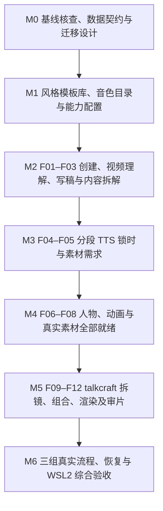

# AI 数字人口播 Agent 平台开发计划

| 项目 | 说明 |
| --- | --- |
| 计划版本 | V2.1，2026-11-04 |
| 需求依据 | [PRD V1.10](AI数字人口播Agent平台-PRD.md) 第 6 章 F01–F12，以及第 8、9 章固定 Workflow 与错误处理规则 |
| 状态 | 下一版执行计划；任务拆分和估算不代表代码已完成或已部署 |
| 开发目录 | `D:\pro\ai_cat\avatar-agent`，参考代码仅从上级 `参考/` 提取适配 |
| 运行环境 | 本机 WSL2 Docker；前端、Go API、PostgreSQL 与媒体执行环境统一部署 |

本计划完整替代旧的“固定三镜、整稿配音、单音色、仅竖屏、单知识点”后续路线。旧最小 MVP 仅作为已有实现和测试记录；新功能按本计划及 PRD 开发。需求、代码状态、真实样片验收分别记录，当前事实以 [开发进度](progress.md) 和 [真实测试报告](mvp-test-20261104.md) 为准。

本版采用固定 Workflow，无通用 Agent 的自主规划、工具选择或自我修复框架。模型仅在预设节点内生成受约束内容，节点顺序、分支和循环由程序控制。V2.1 将执行状态与质量结果分开：质检只弹窗提醒，后台继续制作与交付；用户主动停止才终止后续调度。必要结果缺失或程序确实无法运行时按技术错误恢复，不伪造成功。

## 1. 本版交付目标

用户通过网页选择照片、主题/稿件、动态动效风格、音色、原视频及比例，完成：

**可选原视频理解 → 写稿与内容拆解 → 分段 TTS 并锁定实测时长 → 素材需求规划 → 按需生产人物、动画及准备真实素材 → talkcraft 接入、SHOTBOOK 拆镜、组合预览与成片交付。**

- 默认单机位上半身数字人，人物面部纹理自然且跨帧稳定；只有用户文案制作要求明确多角度才增加机位。
- 人物素材使用照片、对应实际音频和镜头提示词生成；不把文本提示或参考音频能力当作嘴型已验收。
- 动画来自四个参考仓库的已验证模板及已有提示词；创建前可浏览动态样例，至少两套可制作风格、两种真实中文音色、9:16/16:9/1:1。
- 首轮真实混合样片 30–60 秒，界面暂设 90 秒上限；支持章节和多个相关知识点，不按旧计划强制一片一个知识点。
- 交付 MP4、SRT、封面、后期工程、素材/时间映射及逐步成本耗时报告；可刷新恢复、失败重试和局部修改。
- 模型/网络问题提示真实类别及影响范围；质检不通过或检查未完成只提醒，不等待弹窗、不自动重生成。提供用户停止入口，保留已提交订单的真实状态与费用。
- P0 真实素材使用用户上传文件，输出网络素材检索需求但自动联网获取属 P1。支付、积分、多用户并发生产、完整编辑器、无限制代码执行、自动发布及 InfiniteTalk 部署不进入本轮。

## 2. 现有基础与迁移原则

| 范围 | 已有基础或证据 | 下一步 |
| --- | --- | --- |
| 应用与部署 | 独立 Go/React 项目，认证、项目/工作流、WSL2 Docker 基础已部署 | 复用并扩展，逐里程碑更新部署；不另开参考项目开发 |
| 真实模型 | 已有文本/TTS 成功记录，Seedance 首镜与另一次提交待确认记录 | 复核当前配置、音频条件及订单状态；完整人物成片仍需验收 |
| 旧制作链 | 固定三镜、整稿 TTS 后切分、字级对齐和部分 talkcraft 能力 | 迁移为分段音频、按需人物素材、模板动画及 F09–F12 后期链 |
| 质检策略 | 旧音轨波形阈值曾阻断后续步骤 | 新流程将运行时质检结果改为提醒并继续，保留分数、检查策略、历史订单及失败证据；不把继续执行冒称质量通过，不以波形替代嘴型评审 |
| 任务恢复 | 已有任务持久化、查询/重试与所有权逻辑 | 扩展到版本依赖、分段/需求/镜头/渲染尝试；未知订单禁止盲重交 |
| 新功能 | PRD 已确认，不代表实现 | 视频理解、主题写稿、分段锁时、动态图库、多比例与完整 talkcraft 后期逐项交付 |

历史订单、工程、配置及成本保持原貌。旧素材在人物、文案、驱动音频和配置依赖一致且实际可供后续消费时可复用；质量提醒不自动使素材失效。不会自动把旧三镜转换成新任务或重新提交。旧基准模式可以作为诊断入口保留，不能继续成为新流程固定三角度的产品规则或质检停工门禁。本次文档调整不表示已修改部署中的旧门禁代码。

M0 的核查和后续本地开发可用已有授权素材及录制响应完成；遇到待核单或真实模型效果问题，如实记录待核事项与效果差距，同时推进不依赖该结果的模板、数据及页面工作。质量差距不得转成用户运行时门禁，最终效果验收仍必须使用真实输出。

## 3. 运行链路与开发依赖

这是集成交付的依赖顺序，不要求所有本地开发都串行等待。M1 的模板发布是 F01 风格选择的前提；F07 的实际动画生产必须等 F04 的实测时间及 F05 需求。F09 的汇合检查只要求本片用到的素材类型全部就绪，不强制每条视频都有人物、动画和实拍。

## 4. 分阶段任务与退出标准

| 阶段 | 功能范围 | 主要产物 | 退出条件 | 初估工作量 |
| --- | --- | --- | --- | --- |
| M0 基线与契约 | 现有实现盘点、运行/数据/供应商能力及迁移方案 | 差距清单、固定节点/后继、执行/质量状态及停止接口契约、验收样例 | 每项需求有开发/验证落点；错误分类及提醒继续边界明确；未知订单与未验收能力被标记 | 2–3 人日 |
| M1 可选配置与模板库 | F01.3、F07 的预入库与发布 | 至少两套已验证风格、动态预览、两种中文音色试听、三比例能力矩阵 | 创建前可选真实可制作配置；样例与版本/许可可追溯 | 3–5 人日 |
| M2 输入、理解与文案 | F01、F01.4、F02、F03 | 七项输入、草稿恢复、片段文案索引、最终稿与内容段版本 | 两条输入路线正确；理解先于写稿；拆解只处理内容且全文覆盖 | 4–6 人日 |
| M3 实际声音与素材需求 | F04、F05 | 独立分段音频、时间戳/锁时清单、三类素材需求 | 配音先确认再规划；需求不含图层/成片剪辑；重生成一段可失效重核 | 3–4 人日 |
| M4 素材生产与准备 | F06、F07、F08 | 说话人物、实际内容动画、可用真实素材及源/音频映射 | 默认单角度/上半身；动画随实际配音；必需素材实际可消费，质量问题记录但不阻后期 | 4–6 人日 |
| M5 talkcraft 后期 | F09、F10、F11、F12 | 工程、全局时间基、语义/SHOTBOOK、单镜预览、MP4/SRT/封面/报告 | 同源镜头表、缓存及整轨混入有效；质检提醒不阻交付，用户停止后不新调度，可局部返修 | 5–8 人日 |
| M6 综合验收与交付 | 全流程、恢复、提醒/停止、访问与部署 | 三组真实案例、测试结果、费用耗时报告、操作/排障说明 | PRD A01–A36 逐项有证据；不处理提醒仍完成；本机 WSL2 网页可制作及下载 | 3–5 人日 |

上述为单名熟悉现有项目开发者的原始初估，共 **24–37 人日**，包含实现、定向测试、分阶段部署和验收整理；不等于日历交付承诺。M0 完成后根据现有代码可复用程度、视频理解服务能力和模板适配难度重新估算；本次新增明确的错误分类、非阻塞提醒及停止竞态处理也纳入复估，不能视为已被原估算充分覆盖。供应商等待、核单、许可处理、多轮效果调优及新增付费试生成等待不计入该工作量；不再沿用旧最小 MVP 的 8–13 天估算。

### M0：基线与设计

- 以 PRD 第 6 章建立 F01–F12 差距表，将“已有代码”“实际部署”“协议可调”“真实效果通过”分别标记。
- 核查现有目录、数据库模型/迁移、认证、任务租约、素材下载及供应商适配；保留账号、任务、配置、缓存和测试证据。
- 形成业务对象、版本引用、状态迁移及接口设计；明确保存草稿、确认稿、确认配音、运行、查单恢复、局部重做的幂等边界。
- 冻结 Workflow 定义版本、F01–F12 及 F01.4 的节点/预设后继和清单循环，约束模型输出不能改变调度或增加付费尝试；无通用 Agent 推理循环。
- 分离执行状态、质量结果和提醒事件；确定技术错误、质检问题/检查未完成的分类规则，以及弹窗不等待、事件去重、持久停止标记和提交前检查契约。
- 核查视频生成、TTS、文本推理三类服务；上传视频路线增加真实视频理解能力，可复用多模态文本账号，不要求第四把 Key。厂商能力按真实协议声明，禁止无音频输入的接口冒充指定配音数字人路径。
- 记录旧音轨门禁问题和提交待确认问题，设计新流程中门禁转提醒及原单恢复方案；保留历史证据。本次计划更新不触发模型请求，不把未核单任务直接重试。

### M1：模板与可选配置

- 从 mg-styles-15、lemo-opuscar、awesome-opus5-5-videos、opus-video-prompts 提取候选清单；合并重复案例，区分源码模板、提示词及外链资料。
- 首批适配至少两套风格，各自覆盖步骤说明、对比、关系图、重点和总结；保留源码/原提示词/实际适配版本、作者/提交/路径/许可。
- 验证中文、实际时长参数及三比例重排，预生成静音动态缩略图、静帧和完整示例。未验证条目标为仅参考/适配中，不能提交正常制作。
- 完成创建页可复用的风格选择组件：视口/悬停播放、离屏暂停、放大、加载失败回退、草稿恢复；浏览不产生模型调用。
- 配置至少两种真实中文音色及预生成试听，后端返回实际可用项；冻结配置版本与比例能力，不向前端暴露密钥。

### M2：七项输入与两条内容路线

- 页面和后端同时校验照片、主题、文案、风格、音色、原视频、比例；主题/文案至少一项，使用人物时才要求照片，保存草稿可不完整。
- 有视频：校验/预处理并调用视频理解模型，保存摘要、源时间段、片段文案及覆盖范围；分批失败能单独恢复。无视频：跳过理解及其配置检查。
- 写最终稿时引用视频理解版本；已写稿模式默认保留原意，有冲突提供建议，不自动改写已确认内容。
- 按剧情、知识点、章节与内容拆段；保存稳定 ID、原稿引用、制作要求来源，检查原稿按序覆盖一次。多角度制作要求与朗读正文分开，不在拆解阶段生成画面方案。
- 完成编辑、拆合段、版本确认与刷新恢复；文字变化使对应确认失效。

### M3：先声音，再需求

- 按确认段独立 TTS，统一使用所选声音；实测解码时长，生成/复用对应字词时间戳，支持分段试听及重做。
- 确认声音后保存锁时版本、全片顺序、显式停顿与累计时间；未确认或过期音频不能以估算秒数进入 F05。
- F05 只输出有 ID 的人物镜头/驱动音频/请求与有效时长、动画内容/风格/模板及提示词版本、实景查询/准备要求。
- 校验默认单角度和用户明确多角度来源；不规定成片拼接顺序、小窗位置或切镜表，也不提前调用生成/搜索。
- 实现单段改配音后的依赖失效与成功产物复用，明确受影响全局时间与后期工程需重新核算。

### M4：三类素材生产

- 人物：适配同一照片＋本段实际音频＋提示词，默认正面上半身；结合参考保留面部纹理、身份、年龄/肤色、局部反光及跨帧稳定性。
- 按供应商真实时长限制拆任务，保存请求长度、有效长度及驱动音频范围。多角度只处理用户明确要求，不按段落数增加机位，不变速或重复人物凑时长。
- 动画：复用已发布模板和已有提示词，填入本段内容、时长和字词事件，输出独立素材/场景；不带入样例 TTS、字幕、Logo 或片尾，不在本阶段拼装成片。
- 实景：从用户上传的已理解片段、录屏和图片准备实际候选，保存源区间、文案、来源及解码信息；缺素材明确等待补充，自动联网检索留给 P1。
- 模型尝试持久化、上传链接失效重传、原订单查询、未知提交阻断与手动重试同时落地；完成素材检查和人物首中尾/动态审片。
- 必需素材真实可消费即可推进后期；身份/纹理/嘴型等质量问题或质检脚本故障只提醒并继续，不以审片通过作节点调度条件，不自动重生成人物。

### M5：统一 talkcraft 后期

| 步骤 | 具体工作 | 主要检查 |
| --- | --- | --- |
| F09 接入 | 整理任务工程/素材包，合并锁定配音，转换全局 timestamps/timing，接入多个独立人物片段，检测人脸安全区 | 不重做已有 TTS/对齐；源、段内、全局时间分别保存；素材全部真实就绪 |
| F10 拆镜 | 复用 semantic_annotate、card_match、SHOTBOOK 格式及镜头表契约；选用已备素材，形成 beats/anchors | 逐句镜头归属、台词锚点和源区间准确；分镜与代码同源，不覆盖用户风格 |
| F11 组合 | 提取并适配 talkcraft 的场景、素材容器、字幕、轻运镜和转场；先做代表镜有声预览，再完成其余镜头 | 动画不重复运镜、不改时长；人物嘴部/素材重点无遮挡；占位未完成不能交付 |
| F12 交付 | 分镜无声渲染、缓存、拼接、整轨一次混入、帧数检查；检查意见随成片输出，用户选择是否返修 | 可播放 MP4 即可完成交付，质量结果另存；改一镜仅影响必要邻镜；输出 SRT、工程及成本报告 |

媒体运行时提取到本项目 `backend/avatar-runtime`，沿用现有依赖与锁文件，Web 前端与渲染工程隔离。素材清单、多人物片段、风格/比例、来源和检查策略都按 PRD 接入，不直接运行参考仓库或照搬其演示数据/可选 TTS/配乐流程。对来源与许可的记录沿用 [PRD 第 12、15 章](AI数字人口播Agent平台-PRD.md)。

适配 `preflight.py`、`beat_lint.py` 等上游检查退出语义：质检 FAIL、低分及检查脚本异常保存为提醒/检查未完成，不直接把非零退出码冒泡为工作流失败；工程缺文件、无法执行或无可播放输出才按技术错误处理。检查期间不新增用户确认点，提醒不会跳过剩余制作步骤，也不要求先返修再导出。

现有 Mantine 页面展示制作阶段、镜头状态、有声预览、错误和结果；可复用 talkcraft 工作台的契约，不把整个工作台、多轨自由编辑或新增多 Agent 系统作为前提。

### M6：真实全流程与异常验收

- 三组不同人物/文案完成网页流程。至少一组不上传视频，一组上传含多个事件的视频，其中静音片段也能得到视觉描述；至少一条 30–60 秒成片真正包含人物、代码动画和真实素材。
- 默认单角度与明确要求多角度的用稿分别验证；三种比例与至少两种风格/音色形成覆盖矩阵，不机械做所有选项的笛卡尔积，也不省略应覆盖的风格×比例适配。
- 完整播放评审身份、纹理、发音、声音一致性、嘴型、素材语义、字幕和镜头衔接；保留代表帧、时间码及修复记录，模拟测试不能代替真实样片。
- 验证重复提交、提交待确认、查询超时、进程/容器重启、部分失败、成功片段复用、镜头/整轨缓存失效和跨用户拒绝访问。
- 注入首镜质检问题、低波形分数及检查脚本失败，不点击弹窗、刷新或关闭浏览器仍生成其余镜头并交付可下载 MP4；质量结果、提醒历史与执行状态分别核对。
- 验证关闭弹窗不停止、主动停止后无新提交、停止/提交竞态与重启持久性；已提交订单如实查询/回收，不能显示未经证实的取消或退款。
- 注入模型 5xx、鉴权/额度、断网和查询超时，提示真实类别及影响；缺必需产物的依赖任务不能假继续，独立任务仍推进，未知订单不重交；质检脚本异常不能误判为主流程阻塞错误。
- 每阶段及每次调用保存真实耗时、用量、币种/费用来源，未知费用明确待核实；审核复用与重试汇总去重。
- 更新 WSL2 Docker 后从网页登录、创建、刷新、预览和鉴权下载；交付实测 IP/端口、使用说明及验收报告，不沿用旧 IP 当作本次实测。

## 5. 数据、接口与后台实施任务

| 工作包 | 实施内容 | 依赖 |
| --- | --- | --- |
| 数据与版本 | 复用 User/Project/WorkflowRun/WorkflowStepExecution；增加输入、分析、脚本/段落、配音锁时、需求、素材、talkcraft 工程/镜头与审片版本 | M0 设计；各阶段增量实现 |
| 固定工作流 | 版本化节点/预设后继、显式分支、清单循环及既定内容确认点；模型节点结构校验，不允许自主改变执行图 | M0 契约，M2–M5 随节点实现 |
| API 与配置 | 保留现有任务查询/视频鉴权；增加草稿、可用风格/音色/比例、素材、理解、稿件确认、配音确认及局部运行的契约 | M0 契约，M1–M5 按功能交付；路由评审后落地 |
| 调度与恢复 | 单活动执行器及 409、服务端续租、确认等待释放租约、尝试先存后交、取得订单立即持久化、重启标中断、恢复先查旧单 | 从 M0 起贯穿，不拖到最后补 |
| 错误与质检提醒 | 分类保存模型/网络、本地输入/执行错误和质量提醒；质检结果独立，检查失败不阻制作；事件去重、已读及历史查询 | M0 契约，各节点检查同步改造 |
| 用户停止 | 受所有权保护的幂等停止接口、持久停止标记及提交前竞态控制；本地退出后释放租约、真实供应商取消/查单及用量保留 | M0 契约，M2 起落地，M4–M6 验证付费提交边界 |
| 缓存与失效 | 输入/配置/模型/模板/音频/镜头实现依赖摘要；历史任务原样保留；局部变更仅使必要下游失效 | 每阶段与产物同时实现 |
| 文件与权限 | 服务端受控目录、素材及工程归属、Range/Blob 等鉴权预览下载、上传校验；不允许任意宿主机路径 | M2 上传及后续所有产物 |
| 观测与费用 | Project/Run/Step/需求/镜头/尝试关联；实际时间、错误、订单、原单位用量、费用及证据来源；日志脱敏 | 每次新增步骤同时实现 |
| 前端 | 输入、图库、视频理解、文案、配音、需求、镜头/预览及结果；非阻塞质检弹窗、错误类别与停止入口；地址带项目/运行 ID、约两秒轮询并按状态停止 | 对应后端阶段同步交付 |

业务文本与复杂元数据不能塞入受限计费用量字段。保存输入草稿不占执行租约；浏览器关闭不终止后台工作。批量稿件/配音确认以 PRD 为准，不增加每文件、每需求或每镜强制点击。旧订单绑定原供应商配置引用，新配置不影响原订单查询。

## 6. 验证与验收映射

遵循仓库 TDD：影响行为的功能先写有意义的失败测试，再实现并运行定向检查。文档更新不触发模型调用或重新部署；功能变更完成后必须部署 WSL2 验证。

| 范围 | 重点验证 | PRD 验收编号 |
| --- | --- | --- |
| 输入与文案 | 主题/文案条件、原意保留、版本确认、完整覆盖、草稿恢复 | A01、A02、A19 |
| 上传视频理解 | 两条路线、静音视觉、覆盖范围、源时间、用户修订及复用 | A14–A18 |
| 风格/音色/比例 | 已发布状态、动态预览、失败回退、实际音色、模板及提示词追溯、三比例适配 | A20、A21、A27–A29 |
| 配音与素材需求 | 单段 TTS、实测锁时、过期阻断、F05 不剪辑/生成 | A03、A22、A24 |
| 人物及素材 | 图片/音频协议、真实发音/嘴型/身份、默认单角度、上半身/纹理、真实内容动画 | A04、A05、A09、A25、A26 |
| talkcraft 后期 | 同源拆镜、组合、时序/帧数、单镜预览、整轨一次混入、缓存及审片 | A06–A08、A23、A30–A32 |
| 恢复与运行 | 局部修改、幂等、未知提交、重启查单、费用耗时及所有权、WSL2 | A10–A13 |
| 工作流与错误处理 | 固定后继/循环、模型权限边界、质检 FAIL/检查未完成继续、弹窗去重、用户停止竞态/重启持久、技术错误分类 | A33–A36 |

纯参数化渲染和录制响应适合验证契约与恢复，不宣称为真实模型效果通过。具体真实生成按届时的用户制作/测试授权执行，不将历史一次性测试授权重复用于新一轮试生成。

## 7. WSL2 交付与文档维护

- 日常功能只在本项目修改；使用 `deploy/wsl2/deploy.ps1` 更新本机 WSL2 Docker，保留 `/opt/aicat/avatar-mvp` 的服务端配置、账号、数据库、素材及模型缓存，禁止 `docker compose down -v`。
- 每阶段交付同时更新前端、Go API 和必要媒体执行依赖；数据库变更使用可追溯迁移，并验证旧任务仍可查询，不把新工程格式强制写回历史任务。
- 部署后检查容器健康、登录、该阶段 API、真实页面及素材权限。反馈实测访问 IP 和端口，保留验证时间；单机地址可能变化。
- API Key 仅保存在 WSL 服务端，不进入前端、Git、下载工程及日志；不引入浏览器填写供应商密钥的旁路。
- [PRD](AI数字人口播Agent平台-PRD.md) 管功能与验收，本计划管实施顺序，[进度](progress.md) 管实际交付/部署/阻塞，[历史 MVP 计划](AI数字人口播Agent平台-最小MVP开发计划.md) 只追溯旧范围。下一阶段状态变更须附代码、部署或验收证据。

本次交付是需求与开发计划同步，未实现上述新增功能，未重新部署，也未新增付费模型测试。
