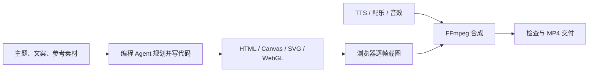

# Opus 视频项目参考分析

分析日期：2026-11-04。依据本机实际拉取的源码、依赖声明、渲染脚本和许可证；没有安装这些工具的运行依赖、执行示例或调用付费模型。仓库中的案例效果、耗时和成本是作者展示或转述，不能视为本项目已复现结果。

## 1. 本地位置与版本

四个仓库作为独立参考目录统一放在 `D:\pro\ai_cat\参考`，总索引见 [参考项目 README](../../参考/README.md)。参考源码未修改，也没有加入现有 Docker 构建上下文。

| 仓库 | 本地目录 | 分析版本 |
|---|---|---|
| lemomo-ai/lemo-opuscar | `D:\pro\ai_cat\参考\lemo-opuscar` | `bebbbe1aa92a3cb4bb6f83500e61b23a17d1aa00` |
| yihui-dev/awesome-opus5-5-videos | `D:\pro\ai_cat\参考\awesome-opus5-5-videos` | `92aee2f586ac0715cb3cbcb6384834f98a33383d` |
| joeseesun/opus-video-prompts | `D:\pro\ai_cat\参考\opus-video-prompts` | `7977c807781d4ba7c235247b8899a72575a30d00` |
| feitangyuan/onetake | `D:\pro\ai_cat\参考\onetake` | `013a61ac8d98883c73733f59c06e49e9ba444f14` |

机器可读索引见 [video-reference-repositories.json](video-reference-repositories.json)。后续分析优先读取本报告和索引，再定位源码；索引只表示参考关系，不表示源码已引入应用或已获得所有商业授权。

## 2. 总体区别：Opus 在流程里做什么

这些仓库描述的主要路线是让 Claude Opus 编写动画、镜头和合成代码。画面通常由 HTML、Canvas、SVG、WebGL 或其他工具绘制，浏览器逐帧渲染后由 FFmpeg 编码。它与 Seedance 从参考图片和声音生成写真人物视频的职责不同。



这里 Opus 主要承担导演、设计和编程工作；不是四个仓库各自训练或部署了一个视频生成模型。仓库标称针对 Opus 5.5 的风格或效果，也不等于其工具脚本都硬编码依赖该模型。更换编程模型的输出质量需要实测。

| 项目 | 实际类型 | 可复用内容 | 是否有可运行制作工具 |
|---|---|---|---|
| Lemo-Opuscar | 风格库、Agent 工作方法、媒体工具箱 | 风格规范、示例源码、渲染、声音、字幕及验收工具 | 有，主要是本地 CLI 和脚本 |
| awesome-opus5-5-videos | 大型案例与提示词索引 | 703 个条目、技术标签、作者来源、示例链接 | 没有独立制作后端 |
| opus-video-prompts | 精选中文提示词与案例指南 | 18 份提示词、54 个案例、9 类制作路线 | 没有独立制作后端 |
| onetake | 连续镜头动效 Agent 工具包 | 动作库、界面重建、时间驱动动画、渲染和连续性检查 | 有，主要是本地 CLI 和脚本 |

这四个项目均不是 NarratoAI 一类包含登录、用户、支付、数据库和后台工作流的完整 SaaS。它们适合提供创作与渲染能力，平台基础设施仍由现有 Go 后端和前端负责。

## 3. Lemo-Opuscar

### 3.1 功能

- 多种视觉风格：手绘、版画、像素、信息图、三维场景、实证影像、新闻包装、纪实剪辑等。
- 为每种风格提供视觉与声音规范、案例和制作源码；允许从已有风格修改或建立个人风格库。
- 以主题为输入规划叙事、镜头、节拍、字幕、配音、音乐和音效。
- 支持风格帧、分镜预览、完整视频、字幕及制作工程的输出。
- 包含文字可读时间、台词识别、音量、黑帧和时间线打点等检查工具或明确的检查流程。

README 标注 66 种风格；本次快照实际有 67 个 `styles/*/style.json`，本报告保留这一差异，不把宣传数字当成精确源码统计。早期总述强调纯代码画面，但当前风格库也明确包含使用真实影像、文档、地理与扫描数据的分支，不能将整个仓库概括为绝不使用外部素材。

### 3.2 技术架构

| 层 | 主要入口 | 作用 |
|---|---|---|
| Agent 方法 | `DIRECTOR.md`、`TECHNIQUE.md`、插件目录 | 导演规范、制作步骤、工具使用协议 |
| 风格资产 | `styles/<style>/STYLE.md`、`style.json`、`demo/` | 风格选择与示例实现 |
| 动画运行时 | `core/lib.js`、Canvas 2D、Three.js/WebGL | 按时间计算画面、运镜和视觉效果 |
| 视频渲染 | `core/render/video.mjs`、`page.mjs` | Playwright 控制 Chromium 截帧，FFmpeg 编码与拼接 |
| 语音 | `core/tts/tts.py`、`tts_zh.py`、`asr_check.py` | Kokoro ONNX 本地 TTS、edge-tts 在线中文、Whisper 校对及时间戳 |
| 音乐和音效 | `core/audio/sampler.py`、`pluck.py`、`sfx.py` | 采样乐器、物理建模弦乐、程序合成音效 |
| 最终混合 | `core/render/mux.sh`、各片的混音脚本 | 配音、音乐和音效混合，双遍响度归一化、MP4 输出 |

依赖声明：Node.js 20+、`playwright-core ^1.63.0`、`three ^0.170.0`，Python 3.11+，NumPy、SciPy、SoundFile、soxr、Pillow、fonttools。语音和音乐另有分层依赖文件。项目要求 FFmpeg 7+；不能直接认为当前 WSL 的 FFmpeg 版本已满足。

核心页面接口：

```js
window.DUR = 30;             // 片长
window.READY = true;         // 字体和素材已就绪
window.render = t => {};     // 绘制 t 时刻，结果确定
window.EV = [];             // 声音和动作事件
window.TEXTS = t => [];      // 可选：文字位置与可读时间检查
```

`video.mjs` 默认三个 worker，各自启动浏览器，按帧调用 `render(t)`，将 JPEG 通过管道传给 FFmpeg，最后无损拼接分段。源码还处理输出文件锁、崩溃遗留分段、并发渲染名额与页面脚本错误。这些是媒体执行器，不是持久化 SaaS 任务队列。

### 3.3 实现流程

需求与素材 → 风格选择 → 叙事方案和节拍表 → 真实代码风格帧 → 统一时间线 → 动画/语音/音乐并行制作 → 逐帧渲染 → 混音与响度处理 → 抽帧及声音检查 → MP4、字幕、来源记录和工程。

主要参考：[技术流程](../../参考/lemo-opuscar/TECHNIQUE.md)、[导演规范](../../参考/lemo-opuscar/DIRECTOR.md)、[核心渲染源码](../../参考/lemo-opuscar/core/render/video.mjs)、[字幕新闻风格](../../参考/lemo-opuscar/styles/caption-news/STYLE.md)。

### 3.4 对当前平台的价值与边界

适合参考风格规范、字幕和解释卡片、配乐/音效事件、统一时间线以及确定性渲染。它可以为数字人口播提供动画 B-roll 和包装，但不提供 Seedance 式的写真人物生成，也不提供 InfiniteTalk 式的音频驱动嘴型生成。

代码和文档为 MIT；演示影片及静帧为 CC BY 4.0，需要署名并标注修改；第三方资产遵循各自许可。README 特别排除了三条演示声音轨的上述授权，不能直接当作商用声音素材复用。

## 4. awesome-opus5-5-videos

### 4.1 功能与数据

实际是一个静态案例目录。当前快照 `data/videos.json` 有 703 条记录，`prompts/` 有 703 个 Markdown 文件，其中 418 条记录带有 `has_remake=true`。

案例覆盖动态图形、解释视频、三维场景和交互游戏。一些条目属于可交互网页而非完整编码视频；部分只有原帖文字或不完整提示词，有显式标记。

典型 JSON 字段：`slug`、作者、原帖 URL、分类、`tech_tags`、`prompt`、`prompt_partial`、预览图 URL、Skillry 页面 URL、收录日期、`has_remake`。

### 4.2 技术架构与流程

```text
README 分类入口
    ├── prompts/<slug>.md：作者、出处和提示词
    └── data/videos.json：可供程序筛选的结构化索引
                   └── 外部 Skillry / 作者原帖的预览和重制页面
```

仓库本体没有视频生成 API、浏览器渲染服务、登录模块或业务数据库；外部 Skillry 网站的代码并未随此仓库提供。Canvas、SVG、GSAP、Three.js 等是案例技术标签，不能当成这个索引仓库安装的依赖。

使用流程是按类型筛选案例 → 阅读完整性标记与来源 → 提取提示词 → 在另一个编程 Agent 中实现 → 另行渲染输出。它更适合作为风格检索和规划参考数据集，不能直接接成一个视频生成服务。

主要参考：[README](../../参考/awesome-opus5-5-videos/README.md)、[数据清单](../../参考/awesome-opus5-5-videos/data/videos.json)。仓库 LICENSE 为 MIT，但 README 明确视频和提示词属于各自作者；仓库许可不等于所有原作品都得到重新授权。

## 5. opus-video-prompts

### 5.1 功能

18 份精选提示词、54 个公开案例，提供中文使用说明、原作者链接、效果描述和技术路线介绍。覆盖产品发布、知识讲解、真人口播转动画、三维、像素动画及混合制作。

与上一项目相比，收录数量少，但模板更细、中文解释更多。例如：

- 30 秒企业讲解片：客户问题 → 服务 → 三步流程 → 证明 → 品牌结尾。
- 科普解说：TTS、双语字幕与动画配图。
- 真人口播转线稿：保留原声、字幕和时长，人物做画中画，主画面根据台词绘制动画。
- 产品片：先分镜，再写动画代码，先低成本预览，再完整渲染。

### 5.2 架构与实现边界

`README.md` 是人工阅读入口；`prompts/*.md` 保存提示词和来源；`cases.json` 保存分类、标题、作者、做法、声称成本/耗时、来源 URL。没有独立执行引擎或后端。

文档归纳九类路线：HTML/Canvas、p5.js、Remotion、HyperFrames、Manim、Python 绘图、Three.js/WebGL、操作专业软件、剪辑已有素材。这些是外部案例路线，不代表仓库同时实现了九个渲染器。

适合把“文案 → 画面表达”的提示词拆成受约束的 Agent 规划模板；尤其可借鉴口播画中画和跟随台词的解释动画。它不解决人物生成、音色保持、嘴型或任务恢复。

主要参考：[口播转动画提示词](../../参考/opus-video-prompts/prompts/10-talking-head-to-lineart.md)、[带 TTS 的科普提示词](../../参考/opus-video-prompts/prompts/09-atmospheric-circulation-tts.md)、[案例清单](../../参考/opus-video-prompts/cases.json)。本快照未发现独立 LICENSE 文件，README 声明提示词和作品版权归原作者；不能按宽松代码许可直接整体商业复制。

## 6. onetake

### 6.1 功能

主要针对产品发布、功能演示和预告片。核心是镜头和物体连续：一个输入框展开成界面，一个组件变成下一个组件，同一摄像机连续移动，而非场景逐张替换。

- `lib/motion.js`：约 39 个动作与辅助函数，含弹簧、入场、碰撞、连续承接、镜头、流体背景和物理模拟。
- `lib/ui_kit.js`：按截图重建 HTML 界面，提供坐标、强调、多语言等工具。
- 主题系统：颜色、字体子集与内嵌字体，支持从截图提取起始视觉方案。
- 确定性渲染、草稿与终稿、运动模糊、多进程和逐帧恢复。
- 画面元素追踪、连续性和节奏分析、音频峰值与削波检查、主体出画检查。
- TTS、字幕、声音材料库及可选真实网页操作录制工具。

当前有 13 个 `cases/` 子目录，包含成片和拆解说明；README 的案例数字存在版本滞后。各案例的完整制作源码没有公开，开放的是通用动作库、工具、模板和方法，不能把成片目录当成完整可编辑工程。

### 6.2 技术架构

| 层 | 源码 | 作用 |
|---|---|---|
| 创作协议 | `SKILL.md`、`references/` | 参考分析、概念、节奏、镜头和声音方法 |
| 动画与 UI | `lib/motion.js`、`lib/ui_kit.js` | JavaScript 纯时间函数、DOM/Canvas 动画、镜头投影 |
| 合成页面 | `templates/comp.html` | 一条片子的 HTML 入口和执行协议 |
| 主题 | `looks/looks.json`、`scripts/look.py` | 配色、字体、嵌入字体与主题生成 |
| 渲染 | `scripts/render.py` | Python Playwright、Chromium、NumPy/Pillow、FFmpeg |
| 分析与验收 | `probe.py`、`verify_promo.py`、`analyze_ref.py` | 元素追踪、连续性、运动、节奏和声音质量 |
| 音频 | `vo_tools.py`、`sfx_palette.py` | Kokoro ONNX、faster-whisper、字幕、程序声音 |

页面执行协议以 `window.__ready`、`__seek(t)`、`__meta` 为核心，`__track(t)` 和 `__motion(t0,t1)`可提供元素轨迹和运动距离。模拟预计算后按时间取样，使跳到任何一帧得到相同结果。

渲染默认草稿 1920×1080、30fps，`--final` 为 3840×2160、60fps。Python 多进程控制多个浏览器；每个输出帧在 180°快门窗口内进行多次时间采样，并在线性光空间平均，得到运动模糊。根据移动距离自适应采样，静止帧跳过额外采样，支持断点帧恢复并写入 `.render.json`。

`--gpu` 当前源码使用 ANGLE/Metal 参数，明显带有 macOS 环境假设；迁移到 WSL2/Linux 需单独处理 GPU 参数，不能原样认为已兼容当前容器。渲染器也与当前 Remotion 帧接口不同，需要明确适配。

### 6.3 连续性检查的真实含义

`probe.py` 追踪 DOM 和 Canvas 绘制元素，统计交接前后哪些对象仍存在、是否移动或缩放。支持自定义轨迹；自动追踪存在边界，如 Canvas 遮罩路径未完整跟踪。

连续性评分为：`(被承接的交接数 + 固定锚点交接数 / 2) / 纳入统计的交接数`。`verify_promo.py` 对低于 0.5 判失败，0.5～0.7 为警告，并有快速硬切段、片尾和显式切点的例外。

这套启发式检查用于识别产品动效是否像幻灯片，不是语义理解、人物身份识别或嘴型同步模型。它的“音频检查”是峰值、削波和静音占比，不是比较参考配音和生成声音的波形相似度。连续运动风格的门槛也不应直接搬到允许硬切的数字人口播镜头上。

### 6.4 流程与适用范围

参考片分析 → 三个视觉概念选一 → 写每个交接处保留的对象及节拍表 → HTML 动画与统一运镜 → 截图草稿 → 连续性/声音/构图检查 → 人工观看 → 高规格终稿。

主要参考：[动作库](../../参考/onetake/lib/motion.js)、[渲染器](../../参考/onetake/scripts/render.py)、[连续性追踪](../../参考/onetake/scripts/probe.py)、[验收脚本](../../参考/onetake/scripts/verify_promo.py)。许可证为 PolyForm Noncommercial 1.0.0，商业使用需要另行授权；当前仅保留本地参考，不把其代码直接引入商业平台。

## 7. 对数字人口播 Agent 的参考建议

### 7.1 保持职责清晰

| 当前平台层 | 继续负责的能力 | 新参考的合理用途 |
|---|---|---|
| NarratoAI 基础与 Go 任务 | 认证、用户归属、数据库、任务状态、重试与视频鉴权 | 四个参考项目都不能替代这些基础能力 |
| 视频模型适配 | 根据人物照片和指定配音生成写真人物片段 | 不用代码动画冒充写真人物生成 |
| TTS 与时间戳 | 一致配音、台词、全局字幕时间线 | 借鉴逐句识别与字幕验证，区分台词、音色、嘴型检查 |
| Agent 规划 | 原稿引用、画面布局、分镜、解释内容和风格 | 案例检索、Lemo 导演规范、精选提示词模板 |
| talkcraft / Remotion 合成 | 逐镜素材、字幕、卡片、转场和最终 MP4 | 选择性加入风格、B-roll 和声音事件 |

推荐组合：数字人负责真实口播；字级时间戳驱动字幕和解释卡片；需要解释概念时使用代码绘制的 B-roll。人物镜头可以保持合理硬切，连续动效用于非口播卡片、开头或结尾。

### 7.2 后续实施优先级

1. **当前 MVP 优先交付可验收成片。** 这些参考不构成变更现有嘴型/声音质量规则的授权；新增检查必须验证其适用性，不能仅因参考仓库存在某个阈值就直接拦截任务。
2. **先引入数据和设计约束。** 从案例索引提取风格、画面表达、镜头与技术标签；规划输出结构化字段，校验台词覆盖和时间映射。
3. **先做少量可控样式。** 从 Lemo 的风格规则借鉴“字幕新闻”“信息图”“简洁排版”等，适配现有 Remotion 组件；暂不建立第二套完整渲染栈。
4. **再评估动画 B-roll。** 在独立 worker 容器中运行生成的页面代码，限制文件与网络访问、CPU/内存/时长；模型密钥继续留在 Go 服务端，避免把任意生成代码放进持有密钥的 API 容器执行。
5. **连续产品宣传片作为单独扩展方向。** 可参考 onetake 的对象承接思路，但不将其连续性验收规则强加给数字人口播，也不在未获商业授权时复制其实现。

上述均为分析建议，本次未实现、部署或调用新的创作功能。
