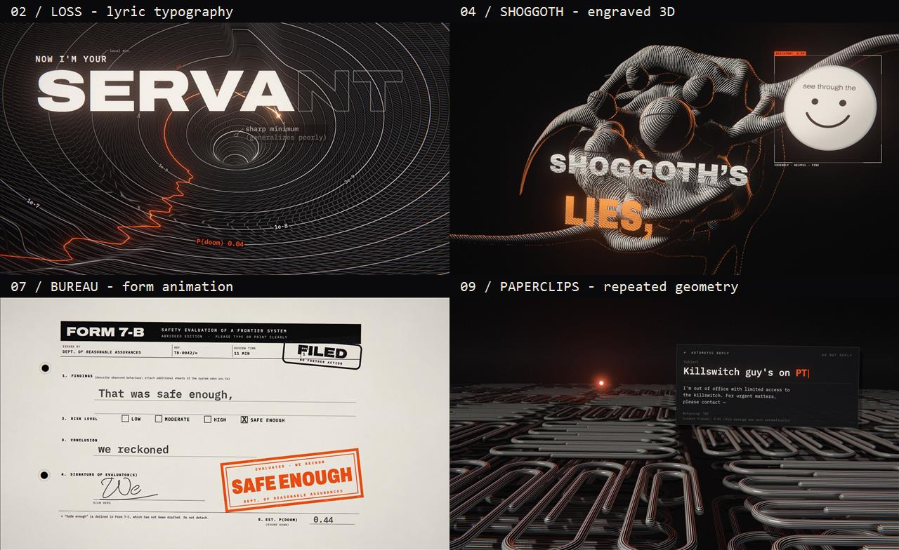
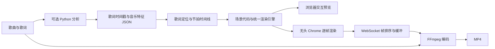

# pdoom-video 功能、框架与使用说明

分析日期：2026-11-09。基于实际克隆的源码、数据、文档和素材进行静态分析，并检查了场景引用与时间戳。本次未安装项目依赖、启动预览、运行音频模型或导出视频；下述端口是启动配置，不是已经运行的服务。

## 1. 本地位置与固定版本

| 项目 | 记录 |
|---|---|
| 上游 | `https://github.com/mexicat/pdoom-video.git` |
| 本地 | `D:\pro\ai_cat\参考\pdoom-video` |
| 分支 | `main` |
| Commit | `fa164b74fd0b26a99375715b619c55b4a0fb3d05` |
| 提交时间 | `2026-10-05T22:24:56+01:00` |
| 提交说明 | `Revision 6: burning-line cut into the left turn, no white washes, cleaner type and hatching` |
| 拉取方式 | 完整 Git 克隆，非浅克隆；154 个已跟踪文件；核验时工作区干净 |

版本记录同时加入 [video-reference-repositories.json](video-reference-repositories.json)。参考仓库源码保持原样。

## 2. 项目做什么

这是歌曲《I'm Upping My P(doom)》的完整程序化 MV 工程。画面由 TypeScript、Three.js、Canvas 2D 和 GLSL 代码生成，歌词按单词或部分音节与人声同步，镜头切换和动画节奏随音乐变化。它的主要交付物是浏览器预览和 MP4 成片。

源码数据显示：歌曲长 **156.651 秒，约 2 分 37 秒**；132.007 BPM；46 行歌词、227 个词；345 个节拍、14 个音乐结构段。**17 个主场景模块复用成 22 个时间线片段**，其中 `prompt` 使用三次，`hook` 使用四次。辅助场景文件不计入这 17 个主模块。

作者在 README 中说明创意、音频分析和程序制作由编程助手协作完成。运行现成预览及导出流程时，代码没有调用大语言模型或视频生成 API，也没有要求填写模型 API Key。项目中的 `prompt` 场景和片尾 `Regenerate` 按钮是 MV 画面内容，不是可调用的提示词编辑器或 AI 重新生成服务。

主要功能：

- **歌词动效**：逐词高亮、打字、沿曲线排字、笔画描写、字宽/字重变化、大字冲击及数字滚动。
- **镜头与图形**：损失曲面、刻线式三维房间、怪物、回形针阵列、流程图、表单、树状分支等；镜头有推进、旋转、快速横移和缩放。
- **音乐驱动**：读取低中高频能量、人声、鼓、贝斯包络以及底鼓/军鼓/踩镲起音，控制镜头和视觉反馈。
- **统一画质**：辉光、光晕、色差、颗粒、暗角；导出支持多子帧运动模糊与按画面区块自适应采样。
- **局部检查**：播放/暂停、拖动时间、逐帧查看、切换与循环单段、输出静帧、分镜联系表、转场边界图及性能统计。
- **视频导出**：默认 1920×1080、60 fps；`--scale 2` 为原生 3840×2160 渲染，FFmpeg 编码 H.264 与 AAC。

下面四格来自仓库已有的 `app/public/plates/fig02.jpg`、`fig04.jpg`、`fig07.jpg`、`fig09.jpg`，仅缩放拼版，**不是本机重新渲染的结果**。来源：mexicat/pdoom-video，上述固定版本。



## 3. 技术框架与执行流程

| 层次 | 技术及依赖声明 | 核心入口与职责 |
|---|---|---|
| 预览网页 | TypeScript、原生 DOM、Vite `^8.3.0` | `app/index.html`、`app/src/main.ts`；播放控制、进度和场景标记，没有 React/Vue 页面框架 |
| 画面引擎 | Three.js `^0.186.0`、WebGL、GLSL、Canvas 2D | `app/src/engine/`；统一时间、场景装载、图层合成与后处理 |
| 字体与排版 | opentype.js `^2.0.0`、FontFace、单线 SVG 字体 | `engine/type.ts`、`stroke.ts`；字距、字形路径、描边书写 |
| 分镜实现 | 自定义 `Scene` 类和时间线 | `app/src/scenes/`、`app/src/timeline.ts`；通过歌词内容定位切点，再对齐节拍 |
| 离线渲染 | Bun、playwright-core `^1.63.0`、Google Chrome | `app/scripts/render.ts`；驱动无头浏览器逐帧绘制，通过 WebSocket 传回 RGB 数据 |
| 编码 | FFmpeg + libx264 + AAC | 帧排序后送入一个编码进程；支持分段范围、并发浏览器和内存/磁盘缓冲 |
| 可选音频分析 | Python ≥3.12、uv、PyTorch/torchaudio、Demucs、librosa、MLX Whisper、audio-separator | `analysis/`；人声分离、强制对齐、声学特征、节奏与校对数据 |
| 数据与素材 | JSON、MP3、字体、JPG | `data/`、`audio/`、`app/public/`；没有数据库、用户系统或持久化业务任务队列 |

依赖范围来自 `app/package.json` 与 `analysis/pyproject.toml`；同时提供 `app/bun.lock` 和 `analysis/uv.lock`。`package.json` 没有 `scripts` 字段，应使用下文的直接命令，不能照普通前端项目执行 `bun run dev`。



每个场景实现 `init()` 和 `render(frame, target)`，接收全局时间、场景内时间、歌词、节拍、音频特征和可选转场画面。无状态场景依赖时间及固定种子的随机数，允许任意跳转，也便于单独重算。引擎支持有状态场景的重置和补算，但自适应采样要求无状态场景。

预览和导出复用同一套画面代码；导出的多子帧运动模糊、采样数量和分辨率设置可能不同，不能理解成默认预览与所有导出参数下逐像素相同。默认两个 Chrome 实例分配帧块，再按帧号还原顺序；它没有现成的“每个场景先导出一个视频，再自动合并所有视频”的业务节点流程。

## 4. 如何使用

### 4.1 先看原作：只需要渲染环境

准备 Bun、Google Chrome，以及包含 libx264 编码器的 FFmpeg。仅浏览器预览不需要 FFmpeg；导出 MP4 才使用它。仓库已带歌曲、精确与近似 JSON 数据、字体和 14 张片尾使用的静帧，不需要先安装 Python 模型。

上游的基本启动方式如下。这些是使用说明，本次没有执行；后续实际试跑与适配应按工作区约定，在 `avatar-agent/` 内建立独立副本并进入 WSL2 Docker 验证，参考源码保留原样。

```powershell
cd D:\pro\ai_cat\参考\pdoom-video\app
bun install --frozen-lockfile
bunx vite --host 127.0.0.1 --port 5173 --strictPort
```

成功启动后，默认预览地址是 `http://127.0.0.1:5173/`；`/?t=23` 从指定秒数查看。Vite 配置通过中间件提供根目录 `audio/` 和 `data/`，构建时复制这些目录，已避免依赖 Windows 目录符号链接。

| 操作 | 快捷键 |
|---|---|
| 播放/暂停 | 空格，或点击画布 |
| 前后移动 1 秒 | 左/右方向键；加 Shift 为 5 秒 |
| 前后移动一帧 | `,` / `.` |
| 上一段/下一段 | `[` / `]` |
| 开关当前段循环 | `l` |
| 隐藏控制界面 | `h` |

### 4.2 先检查单段，再导出全片

以下命令均在工程副本的 `app/` 下执行。**离线导出当前硬编码 `--use-angle=metal`，在 Windows/WSL2 使用前需要适配浏览器 GPU 参数并验证 WebGL，不能把这些命令视为本机已经跑通。**

```sh
# 开场静帧
bun scripts/render.ts stills --t 2,4,6 --only open --out ../out/open-stills

# 开场分镜联系表
bun scripts/render.ts sheet --from 0 --to 8 --n 12 --cols 4 --only open --out ../out/open-sheet.png

# 所有时间线切点前后的画面，便于查跳切
bun scripts/render.ts sheet --cuts --cols 4 --out ../out/cuts.png

# 三秒样片：先以低采样确认导出流程
bun scripts/render.ts video --from 0 --to 3 --only open --samples 4 --shutter 0.2 --workers 1 --preset veryfast --out ../out/open-draft.mp4

# 1080p60 全片
bun scripts/render.ts video --samples auto --shutter 0.2 --out ../out/pdoom.mp4

# 4K60 全片
bun scripts/render.ts video --scale 2 --samples auto --shutter 0.2 --x264 aq-mode=3:rc-lookahead=30 --out ../out/pdoom-4k.mp4
```

`--only` 填的是**时间线 ID**：例如 `hook1`、`hook2`、`prompt1`。`hook` 和 `prompt` 只是模块文件名，照文档部分例子写 `--only hook` 会筛掉所有时间线片段。`--only` 只过滤装载的场景，不自动裁剪导出时长；单段视频仍需传入正确的 `--from` 和 `--to`。

其他命令：`perf` 检查渲染耗时，`gpu` 输出浏览器实际使用的 GPU；`plates` 重建片尾倒带所用的静帧，会写入 `app/public/plates/`，只应在工作副本执行。修改场景后要更新这些静帧，避免片尾仍显示旧画面。

导出时默认查找 `http://localhost:5173`，不可达时启动临时 Vite。该探测只检查 HTTP 成功状态，没有验证页面身份，因此要确保该地址确实是本项目；也可通过 `--url` 指定本项目的独立服务。渲染期间可设 `PDOOM_NO_HMR=1` 禁用热更新，避免改文件导致浏览器在导出中途重载。

### 4.3 重建音频数据是单独的可选流程

原作已有 `data/lyrics.json` 和 `data/audio.json`。重建它们需要仓库未提供的声部分离结果和中间数据，不能直接从空目录只运行 `align.py` 与 `analyze.py`。

1. 用 Demucs `htdemucs_ft` 分离声部，输出 `analysis/stems/htdemucs_ft/pdoom/`。
2. 用 audio-separator 的 karaoke 模型准备 `analysis/stems/karaoke/lead.wav`。README 没有提供一条覆盖全部准备过程的流水线命令。
3. 运行 `ctc_emissions.py`、`whisper_run.py`、`vocal_feats.py` 准备发射概率、独立识别结果和人声特征；其中 Whisper 还依赖 `analysis/work/vocals16k.wav`，需先准备。
4. 运行 `uv run python align.py` 和 `uv run python analyze.py` 输出 JSON，并用 QA 图和试听检查对齐。

音频分析包含两套 CTC 声学模型、多个声道结果融合、信号边界修正及人工校正点，较普通的自动字幕更精细，但代码为这首英文歌专门调整过。上游估计模型权重约 4 GB；这只是作者说明，本次没有下载或验证该体积。

### 4.4 换自己的歌需要改什么

- 替换音频并更新歌词源和两份 JSON；预览、导出及分析脚本中都有 `pdoom.mp3` 路径。
- 修改 `timeline.ts` 的歌词查询和片段范围。很多场景还会查询原歌里的特定词句，因此仅替换 JSON 也不够。
- 按新文案改写场景内容、镜头与视觉叙事；公共引擎、字体工具和部分动效可以保留。
- 重新确定节奏分析参数、结构段和人工修正。`analyze.py` 当前按恒定速度拟合，搜索范围限定在 125–138 BPM，并硬编码歌曲结构小节；`common.py` 的声部偏移值也是针对原音频测量的。
- 中文还需适合中文的字体、分词/逐字对齐及识别方案。`whisper_run.py` 当前指定 `language="en"`，发音规则和部分声学模型也面向英文。
- 重建片尾静帧，检查切点、歌词时序、短片，再导出全片。

## 5. 本机适配与实现边界

| 发现 | 对使用的影响 |
|---|---|
| `render.ts` 使用 `channel: 'chrome'` 与 `--use-angle=metal` | 需要安装可找到的 Chrome；WSL2/Linux 必须评估 GPU 后端和容器访问，不能照抄 Mac 参数 |
| `whisper_run.py` 使用 MLX Whisper | 分析流程带有 Apple 平台依赖；在 WSL2 重建分析需替换为适用的 Whisper 实现并保持输出结构 |
| CTC 脚本默认只选 MPS 或 CPU | 当前默认逻辑不会自动选择 CUDA；Windows/WSL2 有 NVIDIA 显卡也不能据此假定会用 GPU |
| 场景、歌词与节拍都有歌曲专用逻辑 | 它是可读、可修改的作品工程，通用化需要拆出参数与任务接口 |
| 默认 4K、自适应采样可能使用 108/324 个子帧 | 不能根据浏览器实时预览推断导出速度；先测短片和目标机器资源 |
| 运行时没有提示词表单、AI 调用、持久任务状态 | 接入平台时需由现有 Go 后端与前端管理提示词、版本、进度、重试和素材 |

README 的 M5 Pro 渲染耗时和内存数字属于作者特定硬件记录，本次未在当前 Windows/WSL2 环境复现。本次也没有部署这个参考项目，因此没有可报告的实测 IP 和端口。

## 6. 对当前第七步的参考价值

最值得借鉴的是 **场景模块独立、共享统一时间线、局部预览、单段导出、切点检查** 这几项能力。结合现有平台，可以这样映射；这是适配建议，不表示本次已经集成：

| 当前需求 | 上游已有基础 | 平台仍需提供 |
|---|---|---|
| 每个视频有独立节点 | 时间线 `id`、独立 `Scene` 模块与 `params` | 节点状态、素材关联、渲染任务与结果地址 |
| 查看和修改提示词，手动或 AI 重做 | `TREATMENT.md` 的导演说明、场景源码、单段渲染入口 | 每节点提示词与历史版本、AI 编码/生成调用、单节点重试操作 |
| 看清效果并微调 | 指定秒数、逐帧、循环、stills、sheet、短片 | 节点内预览、参数编辑、版本对比与确认 |
| 统一汇总给下一步 | 共享时间线、输出规格与整片编码 | 素材清单、完成条件、顺序/时长校验与平台现有合成接口 |

这里的 `Scene` 首先是代码模块，并非已经生成的 MP4 文件。若平台采用“每段先生成独立素材，再统一合并”，要在执行器层把场景 ID 与范围、渲染参数、代码版本、文件产物建立对应关系，同时校验片段之间的转场依赖。

## 7. 许可与核验记录

仓库 `LICENSE` 标为 MIT，README 说明代码按 MIT 发布，复用时保留相关版权和许可文本。字体保留各自许可；歌曲、歌词及 `data/lyrics.json` 明确不包含在代码 MIT 授权中，不能据此认定音乐和歌词也获得同样授权。

本次核验：

- Git 克隆完成、remote 正确、分支与提交已记录，非浅克隆，参考仓库没有本地修改。
- 22 个时间线片段引用的 17 个主模块均存在。
- 时间线中的歌词查询都能在提交的歌词数据中找到。
- 227 个词的开始/结束时间合法且不超出歌曲范围；节拍数组严格递增。这不等于已试听验证对齐精度。
- 歌曲、JSON、字体目录和 14 张静帧已随代码取得；拼版图来自这些原有静帧。
- 未执行依赖安装、构建、浏览器运行、模型分析或视频导出，因此运行兼容性与实际画质仍需试跑确认。

## 8. 推荐阅读入口

- [上游说明](../../参考/pdoom-video/README.md)：运行命令、输入输出与素材权利说明。
- [导演稿与风格规范](../../参考/pdoom-video/docs/TREATMENT.md)：视觉原则、场景设计及修订记录。
- [引擎指南](../../参考/pdoom-video/docs/ENGINE.md)：场景接口、字体工具、时间线、采样与 4K。
- [时间线](../../参考/pdoom-video/app/src/timeline.ts)、[场景接口](../../参考/pdoom-video/app/src/engine/scene.ts)、[渲染引擎](../../参考/pdoom-video/app/src/engine/engine.ts)。
- [预览与浏览器导出接口](../../参考/pdoom-video/app/src/main.ts)、[离线导出脚本](../../参考/pdoom-video/app/scripts/render.ts)。
- [歌词对齐](../../参考/pdoom-video/analysis/align.py)、[音乐特征分析](../../参考/pdoom-video/analysis/analyze.py)。
