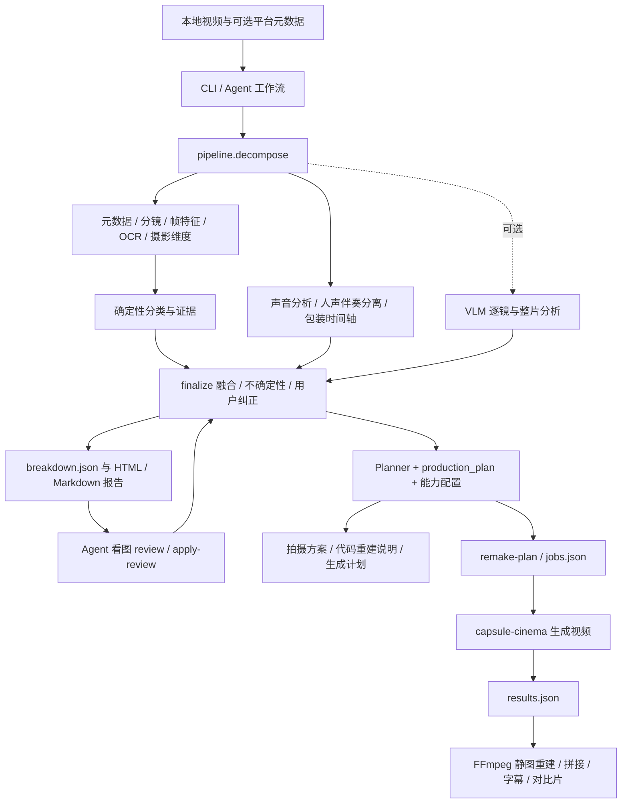

# rea-video 功能、使用方法与架构分析

分析日期：2026-11-10。基于本次完整克隆的源码、文档和配置；在本机 WSL2 `Ubuntu-24.04` 中进行了 Python 语法解析与能力地图校验。本次没有安装 CLI 或 Agent skill，没有调用外部模型、拆解视频、生成视频或部署新服务。下文运行命令是使用说明，不是已运行记录。

## 1. 本地位置与版本

| 项目 | 记录 |
|---|---|
| 上游 | `https://github.com/JuneYaooo/rea-video.git` |
| 本地目录 | `D:\pro\ai_cat\参考\rea-video` |
| WSL 可读路径 | `/mnt/d/pro/ai_cat/参考/rea-video` |
| 分支 | `main` |
| Commit | `356815c0d61291811551a2b8813b2b571d9b3238` |
| 提交时间 | `2026-11-09T07:40:43-08:00`，北京时间 2026-11-09 23:40:43 |
| 提交说明 | 更新微信交流群二维码（11 月 16 日前有效） |
| Python 包版本 / 数据格式 | `0.1.0` / `rea_video.breakdown.v1` |
| 拉取与核验 | 完整 Git 克隆，非浅克隆；411 个已跟踪文件；工作区干净；远端 main 与本地 HEAD 一致 |
| 代码许可文件 | `LICENSE`：Apache-2.0；`NOTICE`：Copyright 2026 JuneYaooo |

固定版本同步登记在 [video-reference-repositories.json](video-reference-repositories.json)。上游源码保持原样。

## 2. 它解决什么问题

rea-video 是一个 **供 Agent 调用的视频分析 CLI，以及配套的复刻规划工具**。输入已有视频，逐镜头推断画面制作方式，分析剪辑、字幕、声音与素材组成，再输出结构化数据、可读报告和重建建议。

它适合回答：这个镜头是实拍、AI 生成还是代码动效？字幕和贴纸什么时候出现？有哪些素材需要重新拍摄或准备？哪些镜头可以交给视频模型，哪些应写代码？

该快照以 Python CLI 和文件产物为核心，没有自带的 SaaS 前后端、用户系统、数据库或 Docker 部署。`report.html` 是生成的静态报告。上游网站入口与这个仓库提供的程序应分别理解。

主要入口：[中文 README](../../参考/rea-video/i18n/README_zh.md)、[CLI 文档](../../参考/rea-video/docs/cli.md)、[命令实现](../../参考/rea-video/rea_video/cli.py)。

## 3. 已实现的主要能力

| 能力 | 实际行为与产物 | 需要注意的范围 |
|---|---|---|
| 分镜与制作方式分析 | 检测切点、转场、镜头时长；每镜输出类别、证据、分数、首尾帧和联系表 | 分数由规则与视觉意见融合得到，不等于经过校准的来源鉴定概率 |
| 11 类画面分类 | 实拍、AI 视频、数字人口播、3D、代码/模板、录屏/截图、静图推拉、静帧、2D 动画、定格动画、影视片段 | 2D 动画、定格动画和影视片段没有完整的离线像素分类器，依赖 VLM 或 Agent 看图 |
| 摄影与风格分析 | 景别、构图、机位/运动、光影、调色；为实拍组织场景、机位和拍摄方案 | 光源/设备等语义信息需要看图补充，不能把估计当作原作者真实设备记录 |
| 字幕与剪辑包装 | OCR 跟踪文字，估计位置、颜色、描边、样式与进出场；检测贴纸/动图/画中画；输出 SRT、ASS、包装时间轴 | 字体、贴纸内容等需复核；贴纸导出的截图不等于可直接使用的透明动态图层 |
| 声音分析 | 检测人声、节拍、BPM、调性与瞬态候选；输出原声、人声和伴奏 WAV | 没有单独分离出的“纯音效轨”；音效可能混在人声/伴奏里，音乐/配音来源仍有不确定性 |
| 素材分析 | 标注实拍、录屏、截图等真实素材，以及人物/产品/Logo 等生成参考 | 检测到嵌入图片不代表能断言它来自真实摄影 |
| 复刻计划 | 每镜生成执行路线、参数、候选模型、所需素材；整片整理生成单元、拍摄场次、代码段、静图任务 | 计划与执行的覆盖范围不同，见第 7 节 |
| 看图复核与纠错 | `review` → 填答案 → `apply-review`；`correct` 记录用户纠正；偏好和纠正保存在本地文件 | 纠正会应用到同一文件及后续提示，不是重新训练模型，也不自动修改分类器权重 |

以上分别由 [classify.py](../../参考/rea-video/rea_video/classify.py)、[aspects/](../../参考/rea-video/rea_video/aspects/)、[packaging.py](../../参考/rea-video/rea_video/packaging.py)、[stems.py](../../参考/rea-video/rea_video/stems.py)、[assets.py](../../参考/rea-video/rea_video/assets.py)、[production.py](../../参考/rea-video/rea_video/production.py)、[memory.py](../../参考/rea-video/rea_video/memory.py) 实现。

## 4. 架构与数据流



### 4.1 模块分工

| 层次 | 文件 | 职责 |
|---|---|---|
| Agent 操作说明 | `skills/rea-video/SKILL.md`、`references/` | 定义安装、拆解、看图复核、纠错和交付流程；本次只作为项目资料阅读 |
| 命令入口 | `cli.py`、`__main__.py` | argparse 子命令、参数、偏好和配置加载；控制分析、报告、复核与复刻 |
| 主流程 | `pipeline.py` | `decompose()` 收集分析结果，`finalize()` 融合判断、刷新规划和报告；复核后可重算结论 |
| 媒体与切镜 | `media.py`、`probe.py`、`shots.py` | FFmpeg/ffprobe 调用、抽帧、片段截取、元数据与来源线索、分镜/转场检测 |
| 画面测量 | `features.py`、`faces.py`、`motion.py`、`overlay.py`、`assets.py` | 纹理/噪声、重复帧、平面运动、人脸、文字轨、元素动画、嵌入素材 |
| 摄影维度 | `aspects/` | `framing`、`camera`、`lighting`、`grade`、`editing`、`subject`、`fmt` 等维度的测量和归纳 |
| 声音与包装 | `audio.py`、`stems.py`、`sound_source.py`、`packaging.py` | 人声/伴奏、节拍与候选音效、声音来源推断、跨镜头字幕/贴纸跟踪与 ASS 导出 |
| 语义与证据融合 | `vlm.py`、`classify.py`、`pipeline.py`、`review.py` | 可选多模态服务、规则分类、融合/门控、低置信标注、人工或 Agent 复核 |
| 规划与知识数据 | `plan.py`、`production.py`、`capabilities/` | 类别到路线、模型配置、生成单元、拍摄场次与代码段组织 |
| 报告和状态 | `report.py`、`visual.py`、`memory.py` | 静态报告、分镜图、音频时间轴、偏好和纠错文件 |
| 外部生成与合成 | `integrations/`、`remake.py` | capsule-cinema 任务导出/调用、静图推拉、片段对时和合成、左右对比视频 |

### 4.2 技术依赖

`pyproject.toml` 声明 Python ≥3.10、NumPy、OpenCV headless、Pillow、PyYAML、ONNX Runtime；OCR 是 `rapidocr-onnxruntime` 可选依赖，开发依赖为 pytest 和 jsonschema。另需系统 FFmpeg 与 ffprobe。

声音分离使用 UVR MDX-Net ONNX 模型，源码指定 `CPUExecutionProvider`，不要求 CUDA。首次使用默认下载约 67 MB 权重，并校验 SHA-256；后续读取缓存。默认缓存为 `~/.cache/rea-video/models`，可通过 `REA_VIDEO_MODELS` 指定。

这里的“不开 VLM 可离线分析”以依赖和必要权重已准备好为前提。只有 Python 包并不保证首次运行可以完全断网。

该快照没有依赖锁文件，版本多为范围声明；若后续服务化，应在独立项目的运行镜像中固定实际依赖版本。

### 4.3 判断不是单次模型回答

程序先测量帧间变化、重复帧、噪声、图像平面运动、文字和元数据，再给出确定性类别分数；可选 VLM 提供语义描述、证据和提示词。`finalize()` 结合规则、VLM、Agent 看图及用户纠正生成最终结论，并对平台转码、24fps 来源歧义及相互冲突的判断保留不确定性。

平台转码会清除或改变噪声和元数据；“缺少噪声”或“看起来像 3D”都不能单独证明制作来源。`probe.py` 的 C2PA/JUMBF 检测是查找容器/字节线索，并未实现完整的内容凭证签名验证。

VLM 客户端使用 OpenAI 风格的 `chat/completions` 请求结构、模型回退和文件缓存。视频通过媒体 data URI 传入，具体服务必须兼容其视频载荷；仅声称“OpenAI 兼容”不保证视频输入可用。可设 `REA_VLM_MEDIA=frames` 只送图片，但整片调用另有视频输入；纯看图服务可结合 `--no-whole` 跳过该调用。

### 4.4 可用于平台对接的数据

`breakdown.json` 是主要结构化产物，格式标识为 `rea_video.breakdown.v1`：

- `source`：源文件路径、尺寸、时长、帧率、旋转与文件摘要。
- `shots[]`：镜头编号和时间段、特征、文字、素材、证据、最终类别与置信度、复刻路线和首尾帧。
- `packaging`：跨镜头的字幕、花字、贴纸、样式、时间轴和音效对齐信息。
- `audio` / `audio_plan` / `sound_sources` / `stems`：信号分析、音频方案、来源推断与音轨。
- `production_plan`：生成单元 `units`、拍摄场次 `shoot`、代码段 `code`、静图 `local` 等。
- `analysis`：VLM 是否真正生效、复核状态等；`summary`：时长加权的制作方式比例与摘要。

这是领域分析 JSON，不是一个现成的通用 NLE 编辑工程；文档中“时间线 → 轨道 → 片段”的完整 Video IR 仍包含设计目标。平台应读取结构化字段，不解析 HTML 报告来驱动任务。

## 5. 使用方法

### 5.1 安装

上游标准安装方式如下，适用于具备 Python ≥3.10、FFmpeg 和 ffprobe 的 Linux/macOS 执行环境：

```bash
# 在执行副本的仓库根目录运行
bash scripts/install_skill.sh
rea-video --help
```

脚本会安装带 OCR 的 CLI，尝试 pip，遇系统 Python 的 externally-managed 限制时回退到 pipx 或本地 `.venv`；再把 skill 链接到当前用户已有的 `.claude`、`.codex`、`.agents` 目录。它不是只下载源码的脚本。

只需要程序时，可以在隔离的 Python 环境中使用：

```bash
python -m pip install -e ".[ocr]"
python -m pip uninstall -y opencv-python
python -m pip install --force-reinstall --no-deps "opencv-python-headless>=4.8,<5"
rea-video --help
```

后两步处理 RapidOCR 带入的 GUI 版 OpenCV 与 headless 版共用 `cv2` 的冲突；安装脚本已自动处理。应在专用环境执行，避免影响其他工具。

结合本工作区约定，后续正式运行应在 **Ubuntu-24.04 的 Docker 分析执行器** 中准备执行副本与依赖，输入、输出、模型缓存分别挂载，接入配置放在 `avatar-agent/deploy/wsl2`。`参考/rea-video` 继续作为只读上游参考。容器里的 skill 链接不会自动安装到 Windows 宿主的 Agent 目录。本次没有进行这一步。

### 5.2 最小分析流程

下面是安装完成后、在执行环境内运行的 CLI 命令；`ref.mp4` 为本地视频文件：

```bash
# 离线规则、OCR、音频与包装分析；覆盖曾保存的 vlm=on 偏好
rea-video decompose ref.mp4 -o out/ref --lang zh --no-vlm

# 阅读紧凑结论；报告入口为 out/ref/report.html
rea-video summary out/ref/breakdown.json

# 初次只想快速检查，不做 OCR、包装及人声分离
rea-video decompose ref.mp4 -o out/quick --lang zh --no-vlm \
  --no-ocr --no-packaging --no-stems
```

CLI 接收本地视频路径，没有实现社交平台链接解析/下载入口。需要先取得视频文件；可优先使用仓库已有的 `docs/cases/videos/dual_role.mp4` 等示例。仓库示例经过重压缩，元数据与作者原始评测文件不同，分析结果不一定复现展示报告。

常见输出：

```text
out/ref/
├── breakdown.json          结构化分析和规划
├── report.html             可浏览报告
├── report.md               Markdown 报告
├── storyboard.jpg          分镜总览
├── audio.png               有音频时的音频时间轴
├── shots/                  每镜联系表、首尾帧及部分动效帧条
├── packaging/              字幕 SRT、样式 ASS、时间轴 JSON、贴纸截图
├── stems/                  original.wav、vocals.wav、music.wav
└── vlm_cache/              使用 VLM 时的响应缓存
```

目录与文件取决于输入、参数和检测结果，并非每次都会全部生成。

### 5.3 可选多模态分析

服务端配置包含 `REA_VLM_BASE_URL`、`REA_VLM_API_KEY`、`REA_VLM_MODEL`；模型名可逗号分隔作为回退列表，媒体类型可选 `both`、`video`、`frames`。

按照工作区约定，真实 Key 只放在 WSL2 服务端配置，再以环境变量或只读配置文件注入容器，不能写到 Windows 参考仓库、前端、Git 或日志。以下 `/run/secrets/rea-video.env` 仅为容器内挂载路径示例：

```bash
rea-video --env-file /run/secrets/rea-video.env \
  decompose ref.mp4 -o out/ref --lang zh --vlm
rea-video summary out/ref/breakdown.json
```

必须看 `analysis.vlm.status` 或摘要中的 `VLM:`：`ok` 为成功，`partial` 为部分成功，`failed` / `not_configured` 并不表示已得到模型分析。VLM 全部失败时，程序仍可能成功完成离线报告。

### 5.4 看图复核与纠正

```bash
rea-video review out/ref
# 查看 review_tasks.json 指向的镜头图，填写 review_answers.json
rea-video apply-review out/ref --by reviewer
rea-video summary out/ref/breakdown.json

# 示例：把第 3 镜纠正为真正逐帧拍摄的定格动画
rea-video correct out/ref --shots 3 --label stop_motion --note "确认是实物逐帧拍摄"
rea-video memory
```

`still_motion` 是“一张静图做推拉”，`stop_motion` 才是“实物逐帧拍摄的定格动画”；不要混用。CLI 文档中的某个纠正示例存在这一术语混用，实际标签以 `classify.py` 为准。

用户偏好与纠正默认保存在 `~/.rea-video`，可用 `REA_VIDEO_HOME` 改位置。多用户平台应隔离这份状态，避免用户间相互影响。

### 5.5 复刻与拼接

安装并配置 capsule-cinema 后，可生成逐镜任务，再查看试跑计划：

```bash
# /workspace/capsule-cinema 是执行环境中的外部项目路径示例
# 明确只让 ai_video 类进入模型生成，避免默认选中实拍等类别
rea-video remake-plan out/ref/breakdown.json \
  --capsule-root /workspace/capsule-cinema --labels ai_video
rea-video remake-run out/ref/remake/jobs.json \
  --capsule-root /workspace/capsule-cinema --dry-run

# 实际生成会调用外部服务并可能计费；预算与执行范围确认后才去掉 --dry-run
# 生成完成后，再执行：
rea-video assemble out/ref/breakdown.json out/ref/remake/results.json --overlays
```

未传 `--labels` 时，`build_remake_jobs()` 默认纳入 AI 视频、3D、实拍、数字人、2D、定格这六类，因此不能把默认命令理解为“仅生成 AI 来源镜头”。静图任务走本地 FFmpeg，其余不能执行的类别可能保留原片。

`remake-run` 调用外部 `UniversalVideoGenerationTool`，写 `results.json`；本仓库没有内置这些视频模型的生成后端。`capsule-draft` 另可导出外部配方草稿。

## 6. 能力地图的作用

`capabilities/` 将规划规则与模型记录分开：

```text
镜头信号 → routing.yaml 路线 → primitives.yaml 能力原语 → models/*.yaml 候选工具
```

本次在 WSL 执行上游只读校验命令，结果为：**43 个原语、16 个验证指标、76 个模型/工具记录，其中 75 个在配置中未标记为关闭；21 条画面规则、5 条音频规则，校验通过**。

```bash
python3 scripts/validate_capabilities.py
```

本次没有加 `--matrix`，因此没有重写上游矩阵文件。数据中有模型上限、参考图数量、原生音频、来源与核验时间等，用于规划；“75 个可用”只是配置状态统计，不是本机实测可调用数。该校验也不验证服务在线状态、价格准确性或模型真实能力。

`Planner` 按类别选路线和候选，执行器再走外部生成、本地 FFmpeg 或代码说明。它尚不是覆盖所有登记模型的通用驱动系统。其 README 中“画面 R01–R16”等文字落后于实际 YAML，本报告以上述校验输出为准。

## 7. 已实现边界与使用时的误区

| 容易误解的能力 | 当前源码的实际范围 |
|---|---|
| “自动还原原项目源码” | 输出制作方式、布局、动效测量和重建提示；不会恢复原作者 AE、Blender、前端源码或原始工程 |
| “自动生成 Remotion 工程” | `code_render_spec` 输出文字/版式/节奏说明，需要 Agent 或开发者另外写工程 |
| “按整片规划一次生成多个镜头” | 报告能组织多镜头生成单元；`remake-run` 仍按逐镜任务调用外部工具 |
| “一键完成全部原创视频” | `assemble()` 对缺失结果可截取原片占位，默认复用原片音轨；应检查 `assemble_log.json` 的 `generated` / `local_still` / `original` |
| “自动清除首尾帧的原字幕” | 只提示参考帧存在文字/贴纸；没有自动擦除步骤。`--overlays` 可叠回文字，贴纸仍需另备素材 |
| “自动生成新配音、音乐、音效” | 有声音分析和复刻建议，当前合成路径没有完整音频重建流水线 |
| “已具备自动复刻打分与循环修复” | 有对比片与配置中的验证指标；完整自动 scorecard 和持续修复循环仍是设计目标 |
| “标成 AI 就确定是 AI” | 来源判别依赖启发式和视觉意见；平台压缩、电影帧率、动画等可能造成混淆，应保留证据和复核入口 |

依据：[复刻说明](../../参考/rea-video/docs/replicate.md)、[CLI 中的阶段状态](../../参考/rea-video/docs/cli.md)、[任务生成](../../参考/rea-video/rea_video/integrations/capsule_cinema.py)、[执行器](../../参考/rea-video/rea_video/integrations/run_remake.py)、[合成实现](../../参考/rea-video/rea_video/remake.py)。

README 的高准确率来自作者提供的评测，不是本次验证结论。`eval/RESULTS.md` 明确记录样本少、部分留出集在修规则后不再完全独立、新类别缺少真实标注、声音来源和音效存在短板。应按实际业务视频建立自己的验收集，不能直接当作通用准确率承诺。

## 8. 对 avatar-agent 的参考价值

最合适的定位是 **“参考视频导入与分析节点”**：在生成分镜前，先将已有视频转换成时间线、素材需求、制作方式和复刻约束。它可以补充本平台已有的视频生成与合成能力。

| 可借鉴部分 | 对平台的用途 | 接入时还要做的工作 |
|---|---|---|
| 分镜和 `shots[]` | 工作台每个镜头显示时长、首尾帧、内容、制作方式与证据 | 上传、任务状态、产物存储、超时/取消/失败处理 |
| 包装独立于底层画面 | 字幕、标题、贴纸可单独改文案，避免被写死在生成视频里 | 编辑组件、字体/素材、与现有时间线协议对齐 |
| 生成单元与拍摄场次 | 同场景镜头保持角色/产品参考一致，降低重复准备 | 将规划转换为平台实际支持的模型与执行任务 |
| 三类执行路线 | 实拍素材、代码动效、模型生成分别处理 | 用现有 Go 后端编排，适配本平台的生成、Remotion 和合成能力 |
| 看图复核与纠错 | 用户可改分类和提示词，保留原始证据与修改历史 | 按项目/用户隔离状态，提供确认和单镜重试 |
| 能力配置与验证指标 | 将模型限制和检测规则从业务逻辑中提取出来 | 按本平台实际供应商重新核验，不能直接照抄所有型号与价格 |

建议的服务化边界是：**现有 Go API 发分析任务 → WSL2 Docker 中的 Python worker → 返回 JSON 和媒体产物 → 工作台展示与确认 → 交给现有生成/合成执行器**。这是接入建议，本次没有实现或部署。

worker 可沿用现有 WSL 发行版与 `/opt/aicat/avatar-mvp` 部署位置，在现有 Compose 中增加独立服务；数据库、任务素材和缓存继续保留。模型配置仅服务端持有，模型缓存使用持久卷。前端不应直接启动命令或访问 Key。

源码 `source.path` 及部分中间文件使用本地绝对路径，接入时需要映射成平台产物 ID/地址。若将 Python API 放进常驻进程，还应核对语言全局状态和 `REA_VIDEO_HOME` 等共享状态；一任务一进程/容器更容易先建立清晰的隔离边界。

## 9. 本次核验与未执行项

- 完整克隆成功，远端 URL 正确，main 固定提交已记录；远端 main 与 HEAD 一致。
- 上游已跟踪文件 411 个，仓库工作区干净。
- 在 `Ubuntu-24.04` 的 Python 中对仓库 70 个 Python 文件进行了 AST 语法解析，全部通过；没有写入 pycache。
- 运行上游 `scripts/validate_capabilities.py`，schema 和引用关系校验通过。
- 仓库包含 25 个测试文件；静态数到 174 个以 `test_` 开头的函数。**没有运行 pytest**，该数量也不是参数化展开后的测试用例数。
- 未安装 CLI/skill、未下载分离模型、未执行示例视频分析、未调用 VLM、未生成或合成成片，因此性能、分析准确率与端到端运行兼容性尚未在本机验证。
- 本次只有参考仓库和分析文档变更，没有应用功能变更或新服务部署；没有新增可访问 IP/端口，也没有重建现有前后端和数据库。

代码许可说明以仓库 [LICENSE](../../参考/rea-video/LICENSE) 和 [NOTICE](../../参考/rea-video/NOTICE) 为准；README 将部分第三方原片与对比视频注明为对比展示，不能仅因代码许可证而认定其中所有视频、音乐和人物素材可以复用。
